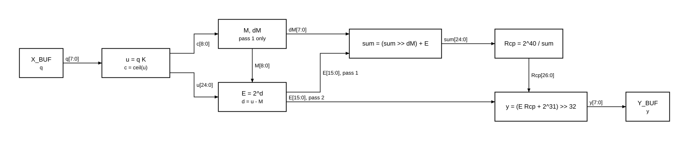

# Softmax trong `smx`: từ lý thuyết đến phương trình phần cứng

| Trường | Giá trị |
|---|---|
| Mục đích | Giải thích vì sao lõi tính đúng những phương trình đang có, để đọc RTL và duyệt các mục A |
| Người đọc | Kỹ sư RTL/DV, không cần biết trước về softmax |
| Nguồn chân lý số học | `model/softmax_ref.py`, rồi `docs/requirements.md` mục 4. File này chỉ giải thích, không đặc tả; khi có khác biệt thì hai nguồn kia đúng |
| Trạng thái | DRAFT, chưa có quyết định mới nào trong file này |

Loại số liệu: **[GM]** đo hoặc tính bằng golden model, **[CM]** suy ra bằng chứng minh trong file này, **[TL]** từ tài liệu công bố (`docs/research/softmax-survey.md`).

## Cả thuật toán trong một khung

Đây là đích đến. Các mục sau giải thích từng dòng từ đâu ra.

Đầu vào: hàng $q_0, \dots, q_{L-1}$ kiểu INT8, hệ số $K$ kiểu UQ0.16, do phần mềm tính từ scale $S$ của dữ liệu.

$$
\begin{aligned}
u_k &= q_k \cdot K, \qquad c_k = \lceil u_k / 2^{16} \rceil && \text{(mục 4, 5)} \\[4pt]
\textbf{Lượt 1, } &\text{theo nhóm } g \text{ gồm } P \text{ phần tử, chỉ số tăng dần:} \\
M_{\text{new}} &= \max\bigl(M,\ \max_{k \in g} c_k\bigr), \quad \Delta M = M_{\text{new}} - M && \text{(mục 5, 7)} \\
\text{sum} &= (\text{sum} \gg \Delta M) + \sum_{k \in g} E\bigl(u_k - M_{\text{new}} \cdot 2^{16}\bigr), \quad M = M_{\text{new}} && \text{(mục 7)} \\[4pt]
R_{cp} &= \lfloor 2^{40} / \text{sum} \rfloor && \text{(mục 8)} \\[4pt]
\textbf{Lượt 2: } y_k &= \min\Bigl(255,\ \bigl(E(u_k - M \cdot 2^{16}) \cdot R_{cp} + 2^{31}\bigr) \gg 32\Bigr) && \text{(mục 8, 9)}
\end{aligned}
$$

Trong đó $E(d)$ tính $2^{d/2^{16}} \cdot 2^{15}$ với $d \le 0$ bằng bảng tuyến tính từng đoạn và một phép dịch (mục 6). Nhóm đầu của hàng lấy $M_{\text{new}} = \max_{k \in g} c_k$, $\Delta M = 0$ và bỏ qua sum cũ.

Kết quả: $y_k / 256 \approx \text{softmax}(S q)_k$. Phần cứng không có số thực, không có $e$, không có log.

## Ký hiệu

| Ký hiệu | Nghĩa | Trong RTL |
|---|---|---|
| $L$, $R$, $P$ | Độ dài hàng, số hàng, số lane | `len`, `rows`, `P` |
| $q_k$ | Điểm đầu vào, INT8 | `q_in` |
| $S$ | Scale lượng tử hoá: giá trị thực $x = S q$ | Chỉ có ở phần mềm |
| $K$ | $S \log_2 e$ dạng UQ0.16 | `k`, `SCALE_K` |
| $u_k$ | Số mũ cơ số 2 của phần tử, Q8.16 | `u_out` |
| $c_k$ | Trần của số mũ, số nguyên | `c_out` |
| $M$ | Số mũ nguyên lớn nhất cho tới hiện tại | `m_out` |
| $\Delta M$ | Độ tăng của $M$ | `dm_out` |
| $d$ | Số mũ sau chuẩn hoá, $d \le 0$ | Tính trong `smx_exp2` |
| $I$, $F$ | Phần nguyên và phần lẻ của $d$ | Tính trong `smx_exp2` |
| $E$ | $2^{d}$ dạng UQ1.15 | `e_out` |
| sum | Tổng $E$ đã chuẩn hoá theo $M$ hiện tại | `sum_out` |
| $R_{cp}$ | Nghịch đảo của sum | `rcp_out` |
| $y_k$ | Đầu ra UINT8, thang 1/256 | `y_out` |
| $C_i$, $m_i$ | Hệ số bảng PWL | `PWL_C_N8`, `PWL_M_N8` |

Cẩn thận hai chỗ trùng tên. Trong attention, $K$ còn là ma trận key, còn ở tài liệu này $K$ luôn là hệ số scale. Bảng PWL trong code gọi độ dốc là `M_`, ở đây viết $m_i$ để khỏi lẫn với $M$.

Ký pháp: $\gg$ là dịch phải số học, bằng $\lfloor x / 2^n \rfloor$. Qa.b là số fixed-point có $b$ bit lẻ. UQ là không dấu.

## 1. Softmax là gì

### 1.1. Định nghĩa

Softmax biến một vector số thực bất kỳ thành phân phối xác suất:

$$
\text{softmax}(x)_i = \frac{e^{x_i}}{\sum_{j=0}^{L-1} e^{x_j}}
$$

Hàm mũ làm hai việc: biến mọi giá trị thành số dương, và khuếch đại chênh lệch. Phép chia cho tổng làm các đầu ra cộng lại bằng 1.

Ví dụ, tính bằng float64:

| $x$ | softmax |
|---|---|
| $[2, 1, 0]$ | $[0{,}6652;\ 0{,}2447;\ 0{,}0900]$ |
| $[12, 11, 10]$ | $[0{,}6652;\ 0{,}2447;\ 0{,}0900]$ |
| $[4, 2, 0]$ | $[0{,}8668;\ 0{,}1173;\ 0{,}0159]$ |
| $[1;\ 0{,}5;\ 0]$ | $[0{,}5065;\ 0{,}3072;\ 0{,}1863]$ |
| $[0, 0, 0]$ | $[0{,}3333;\ 0{,}3333;\ 0{,}3333]$ |

### 1.2. Các tính chất mà phần cứng dựa vào

**T1. Tổng bằng 1, mọi đầu ra nằm trong $(0, 1)$.** Nên đầu ra biểu diễn được ở thang cố định, không cần scale riêng cho mỗi lần chạy. Lõi chọn thang 1/256.

**T2. Chỉ phụ thuộc vào chênh lệch.** Cộng cùng một hằng số vào mọi $x_i$ không đổi kết quả, vì

$$
\frac{e^{x_i + a}}{\sum_j e^{x_j + a}} = \frac{e^{a} e^{x_i}}{e^{a} \sum_j e^{x_j}} = \frac{e^{x_i}}{\sum_j e^{x_j}}
$$

Hai dòng đầu của bảng trên cho thấy điều này. Đây là tính chất quan trọng nhất của thiết kế: ta được phép trừ đi bất kỳ giá trị nào để đưa số mũ về miền dễ tính. Mục 5 và 7 dựa hoàn toàn vào nó.

**T3. Nhân với hằng số là chỉnh độ gắt.** Dòng 3 của bảng nhân $x$ lên 2 lần và phân phối gắt hơn; dòng 4 chia đôi và phân phối phẳng hơn. Hằng số này là "nhiệt độ" trong tài liệu máy học. Vì thế scale $S$ không thể bỏ qua, và phải đi vào phép tính qua $K$.

**T4. Một phép chia dùng chung cho cả hàng.** Mẫu số giống nhau cho mọi $i$, nên chỉ cần tính $1/\text{tổng}$ một lần rồi nhân cho từng phần tử (mục 8).

### 1.3. Softmax trong đề tài này

Trong multi-head self-attention của DeiT-Tiny, mỗi head tính $A = \text{softmax}(QK^{\mathsf T} / \sqrt{64})$ theo hàng. Một hàng của lõi là một query token của một head, $L = 197$ phần tử (`docs/spec/02-target-workload.md`). Lõi chỉ thay phép softmax; phần còn lại của mạng vẫn là FP32 trên host.

## 2. Vì sao softmax khó cho phần cứng

Tính thẳng theo định nghĩa gặp ba vấn đề:

1. **Hàm mũ.** Cần bảng lớn hoặc xấp xỉ đắt, và tính cho từng phần tử.
2. **Dải động.** Với $x$ lớn, $e^{x}$ vượt mọi độ rộng hợp lý: $e^{88{,}7}$ đã xấp xỉ giới hạn của float32. Phần cứng số nguyên càng không chứa nổi.
3. **Phép chia.** Đắt và chậm nếu làm cho từng phần tử.

Cách chống tràn thông thường là dùng T2 để trừ giá trị lớn nhất trước. Nhưng làm vậy cần thêm một lượt quét, thành ba lượt: tìm max, cộng tổng, chuẩn hoá [TL].

| Vấn đề | Cách làm ngây thơ | Lõi `smx` | Mục |
|---|---|---|---|
| Hàm mũ cơ số $e$ | Bảng lớn | Đổi sang cơ số 2: phần nguyên là phép dịch, phần lẻ là bảng nhỏ | 4, 6 |
| Tràn | Lượt riêng tìm max | Chuẩn hoá bằng số mũ nguyên, cập nhật trong khi cộng | 5, 7 |
| Số lượt | 3 | 2 | 7, 9 |
| Phép chia | Mỗi phần tử một lần | Mỗi hàng một lần | 8 |

## 3. Từ số thực sang số nguyên

### 3.1. Đầu vào

Host lượng tử hoá điểm thực về INT8 theo $x = S q$, với $q \in [-128, 127]$. Mỗi head trong mỗi layer có $S$ riêng. Đó là lý do một lần chạy chỉ dùng một $K$.

Ví dụ xuyên suốt tài liệu: $S = 0{,}0625$.

### 3.2. Đầu ra

Đầu ra là $y \in [0, 255]$, giá trị thực $y/256$. Lý tưởng là $y = \text{round}(256 p)$ với $p$ là xác suất đúng. Sai số tối thiểu không tránh được là nửa LSB:

$$
\frac{1/2}{256} = \frac{1}{512} \approx 0{,}00195
$$

Con số này là "sàn" của mọi đo đạc ở mục 11.

Xác suất 1,0 cần $y = 256$, không biểu diễn được, nên bão hoà về 255.

## 4. Đổi cơ số: từ $e^x$ sang $2^u$

Hàm mũ cơ số 2 hợp với phần cứng hơn hẳn vì nhân cho $2^n$ chỉ là phép dịch. Công thức đổi cơ số:

$$
e^{x} = 2^{x \log_2 e}
$$

Thế $x = S q$:

$$
e^{S q} = 2^{\,S \log_2 e \cdot q} = 2^{\,q \cdot K / 2^{16}}
\qquad\text{với}\qquad
K = \text{round}\bigl(S \log_2 e \cdot 2^{16}\bigr)
$$

Vậy $u = q \cdot K$ chính là số mũ cơ số 2, ở dạng fixed-point có 16 bit lẻ. Mọi hằng số vô tỉ đã gộp vào $K$, và phần mềm tính $K$ một lần cho mỗi scale. Phần cứng chỉ cần một bộ nhân. Đây là khác biệt so với Softermax, vốn dùng thẳng $2^x$ và phải fine-tune lại mô hình [TL]: lõi `smx` vẫn tính đúng softmax cơ số $e$ với mọi scale.

**Ví dụ:** $S = 0{,}0625$ cho $S \log_2 e \cdot 2^{16} = 5909{,}279$, nên $K = 5909$ [GM].

**Giới hạn của $S$.** $K$ phải vừa 16 bit không dấu, tức $S \log_2 e < 1$, tức $S < \ln 2 \approx 0{,}693$. Đây là ràng buộc REQ-ARI-02.

**Sai số do làm tròn $K$.** $K$ lệch tối đa 0,5 LSB, kéo theo số mũ của chênh lệch $\Delta q$ lệch $\Delta q \cdot \delta K / 2^{16}$. Tính thật [GM]:

| $S$ | $K$ chính xác | $K$ | Lệch số mũ ở $\Delta q = 255$ | Lệch tương đối đầu ra |
|---|---|---|---|---|
| 0,02 | 1890,969 | 1891 | 0,00012 | 0,008 % |
| 0,0625 | 5909,279 | 5909 | 0,00109 | 0,075 % |
| 0,2 | 18909,692 | 18910 | 0,00120 | 0,083 % |
| 0,5 | 47274,231 | 47274 | 0,00090 | 0,062 % |

Đây là cận xấu nhất, ở chênh lệch lớn nhất có thể; lúc đó phần tử bé gần như bằng 0 sau chuẩn hoá nên ảnh hưởng thực tế nhỏ hơn.

**Độ rộng [CM].** $|u| \le 128 \cdot 65535 < 2^{23}$. RTL viết $q$ 8 bit nhân $K$ mở rộng thành 17 bit có dấu, nên tích là 25 bit có dấu.

## 5. Chuẩn hoá bằng số mũ nguyên (IntMax)

### 5.1. Ý tưởng

Theo T2 ở dạng cơ số 2, với mọi giá trị $V$:

$$
\text{softmax}_i = \frac{2^{u_i - V}}{\sum_j 2^{u_j - V}}
$$

(Ở mục này $u$ hiểu theo đơn vị số thực, tức $u/2^{16}$ của phần cứng.)

Ta muốn chọn $V$ sao cho mọi $2^{u_i - V}$ đều nhỏ, không tràn. Chọn $V = \max u$ là cách kinh điển. Softermax đề xuất cách tốt hơn cho phần cứng [TL]: chọn $V$ là **số nguyên**, đó là trần của giá trị lớn nhất:

$$
M = \max_k c_k = \max_k \lceil u_k \rceil = \lceil \max_k u_k \rceil
$$

### 5.2. Hai bất đẳng thức cần có [CM]

Đặt $d_k = u_k - M$.

**Mọi $d_k \le 0$.** Vì $u_k \le \lceil u_k \rceil \le M$. Do đó $2^{d_k} \le 1$, không bao giờ tràn.

**Phần tử lớn nhất đủ lớn.** Phần tử đạt $c_k = M$ có $u_k > M - 1$, tức $d_k \in (-1, 0]$, nên $2^{d_k} > 1/2$. Tổng không thể quá bé. Mục 7.4 dùng điều này để giới hạn độ rộng bộ chia.

Dùng trần là để có cả hai. Nếu dùng sàn, phần tử lớn nhất có thể có $d > 0$ và $2^{d}$ vượt 1, phá vỡ định dạng UQ1.15.

### 5.3. Vì sao $M$ phải nguyên

Tách số mũ thành phần nguyên và phần lẻ (mục 6). Khi $M$ là số nguyên, trừ $M$ **không làm đổi phần lẻ**:

$$
d = u - M \quad\Rightarrow\quad F(d) = F(u)
$$

Do đó đổi $M$ chỉ đổi phép dịch, không đổi kết quả tra bảng. Từ đây có hai hệ quả lớn:

- Khi $M$ tăng thêm $\Delta M$, mọi số hạng cũ chỉ bị chia đúng cho $2^{\Delta M}$, nên sửa tổng bằng một phép dịch (mục 7). Nếu $V$ không nguyên thì phải nhân với $2^{\text{lẻ}}$, cần thêm bộ nhân.
- Không cần so sánh số 25 bit để tìm max, chỉ cần so $c$ 9 bit.

### 5.4. Tính trần trong phần cứng

$$
c = \lceil u / 2^{16} \rceil = u[24{:}16] + (u[15{:}0] \neq 0)
$$

Phần nguyên ở dạng bù hai đã là sàn, nên cộng 1 khi còn phần lẻ khác 0. Đây là tầng 3 của `smx_scale`.

**Miền giá trị [CM]:** $\lceil -128 \cdot 65535 / 65536 \rceil = -127$ và $\lceil 127 \cdot 65535 / 65536 \rceil = 127$. Vậy $c \in [-127, 127]$ và $\Delta M \le 254$, vừa 8 bit. RTL giữ $c$ ở 9 bit vì lane bị mask được thay bằng $-256$, nhỏ hơn mọi $c$ hợp lệ.

## 6. Tính $2^d$: dịch cộng bảng

### 6.1. Tách phần nguyên và phần lẻ

Với $d \le 0$, viết $d = I + F$, với $I = \lfloor d \rfloor \le 0$ và $F \in [0, 1)$. Khi đó

$$
2^{d} = 2^{F} \cdot 2^{I} = 2^{F} \gg (-I)
$$

$2^F \in [1, 2)$ nằm trong dải hẹp cố định, nên chỉ cần xấp xỉ nó trên một đoạn duy nhất, rồi dịch để có mọi giá trị khác.

Trong fixed-point có 16 bit lẻ, dạng bù hai làm phép tách này miễn phí: $I$ là các bit cao (`d >> 16`), $F$ là 16 bit thấp (`d & 0xFFFF`). Với số âm vẫn đúng vì dịch số học là sàn.

**Ví dụ:** $d = -25784$, tức $-0{,}39343$. Khi đó $I = -1$, $F = 39752$, tức $0{,}60657$. Kiểm tra: $-1 + 0{,}60657 = -0{,}39343$.

### 6.2. Xấp xỉ $2^F$ bằng tuyến tính từng đoạn

Chia $[0, 1)$ thành $N$ đoạn đều (`N_SEG`). Trên đoạn $i$, thay đường cong bằng dây cung nối hai đầu đoạn:

$$
2^{F} \approx 2^{i/N} + \bigl(2^{(i+1)/N} - 2^{i/N}\bigr) \cdot \underbrace{\frac{F - i/N}{1/N}}_{\text{vị trí trong đoạn, từ 0 đến 1}}
$$

Đổi sang số nguyên, với giá trị UQ1.15:

$$
C_i = \text{round}\bigl(2^{i/N} \cdot 2^{15}\bigr), \qquad
m_i = \text{round}\bigl((2^{(i+1)/N} - 2^{i/N}) \cdot 2^{15}\bigr)
$$

Với $N = 8$ thì $F$ 16 bit tách thành chỉ số đoạn 3 bit cao và phần dư $r$ 13 bit thấp:

$$
\text{idx} = F \gg 13, \qquad r = F \mathbin{\&} \texttt{0x1FFF}, \qquad
E_0 = C_{\text{idx}} + \bigl((m_{\text{idx}} \cdot r) \gg 13\bigr)
$$

Tổng quát, phần dư có $16 - \log_2 N$ bit. Vì chia đều và $N$ là lũy thừa của 2, không cần phép so sánh nào để tìm đoạn.

Bảng thật ở $N = 8$ [GM], sinh bằng `softmax_ref.py --gen-pwl 8`:

| idx | 0 | 1 | 2 | 3 | 4 | 5 | 6 | 7 |
|---|---|---|---|---|---|---|---|---|
| $C_i$ | 32768 | 35734 | 38968 | 42495 | 46341 | 50535 | 55109 | 60097 |
| $m_i$ | 2966 | 3234 | 3527 | 3846 | 4194 | 4574 | 4988 | 5439 |

$C_0 = 32768 = 2^{15}$ đúng là giá trị của 1,0 trong UQ1.15.

### 6.3. Sai số của bảng

Định lý nội suy tuyến tính: trên đoạn rộng $h$, sai số của dây cung không quá $\frac{h^2}{8} \max |f''|$. Với $f(F) = 2^{F}$ thì $f'' = (\ln 2)^2 \cdot f$, nên sai số **tương đối** không quá

$$
\frac{(\ln 2)^2}{8 N^2}
$$

Sai số giảm 4 lần khi gấp đôi số đoạn. $2^F$ lồi nên dây cung nằm trên đường cong, tức $E_0$ thường hơi lớn hơn giá trị đúng. So cận này với đo thật trên toàn bộ 65536 giá trị $F$ [GM]:

| `N_SEG` | Cận lý thuyết | Đo được, lớn nhất | Đo được, trung bình | Bộ nhân $m \times r$ |
|---|---|---|---|---|
| 4 | 0,375 % | 0,376 % | 0,250 % | 14 × 14 bit |
| 8 | 0,094 % | 0,094 % | 0,062 % | 13 × 13 bit |
| 16 | 0,023 % | 0,025 % | 0,015 % | 12 × 12 bit |

Số đo vượt cận rất ít do làm tròn hệ số. Vì đầu ra chỉ có 8 bit, sai số này chìm dưới sai số làm tròn đầu ra ở `N_SEG = 8` (mục 11).

### 6.4. Dịch và ngưỡng cắt

$$
E = \begin{cases} E_0 \gg (-I) & \text{nếu } -I \le 15 \\ 0 & \text{nếu } -I > 15 \end{cases}
$$

Ngưỡng cắt không phải là xấp xỉ thêm [CM]. Vì $E_0 < 2^{16}$, dịch 16 bit trở lên vốn đã cho 0. Điều kiện này chỉ giới hạn bộ dịch ở 4 bit. Về nghĩa, $-I > 15$ tương đương $d < -15$, khi đó giá trị thực $2^{d} \cdot 2^{15}$ đã nhỏ hơn 1 LSB của $E$.

**Miền của $E$ [CM].** Nếu $d = 0$ thì $E = 2^{15}$ đúng. Nếu $d < 0$ thì $I \le -1$, nên $E \le E_0 / 2 < 2^{15}$. Vậy $0 \le E \le 2^{15}$, cần 16 bit.

## 7. Online normalization: cộng tổng khi chưa biết max

### 7.1. Vấn đề

Muốn dùng $M$ cuối cùng ngay từ đầu thì phải quét trước để tìm nó. Online normalization của Milakov và Gimelshein tránh lượt đó [TL]: vừa cộng vừa cập nhật max, và sửa lại tổng mỗi khi max tăng.

### 7.2. Dẫn công thức

Gọi $M_g$ là max tính tới nhóm $g$, và $s_g$ là tổng đúng đã chuẩn hoá theo $M_g$:

$$
s_g = \sum_{\text{mọi } k \text{ đã xét tới } g} 2^{u_k - M_g}
$$

Tách số hạng cũ và số hạng mới:

$$
s_g = \sum_{k \text{ cũ}} 2^{u_k - M_{g-1}} \cdot 2^{M_{g-1} - M_g} + \sum_{k \in g} 2^{u_k - M_g}
= s_{g-1} \cdot 2^{-\Delta M} + \sum_{k \in g} 2^{u_k - M_g}
$$

Vì $\Delta M$ là số nguyên (mục 5.3), nhân với $2^{-\Delta M}$ chính là dịch phải:

$$
\boxed{\ \text{sum}_g = (\text{sum}_{g-1} \gg \Delta M) + \sum_{k \in g} E(u_k - M_g \cdot 2^{16})\ }
$$

Khi hết hàng, $M_g = M$ cuối và tổng đã được chuẩn hoá đúng theo $M$, mà không có lượt tìm max riêng. Đó là cách ba lượt rút xuống còn hai.

Nhóm đầu không có tổng cũ, nên $\text{sum}_0 = \sum E$ và $\Delta M = 0$. Trong phần cứng đây là tín hiệu `in_first`.

Công thức gốc của Milakov xét từng phần tử. Lõi xử lý theo nhóm $P$ phần tử, vì mỗi chu kỳ có $P$ giá trị đi vào: cả nhóm dùng chung một $M_g$. Điều đó vẫn đúng vì chỉ cần $M_g \ge c_k$ cho mọi $k$ trong nhóm để $d \le 0$.

### 7.3. Làm tròn và vì sao thứ tự là một phần của đặc tả

Phép dịch trong phần cứng cắt bỏ bit. Do đó kết quả số nguyên phụ thuộc vào thứ tự duyệt và cách chia nhóm, dù tổng thực không phụ thuộc.

**Ví dụ [GM], cùng 24 giá trị, $K = 5909$, $P = 8$:**

| Thứ tự | sum | Phần tử lớn thứ hai trong $y$ |
|---|---|---|
| Ngẫu nhiên | 100113 | 70 |
| Tăng dần | 100117 | 69 |

Một hàng khác, 40 phần tử, $K = 5909$: sum là 105549, 105548, 105547 ở $P = 4, 8, 16$ [GM].

Vì thế thứ tự nhóm và phép dịch cắt bỏ nằm trong đặc tả (REQ-ARI-05), và golden model luôn nhận $P$. Đây là lý do `CLAUDE.md` cấm "tối ưu" các chỗ này: làm vậy vẫn cho softmax đúng về xấp xỉ nhưng không còn bit-exact.

### 7.4. Cận của sum: phần liên quan đến mục A3 [CM]

**Cận trên.** Mỗi $E \le 2^{15}$ (mục 6.4), và phép dịch chỉ làm giảm. Vậy

$$
\text{sum} \le L \cdot 2^{15} \le 512 \cdot 2^{15} = 2^{24}
$$

Cận này đạt được: ở $K = 0$, mọi $u = 0$, $d = 0$, $E = 2^{15}$, nên sum đúng bằng $2^{24}$ khi $L = 512$ [GM]. Giá trị $2^{24}$ cần 25 bit, đúng bằng `SUM_W`.

Câu trong REQ-ARI-05 đang ghi "≤ 512·2¹⁶". Viết vậy là cận lỏng hơn cần thiết, tương ứng $2^{25}$ và 26 bit. Mục A3 đề xuất sửa thành $512 \cdot 2^{15}$. Đây chỉ là sửa câu chữ: số học, RTL và độ rộng tối thiểu 25 bit đều không đổi.

**Cận dưới.** Xét nhóm cuối cùng làm $M$ tăng, hoặc nhóm đầu nếu $M$ không tăng về sau. Nhóm đó chứa phần tử có $c_k = M$, tức $d \in (-2^{16}, 0]$. Khi đó $I \in \{-1, 0\}$ và $E_0 \ge C_0 = 2^{15}$, nên $E \ge 2^{15} \gg 1 = 2^{14}$. Số hạng này được cộng **sau** phép dịch của nhóm đó và về sau $\Delta M = 0$, nên không bị dịch nữa. Vậy

$$
\text{sum} \ge 2^{14}
$$

Giá trị $2^{14}$ đạt được ở $L = 1$, $q = 1$, $K = 1$ [GM]. Đây là điều đảm bảo không chia cho 0, và cố định độ rộng $R_{cp}$ ở mục 8.

Chạy 6000 hàng ngẫu nhiên và corner ở $P = 4, 8, 16$ cho sum trong đúng $[16384, 16777216]$ [GM].

### 7.5. sum online so với tổng $E$ cuối

Có hai cách cộng: sum online như trên, và cộng các $E$ tính lại bằng $M$ cuối ở lượt 2. Chúng không bằng nhau.

Do hai tính chất của phép sàn, $\lfloor \lfloor x / a \rfloor / b \rfloor = \lfloor x / (ab) \rfloor$ và $\lfloor x + y \rfloor \ge \lfloor x \rfloor + \lfloor y \rfloor$, ta có [CM]:

$$
\text{sum}_{\text{online}} \ge \sum_k E_{\text{cuối}}
$$

Online gộp các phần lẻ lại trước khi cắt, nên mất ít hơn cắt từng số hạng. Đo trên cùng 6000 hàng [GM]: online lớn hơn tổng $E$ cuối tới 441 LSB, tức 0,67 %. Còn so với tổng thực, online lệch tối đa 0,094 %, xấp xỉ sai số của bảng PWL. Vậy online chính xác hơn và cũng không tốn thêm lượt.

## 8. Phép chia: một nghịch đảo cho cả hàng

### 8.1. Dẫn công thức đầu ra

Theo T4, kết quả cần là $y = 256 \cdot E / \text{sum}$. Thay vì chia cho từng phần tử, tính một lần:

$$
R_{cp} = \lfloor 2^{40} / \text{sum} \rfloor
$$

Rồi với mỗi phần tử:

$$
\frac{E \cdot R_{cp}}{2^{32}} \approx \frac{E}{\text{sum}} \cdot \frac{2^{40}}{2^{32}} = \frac{E}{\text{sum}} \cdot 256
$$

$40 - 32 = 8$ chính là thang $2^8 = 256$ của đầu ra. Cộng $2^{31}$ trước khi dịch 32 bit là làm tròn nửa lên:

$$
y = \min\bigl(255,\ (E \cdot R_{cp} + 2^{31}) \gg 32\bigr)
$$

Không có thành phần $2^{15}$ nào cần bù, vì $E$ và sum cùng thang UQ1.15 nên tỉ số của chúng đã là số thực đúng.

### 8.2. Độ rộng [CM]

Từ mục 7.4, $2^{14} \le \text{sum} \le 2^{24}$, nên $2^{16} \le R_{cp} \le 2^{26}$. Giá trị $2^{26}$ cần 27 bit, đúng bằng `RCP_W`. Tích $E \cdot R_{cp}$ cần tối đa 43 bit.

$R_{cp}$ lệch dưới 1 LSB so với $2^{40}/\text{sum}$ do lấy sàn. Vì $E \le 2^{15}$, ảnh hưởng tới $y$ nhỏ hơn $2^{15} / 2^{32} \approx 7{,}6 \cdot 10^{-6}$ LSB, không đáng kể.

### 8.3. Bộ chia restoring

Cần $\lfloor 2^{40} / s \rfloor$ với $s = \text{sum}$. Viết $2^{40} = 2^{13} \cdot 2^{27}$. Bộ chia giữ bất biến sau bước $j$:

$$
2^{13} \cdot 2^{j} = q_j \cdot s + \text{rem}_j, \qquad 0 \le \text{rem}_j < s
$$

Bắt đầu $q_0 = 0$, $\text{rem}_0 = 2^{13}$. Bất biến đúng vì $2^{13} < 2^{14} \le s$; đây là lý do cận dưới của sum quan trọng. Mỗi bước nhân đôi hai vế:

- $t = 2 \cdot \text{rem}$.
- Nếu $t \ge s$: $\text{rem} = t - s$ và bit thương là 1.
- Ngược lại: $\text{rem} = t$ và bit thương là 0.

Sau 27 bước, $q_{27}$ đúng là $\lfloor 2^{40} / s \rfloor$. Mỗi chu kỳ một bit, nên `DIV_LAT = 28`. Hợp đồng ghi đã kiểm vét cạn trên mọi $s \in [2^{14}, 2^{24}]$ (`05-cross-block.md` mục 4.5).

### 8.4. Bão hoà

$y$ đạt 256 khi $E / \text{sum}$ gần 1, xảy ra khi một phần tử áp đảo. Cụ thể $L = 1$ luôn cho $y = 255$ [GM]. Về lý thuyết, xác suất từ khoảng $255{,}5 / 256 \approx 0{,}998$ trở lên bão hoà. Đây là trường hợp tràn duy nhất (REQ-ARI-08).

## 9. Vì sao cần lượt 2

Sau lượt 1 ta có $M$ và $R_{cp}$, nhưng chưa có $y$: các $E$ của lượt 1 được tính với $M$ tạm, và đã bị cộng gộp vào sum nên không lấy lại được. Lượt 2 đọc lại $q$ từ X_BUF, tính lại $E$ với $M$ cuối, rồi nhân với $R_{cp}$.

Nhờ mục 5.3, hai lượt dùng chung phần cứng: `smx_scale` và `smx_exp2` không biết mình đang ở lượt nào, chỉ khác giá trị $M$ đi vào.

Phương án khác là lưu $E$ của lượt 1 rồi dịch theo $M$ cuối. Cách đó cần thêm một buffer rộng hơn X_BUF; đọc lại thì không tốn bộ nhớ thêm, đổi lại là phép tính lặp. SoftGen cũng rút ra bài học đọc lại từ bộ nhớ [TL].

## 10. Ví dụ trọn vẹn

$L = 10$, $P = 8$, `N_SEG` = 8, $S = 0{,}0625$, $K = 5909$ [GM]:

$$
q = [10,\ -5,\ 3,\ 0,\ -20,\ 7,\ 1,\ -8,\ 12,\ 40]
$$

**Bước 1. Scale.**

| | | | | | | | | | | |
|---|---|---|---|---|---|---|---|---|---|---|
| $q$ | 10 | −5 | 3 | 0 | −20 | 7 | 1 | −8 | 12 | 40 |
| $u$ | 59090 | −29545 | 17727 | 0 | −118180 | 41363 | 5909 | −47272 | 70908 | 236360 |
| $c$ | 1 | 0 | 1 | 0 | −1 | 1 | 1 | 0 | 2 | 4 |

**Bước 2. Lượt 1, nhóm 0 (8 phần tử đầu).** $M_g = 1$, $M = 1$, $\Delta M = 0$. $\sum E = 136257$, nên sum $= 136257$.

**Bước 3. Lượt 1, nhóm 1 (2 phần tử cuối).** $M_g = 4$, $M = 4$, $\Delta M = 3$. $\sum E = 4339 + 24958 = 29297$. Tổng cũ phải chia 8 vì $M$ tăng 3:

$$
\text{sum} = (136257 \gg 3) + 29297 = 17032 + 29297 = 46329
$$

Tổng thực, tính bằng số thực với $M = 4$, là 46306,05. Chênh 0,05 %, đúng là sai số PWL.

**Bước 4. Chia.** $R_{cp} = \lfloor 2^{40} / 46329 \rfloor = 23732686$.

**Bước 5. Lượt 2, cho hai phần tử:**

| Đại lượng | $q = 40$ | $q = -20$ |
|---|---|---|
| $u$ | 236360 | −118180 |
| $d = u - 4 \cdot 2^{16}$ | −25784 | −380324 |
| $d / 2^{16}$ | −0,39343 | −5,80328 |
| $I$ | −1 | −6 |
| $F$ | 39752 | 12892 |
| idx, $r$ | 4; 6984 | 1; 4700 |
| $C$, $m$ | 46341; 4194 | 35734; 3234 |
| $(m \cdot r) \gg 13$ | 3575 | 1855 |
| $E_0$ | 49916 | 37589 |
| $E = E_0 \gg (-I)$ | 24958 | 587 |
| $E$ thực $= 2^{d/2^{16}} \cdot 2^{15}$ | 24946,80 | 586,80 |
| $E \cdot R_{cp}$ | 592320377188 | 13931086682 |
| $E \cdot R_{cp} / 2^{32}$ | 137,91 | 3,24 |
| $y$ sau làm tròn | 138 | 3 |

**Kết quả toàn hàng:**

| | | | | | | | | | | |
|---|---|---|---|---|---|---|---|---|---|---|
| $y$ | 21 | 8 | 14 | 11 | 3 | 18 | 12 | 7 | 24 | 138 |
| $256 \cdot$ softmax float | 21,15 | 8,28 | 13,66 | 11,32 | 3,24 | 17,54 | 12,05 | 6,87 | 23,97 | 137,92 |

Tổng các $y$ là 256. Mọi $y$ đều bằng giá trị float làm tròn.

$M$ triệt tiêu khi lập tỉ số giữa hai phần tử. Với $q = 40$ và $q = 20$, tỉ số là $2^{20 \cdot K / 2^{16}} = 3{,}4901$, không còn $M$ và gần bằng $e^{0{,}0625 \cdot 20} = 3{,}4903$. Chênh lệch nhỏ đó là do làm tròn $K$.

## 11. Sai số

### 11.1. Các nguồn sai số

| Nguồn | Độ lớn | Ở đâu |
|---|---|---|
| Làm tròn đầu ra về UINT8 | 0,5 LSB, luôn có | Mục 3.2 |
| Bảng PWL | 0,094 % giá trị $E$ ở `N_SEG` = 8 | Mục 6.3 |
| Làm tròn $K$ | Tối đa 0,083 % ở $\Delta q = 255$, với các $S$ đã xét | Mục 4 |
| Cắt bit khi dịch $E$ | Dưới 1 LSB của $E$ | Mục 6.4 |
| Cắt bit khi dịch sum | Tính chung vào phép đo sum ở mục 7.5, tổng lệch 0,094 % | Mục 7.5 |
| Lấy sàn $R_{cp}$ | $< 7{,}6 \cdot 10^{-6}$ LSB | Mục 8.2 |

### 11.2. Đo trên hàng ngẫu nhiên

Hàng INT8 ngẫu nhiên đều, $L = 197$, $P = 8$, 300 hàng mỗi cấu hình, so với softmax float64 [GM]. LSB là 1/256.

| $S$ | `N_SEG` | Lệch lớn nhất, LSB | Lệch lớn nhất, xác suất | Tỉ lệ $y$ khác float làm tròn | Khoảng $\sum y$ |
|---|---|---|---|---|---|
| 0,02 | 4 | 0,510 | 0,00199 | 0,127 % | 236–253 |
| 0,02 | 8 | 0,501 | 0,00196 | 0,017 % | 232–254 |
| 0,02 | 16 | 0,500 | 0,00195 | 0,010 % | 235–252 |
| 0,0625 | 4 | 0,530 | 0,00207 | 0,113 % | 245–260 |
| 0,0625 | 8 | 0,507 | 0,00198 | 0,042 % | 243–261 |
| 0,0625 | 16 | 0,506 | 0,00198 | 0,025 % | 243–259 |
| 0,2 | 4 | 0,571 | 0,00223 | 0,115 % | 249–260 |
| 0,2 | 8 | 0,532 | 0,00208 | 0,047 % | 249–261 |
| 0,2 | 16 | 0,507 | 0,00198 | 0,014 % | 249–261 |
| 0,5 | 4 | 0,619 | 0,00242 | 0,074 % | 252–260 |
| 0,5 | 8 | 0,540 | 0,00211 | 0,030 % | 251–260 |
| 0,5 | 16 | 0,525 | 0,00205 | 0,022 % | 252–258 |

Đọc bảng: ở `N_SEG` = 8, độ lệch rất gần sàn 0,5 LSB, tức sai số gần như chỉ do làm tròn đầu ra. Có khoảng 99,95 % giá trị $y$ trùng với float làm tròn. Tăng lên 16 đoạn được thêm rất ít, còn giảm xuống 4 đoạn thì lệch rõ hơn khi $S$ lớn. Đó là cơ sở chọn `N_SEG = 8`.

Bảng này là hàng ngẫu nhiên, **không phải** dữ liệu DeiT-Tiny. Độ chính xác toàn mạng thuộc thí nghiệm E1, chưa chạy.

### 11.3. Giới hạn của thang 1/256

$\sum y$ không nhất thiết bằng 256, vì mỗi phần tử được làm tròn riêng. Với phân phối đều, độ lệch này rõ nhất [GM]:

| $L$ | $256/L$ | $y$ mỗi phần tử | $\sum y$ |
|---|---|---|---|
| 2 | 128 | 128 | 256 |
| 197 | 1,30 | 1 | 197 |
| 256 | 1 | 1 | 256 |
| 512 | 0,5 | 1 | 512 |

Ở $L = 512$, xác suất đều $1/512$ rơi đúng điểm làm tròn và lên 1, nên $\sum y$ gấp đôi. Mỗi phần tử vẫn chỉ lệch 0,5 LSB như đã nêu, nhưng khi $L$ lớn thì tổng sai số đáng kể. Với $L = 197$ của DeiT-Tiny, phân phối đều cho tổng 197 thay vì 256. Phần tử có xác suất dưới $1/512$ cho $y = 0$. Đây là hệ quả của đầu ra UINT8 đã chốt ở requirements, không phải lỗi của lõi. Tác động lên độ chính xác mạng sẽ do E1 và E2 cho biết.

## 12. Từ phương trình đến phần cứng

### 12.1. Mỗi phương trình nằm ở đâu

| Phương trình | Khối | Tầng |
|---|---|---|
| $K = \text{round}(S \log_2 e \cdot 2^{16})$ | Phần mềm, ghi `SCALE_K` | |
| $u = q K$ | `smx_scale` | 1: đăng ký $q$, $K$. 2: nhân DSP |
| $c = \lceil u / 2^{16} \rceil$ | `smx_scale` | 3: cộng 1 nếu phần lẻ khác 0 |
| $M_g = \max c$ trong nhóm | `smx_maxtree` | 1: mask, rút còn 2 ứng viên. 2: mức cuối |
| $M_{\text{new}}$, $\Delta M$ | `smx_maxtree` | 2: so với $M$, cập nhật, tính hiệu |
| $d = u - M \cdot 2^{16}$; $I$, $F$, idx, $r$; tra $C$, $m$ | `smx_exp2` | 1 |
| $m \cdot r$ | `smx_exp2` | 2: nhân DSP |
| $E = (C + (m r \gg 13)) \gg (-I)$ ở `N_SEG` = 8, ngưỡng cắt | `smx_exp2` | 3 |
| $\sum E$ của nhóm | `smx_sumacc` | 1, 2: cây cộng |
| $\text{sum} = (\text{sum} \gg \Delta M) + \sum E$ | `smx_sumacc` | 3: vòng tích luỹ |
| $R_{cp} = \lfloor 2^{40} / \text{sum} \rfloor$ | `smx_divider` | 27 vòng tuần tự |
| $E \cdot R_{cp}$ | `smx_norm` | 1: đăng ký. 2: nhân DSP |
| Làm tròn, bão hoà | `smx_norm` | 3 |

Mỗi lane có 3 bộ nhân: `smx_scale`, `smx_exp2`, `smx_norm`. Đó là lý do 24 DSP ở $P = 8$.

### 12.2. Độ rộng và lý do

| Đại lượng | Bit | Miền | Lý do |
|---|---|---|---|
| $q$ | 8 có dấu | $[-128, 127]$ | INT8 |
| $K$ | 16 không dấu | $[0, 65535]$ | UQ0.16; $S < \ln 2$ |
| $u$ | 25 có dấu | $\lvert u \rvert < 2^{23}$ | Tích 8 × 17 có dấu |
| $c$, $M$ | 9 có dấu | $[-127, 127]$, thêm $-256$ cho lane mask | Mục 5.4 |
| $\Delta M$ | 8 không dấu | $[0, 254]$ | $127 - (-127)$ |
| $E$ | 16 không dấu | $[0, 2^{15}]$ | Mục 6.4 |
| sum | 25 không dấu | $[2^{14}, 2^{24}]$ | Mục 7.4 |
| $R_{cp}$ | 27 không dấu | $[2^{16}, 2^{26}]$ | Mục 8.2 |
| $E \cdot R_{cp}$ | 43 không dấu | | 16 + 27 |
| $y$ | 8 không dấu | $[0, 255]$ | UINT8, bão hoà |

### 12.3. Những gì không được đổi

Các chi tiết sau là một phần của đặc tả, đổi là mất bit-exact dù kết quả vẫn "gần đúng":

- Thứ tự nhóm tăng dần và cách chia theo $P$ (mục 7.3).
- Phép dịch sum cắt bỏ, và phép dịch $E$ cắt bỏ.
- Dùng $M_{\text{new}}$ của chính nhóm, không phải $M$ cũ, khi tính $E$ ở lượt 1. Dùng $M$ cũ thì $d$ có thể dương.
- sum lấy từ online, không phải tổng $E$ cuối (mục 7.5).
- Làm tròn $(E R_{cp} + 2^{31}) \gg 32$, rồi mới bão hoà.
- `in_first` chỉ có hiệu lực khi `in_valid = 1`, vì thẻ `first` cũng lên ở lượt 2 (`05-cross-block.md` mục 4).

## 13. So với các cách làm khác

Tóm tắt từ `docs/research/softmax-survey.md` mục 3 [TL]. Lựa chọn ở cột cuối đã phân tích ở trên.

| | I-BERT | Shiftmax (I-ViT) | Softermax | `smx` |
|---|---|---|---|---|
| Cơ số mũ | $e$, qua đa thức bậc 2 | 2, $\log_2 e$ xấp xỉ bằng dịch | 2, không đổi cơ số | 2, $K$ lập trình được |
| Phần lẻ | Đa thức bậc 2 | Tuyến tính một đoạn | PWL 4 đoạn | PWL 8 đoạn, tham số hoá |
| Chuẩn hoá | Trừ max | Trừ max | IntMax online | IntMax online |
| Số lượt | 3 | 3 | 2 | 2 |
| Chia | Không nêu chi tiết phần cứng | Một lần mỗi vector | PWL reciprocal + nhân | Bộ chia tuần tự, một lần mỗi hàng |
| Cần fine-tune | Có | Có | Có | Không |

Điểm riêng của `smx`: bộ nhân $K$ giữ đúng cơ số $e$ nên không phải huấn luyện lại, đổi lại mỗi lane tốn thêm một DSP.

## 14. Liên hệ với các mục A

Đọc xong tới đây là đủ nền số học. Trong các mục A còn lại, chỉ A3 liên quan tới toán; A5, A6, A7 không đổi kết quả số học.

| Mục | Liên hệ | Cần nắm gì |
|---|---|---|
| A1 | Toàn bộ | So phương trình ở mục 12.1 với từng tài liệu block |
| A3 | Mục 7.4 | Cận đúng của sum là $512 \cdot 2^{15} = 2^{24}$. Sửa câu chữ, không đổi RTL |
| A4 | Không | Span địa chỉ trong Platform Designer. Vùng thừa đọc 0 |
| A5 | Không | Vị trí đặt shift register sideband: M10K hay thanh ghi. Chỉ ảnh hưởng timing và tài nguyên; kết quả $y$ không đổi |
| A6 | Không | Ghi LEN = 1025 cho $L = 1$ vì chỉ giữ bit `[9:0]`. Là chuyện phần mềm cần biết. Số học vẫn đúng cho $L = 1$ |
| A7 | Không | Ràng buộc timing đường `acc_*` khi tổng hợp cả hệ thống |

## 15. Tài liệu tham khảo

Đầy đủ ở `docs/research/softmax-survey.md` mục 7.

- M. Milakov, N. Gimelshein, "Online normalizer calculation for softmax", arXiv:1805.02867, 2018.
- J. R. Stevens et al., "Softermax: Hardware/Software Co-Design of an Efficient Softmax for Transformers", DAC 2021, arXiv:2103.09301.
- S. Kim et al., "I-BERT: Integer-only BERT Quantization", ICML 2021, arXiv:2101.01321.
- Z. Li, Q. Gu, "I-ViT: Integer-only Quantization for Efficient Vision Transformer Inference", ICCV 2023, arXiv:2207.01405.
- Z. Wei et al., "Design Space Exploration for Softmax Implementations", ASAP 2020.
- H. Touvron et al., "Training data-efficient image transformers & distillation through attention", ICML 2021, arXiv:2012.12877.

Tái tạo số [GM]: gọi `softmax_row`, `pwl_table`, `exp2_neg` trong `model/softmax_ref.py`. Bảng 11.2 dùng `softmax_float` làm giá trị đúng, với `numpy.random.default_rng(1)`.
