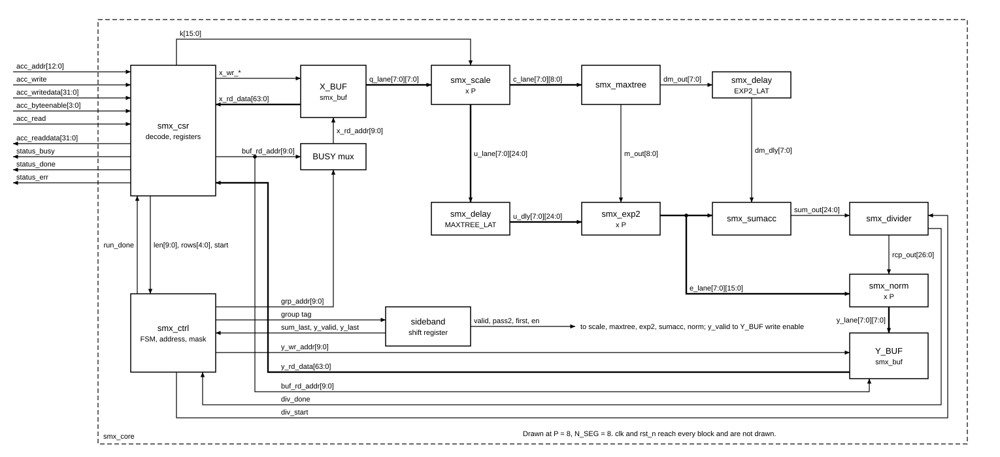
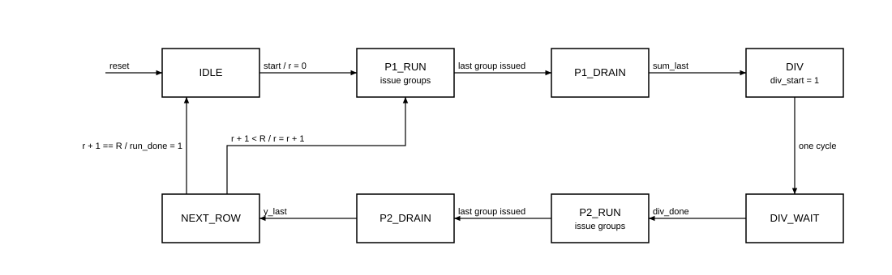

# Cross-block contract — `smx_core`

> Hợp đồng giữa các block của `smx_core`: port, căn pipeline, sự kiện điều khiển, công thức `CYCLE_CNT`. Tài liệu block chi tiết hoá nội bộ nhưng **không được lệch** file này; muốn đổi thì báo người giám sát để thống nhất rồi sửa ở đây trước. Khi file này khác `docs/spec/04-architecture.md` về chi tiết, file này được ưu tiên.
> Số học: `model/softmax_ref.py` và `docs/requirements.md` mục 4. Giao diện ngoài: requirements mục 5 (đóng băng). Quyết định đã tự chốt và việc chờ Chau: `docs/spec/07-open-decisions.md`.

## 1. Nguyên tắc

1. **Pipeline cố định, không stall.** Mỗi block datapath có latency hằng số trong `smx_pkg`. Một nhóm P phần tử đi vào mỗi chu kỳ, không backpressure.
2. **`smx_core` giữ sideband.** `smx_ctrl` phát thẻ của nhóm (`valid`, `pass2`, `first`, `last`, `en`). `smx_core` trễ thẻ qua một shift register và rút ra đúng tầng. Block datapath không biết lượt, không biết hàng.
3. **`smx_ctrl` điều khiển theo sự kiện**, không tự đếm latency của datapath: `sum_last`, `div_done`, `y_valid`, `y_last`. Đổi latency một block chỉ cần sửa `smx_pkg`, và `smx_core` tự căn lại.
4. **Chỉ thanh ghi điều khiển có reset.** Valid, FSM và CSR dùng `always_ff @(posedge clk or negedge rst_n)`. Thanh ghi dữ liệu nằm ở khối `always_ff @(posedge clk)` riêng để Quartus gói được vào DSP (`smx_exp2.md` mục 5.1, quy tắc 2).
5. **Tham số `P` và `N_SEG` truyền từ `smx_core` xuống.** `P ∈ {4, 8, 16}` (A5), giá trị nộp là 8. Block phụ thuộc P phải có `parameter int P = smx_pkg::P` và dựng được ở cả ba giá trị. `smx_pkg::P`, `smx_pkg::N_SEG` chỉ là giá trị mặc định; không suy độ rộng từ chúng bên trong block.
6. **Port theo lane dùng mảng packed hai chiều**, ví dụ `input logic [P-1:0][smx_pkg::C_W-1:0] c_in`. Phần tử không mang dấu trong kiểu; bên trong dùng `$signed(c_in[i])`. Lane 0 ứng với phần tử có chỉ số nhỏ nhất của nhóm.
7. **Giới hạn cú pháp Quartus 18.1** (đã thử, báo `Error 10170`):
   - Không viết `for (genvar i = 0; ...)`. Khai báo `genvar i;` ngoài vòng lặp.
   - Không viết `localparam` trong danh sách tham số ở header. Dùng `parameter int ADDR_W = $clog2(...)` ở header, hoặc `localparam` trong thân module.
   - ModelSim có thể chấp nhận các dạng trên, nên không dựa vào mô phỏng để phát hiện.
8. **`set_parameter` trong Quartus im lặng khi module không có tham số đó**: build giá trị mặc định, không báo gì. Quét tham số bằng `syn/map_check.sh` chỉ có nghĩa với tham số có thật.

## 2. Luồng dữ liệu



## 3. Latency và căn pipeline

Hằng số ở `smx_pkg`: `BUF_LAT = 1`, `SCALE_LAT = 3`, `MAXTREE_LAT = 2`, `EXP2_LAT = 3`, `SUMACC_LAT = 3`, `NORM_LAT = 3`, `DIV_LAT = 28`, `ACC_RD_LAT = 2`.

Với nhóm mà `smx_ctrl` phát ở chu kỳ `t` (giống nhau ở mọi P):

| Chu kỳ | Công thức | Sự việc | Thẻ dùng tại đây |
|---|---|---|---|
| `t` | | `grp_addr` ở cổng đọc X_BUF | |
| `t+1` | `+BUF_LAT` | `q` ở đầu vào `smx_scale` | `valid` |
| `t+4` | `+SCALE_LAT` | `c` ở đầu vào `smx_maxtree`; `u` vào đường trễ | `valid & ~pass2`, `first`, `en` |
| `t+6` | `+MAXTREE_LAT` | `m_out`, `dm_out`, `u` đã trễ ở đầu vào `smx_exp2` | `valid`, `en` |
| `t+9` | `+EXP2_LAT` | `E` ở đầu vào `smx_sumacc` hoặc `smx_norm`; `dm` đã trễ | lượt 1: `valid & ~pass2`, `first`; lượt 2: `valid & pass2` |
| `t+12` | `+SUMACC_LAT` | lượt 1: `sum_out` của nhóm | `sum_last = valid & ~pass2 & last` |
| `t+12` | `+NORM_LAT` | lượt 2: `y` ở cổng ghi Y_BUF | `y_valid = valid & pass2`, `y_last = y_valid & last` |

Hai điểm cần giữ đúng:

- `m_out` thay đổi đúng ở chu kỳ `t+6` của nhóm vừa cập nhật, nên mỗi nhóm thấy `Mnew` của chính nó (REQ-ARI-05). Ở lượt 2 `smx_maxtree` không nhận `in_valid`, nên `m_out` giữ nguyên M cuối hàng và cùng dây đó cấp cho `smx_exp2`.
- Tất cả nhóm trong một lượt đi cùng thứ tự chỉ số tăng dần. Không block nào được đảo thứ tự.

## 4. Port từng block

Mọi block có `clk`, `rst_n`, trừ `smx_buf` và `smx_delay` chỉ có `clk`. Độ rộng lấy từ `smx_pkg`: `Q_W = 8`, `K_W = 16`, `U_W = 25`, `C_W = 9`, `DM_W = 8`, `E_W = 16`, `SUM_W = 25`, `RCP_W = 27`, `Y_W = 8`.

Ở mọi block có `out_valid`: `out_valid` là `in_valid` trễ đúng latency, reset về 0, và dữ liệu ra chỉ có nghĩa khi `out_valid = 1` (riêng `m_out`, `sum_out`, `rcp_out` giữ giá trị đến khi có cập nhật tiếp theo). `smx_core` điều khiển bằng sideband nên có thể để trống các cổng `out_valid` này; testbench block vẫn phải kiểm chúng.

`in_first` chỉ có nghĩa khi `in_valid = 1`. Thẻ `first` cũng lên ở nhóm đầu lượt 2, lúc đó `in_valid = 0`; block hành động theo `in_first` một mình sẽ ghi đè M và làm sai mọi Y.

### 4.1. `smx_scale` (một lane, `P` bản)

| Port | Hướng | Độ rộng | Mô tả |
|---|---|---|---|
| `in_valid` | in | 1 | |
| `q_in` | in | 8 | signed INT8 |
| `k_in` | in | 16 | không dấu, UQ0.16; ổn định suốt lần chạy |
| `out_valid` | out | 1 | |
| `u_out` | out | 25 | signed Q8.16, `u = q·K` |
| `c_out` | out | 9 | signed, `c = ⌈u/2¹⁶⌉` |

Bẫy dấu: `$signed(q_in) * k_in` là phép nhân **không dấu** trong SystemVerilog vì toán hạng khác dấu. Phải viết `$signed(q_in) * $signed({1'b0, k_in})` (8×17 có dấu). Hàm tham chiếu: `softmax_ref.ceil_q16` và `info["u"]`, `info["c"]`.

### 4.2. `smx_maxtree`

Tham số `P`.

| Port | Hướng | Độ rộng | Mô tả |
|---|---|---|---|
| `in_valid` | in | 1 | chỉ lên ở lượt 1 |
| `in_first` | in | 1 | nhóm đầu của hàng: `Mnew = Mg` |
| `in_en` | in | `P` | lane hợp lệ; lane 0 của mọi nhóm luôn hợp lệ |
| `c_in` | in | `P × 9` | signed; lane có `in_en = 0` có thể mang rác hoặc X, không được ảnh hưởng kết quả |
| `out_valid` | out | 1 | |
| `m_out` | out | 9 | signed; `Mnew`, giữ nguyên khi không có nhóm mới |
| `dm_out` | out | 8 | không dấu; `Mnew − M`, bằng 0 ở nhóm đầu (khớp `dM` của golden) |

**Chia tầng bắt buộc** (đo bằng Fitter trên probe: cả cây ở tầng 1 chỉ đạt 90 MHz ở P = 16, chia đều đạt 117 MHz): tầng 1 rút còn 2 ứng viên (`log₂P − 1` mức so sánh), tầng 2 gồm mức cuối, so với M, cập nhật M và tính `dm`. Lane bị mask thay bằng giá trị nhỏ hơn mọi `c` hợp lệ (`c ∈ [−127, 127]`), ví dụ `9'b1_0000_0000`; viết `-9'sd256` sẽ bị Quartus báo warning 10259. Phương án lùi nếu không đạt 100 MHz: `MAXTREE_LAT = 3`.

### 4.3. `smx_exp2` (một lane, `P` bản, đã có)

`in_valid`, `in_en`, `u_in`, `m_in`, `out_valid`, `e_out`. Xem `smx_exp2.md`.

### 4.4. `smx_sumacc`

Tham số `P`.

| Port | Hướng | Độ rộng | Mô tả |
|---|---|---|---|
| `in_valid` | in | 1 | chỉ lên ở lượt 1 |
| `in_first` | in | 1 | nhóm đầu: bỏ qua `sum` cũ |
| `e_in` | in | `P × 16` | không dấu; lane bị mask đã bằng 0 từ `smx_exp2` |
| `dm_in` | in | 8 | không dấu, cùng chu kỳ với `e_in` |
| `out_valid` | out | 1 | |
| `sum_out` | out | 25 | không dấu; giữ nguyên khi không có nhóm mới |

`sum ← first ? Σ : (sum >> dm) + Σ`, dịch cắt bỏ, `dm ≥ 25` cho 0. Cây cộng chia hai tầng (P bất kỳ), tầng 3 là vòng tích luỹ một chu kỳ. Hàm tham chiếu: `softmax_ref.group_sum`.

### 4.5. `smx_divider`

| Port | Hướng | Độ rộng | Mô tả |
|---|---|---|---|
| `start` | in | 1 | xung một chu kỳ; `sum_in` được lấy mẫu tại đây |
| `sum_in` | in | 25 | không dấu; hợp lệ khi `2¹⁴ ≤ sum ≤ 2²⁴` |
| `done` | out | 1 | xung một chu kỳ, đúng `DIV_LAT` chu kỳ sau `start` |
| `rcp_out` | out | 27 | không dấu; hợp lệ từ `done` và giữ đến `start` kế tiếp |

Thuật toán đã kiểm vét cạn trên mọi `sum ∈ [2¹⁴, 2²⁴]` (16 760 833 giá trị, 0 sai khác): khởi tạo `rem = 2¹³` (`2^(RECIP_SH − RCP_W)`), lặp 27 lần `rem ← 2·rem`, nếu `rem ≥ sum` thì `rem −= sum` và bit thương bằng 1. `rem` 24 bit, `2·rem` 25 bit, so sánh 25 bit không dấu (26 bit nếu dùng phép trừ để lấy borrow).

Timing với `start` ở chu kỳ `s`: nạp ở cuối `s`, lặp ở `s+1..s+27`, đăng ký `done` ở cạnh lặp cuối, nên `done` và `rcp_out` cuối cùng xuất hiện ở `s+28`. Hàm tham chiếu: `softmax_ref.reciprocal`.

### 4.6. `smx_norm` (một lane, `P` bản)

| Port | Hướng | Độ rộng | Mô tả |
|---|---|---|---|
| `in_valid` | in | 1 | chỉ lên ở lượt 2 |
| `e_in` | in | 16 | không dấu UQ1.15 |
| `rcp_in` | in | 27 | không dấu; ổn định suốt lượt 2 |
| `out_valid` | out | 1 | |
| `y_out` | out | 8 | không dấu; `min(255, (E·Rcp + 2³¹) >> 32)` |

Tích `E·Rcp` chạy được tới 2⁴⁰ trong lần chạy thật, và tới 43 bit nếu E, Rcp độc lập. Giữ bão hoà toàn độ rộng để testbench có thể quét E, Rcp độc lập. Làm tròn có thể viết `p[..:32] + p[31]`, không cần bộ cộng 43 bit. Lane bị mask có `E = 0` nên `y = 0`; REQ-FUN-03 cho phép ghi giá trị này vào Y_BUF. Hàm tham chiếu: `softmax_ref.norm_out`.

### 4.7. `smx_buf` (dùng hai lần: X_BUF, Y_BUF)

Tham số `parameter int P = smx_pkg::P`. Suy ra `BANKS = P/4`, `DEPTH = 8192/P`, `ADDR_W = $clog2(8192/P)` (P = 8: 2 bank, 1024 word, 10 bit). Simple dual-port, M10K, đọc trễ `BUF_LAT = 1`, không reset, đọc mọi chu kỳ.

| Port | Hướng | Độ rộng | Mô tả |
|---|---|---|---|
| `wr_en` | in | `BANKS` | mỗi bit một bank |
| `wr_be` | in | 4 | byte-enable, dùng chung cho các bank đang ghi |
| `wr_addr` | in | `ADDR_W` | |
| `wr_data` | in | `BANKS × 32` | bank 0 ở bit thấp |
| `rd_addr` | in | `ADDR_W` | |
| `rd_data` | out | `BANKS × 32` | bank 0 ở bit thấp, tức lane 0 ở `rd_data[7:0]` |

**Cách viết bộ nhớ bắt buộc.** RAM kiểu packed `logic [3:0][7:0] mem [DEPTH]` đặt trong `generate` bị Quartus âm thầm chuyển thành 65 000 flip-flop, không lỗi, không warning. Đã thử cách đúng: một mảng `logic [7:0] mem [0:DEPTH-1]` cho mỗi bank và mỗi byte, trong `generate` lồng nhau. Tiêu chí đạt: `.map.rpt` báo `Total block memory bits` = 65 536 và số thanh ghi logic nhỏ, ở P = 4, 8, 16.

Bố trí địa chỉ theo REQ-IF-07, với `i` là chỉ số phần tử, `r` là hàng (đã kiểm bằng script trên mọi `(r, i)` ở cả ba P):

- Địa chỉ word trong buffer: `w = (r·L_MAX + i) / 4` (11 bit).
- Bank: `w mod BANKS`. Địa chỉ trong bank: `w / BANKS`.
- Địa chỉ nhóm của datapath: `grp_addr = {r, g}` với `g = i / P`; đây chính là địa chỉ trong bank. P = 8: `{r[3:0], g[5:0]}`.

P = 4 chỉ có một bank; dùng `generate` để tránh part-select độ rộng 0.

### 4.8. `smx_csr`

Chứa thanh ghi và toàn bộ giải mã `acc_*`, gồm hai tầng đọc. Tham số `P`, `N_SEG`.

| Port | Hướng | Độ rộng | Mô tả |
|---|---|---|---|
| `acc_addr` | in | 13 | word address |
| `acc_write`, `acc_read` | in | 1 | |
| `acc_writedata` | in | 32 | |
| `acc_byteenable` | in | 4 | |
| `acc_readdata` | out | 32 | đúng 2 chu kỳ sau `acc_read` |
| `status_busy`, `status_done`, `status_err` | out | 1 | conduit, chính là bit STATUS |
| `len` | out | 10 | ổn định khi BUSY |
| `rows` | out | 5 | ổn định khi BUSY |
| `k` | out | 16 | ổn định khi BUSY |
| `start` | out | 1 | xung ở chu kỳ đầu BUSY = 1; chỉ phát khi cấu hình hợp lệ |
| `run_done` | in | 1 | xung từ `smx_ctrl`, kết thúc lần chạy |
| `x_wr_en` | out | `BANKS` | one-hot; 0 khi BUSY |
| `x_wr_be` | out | 4 | |
| `x_wr_addr` | out | `ADDR_W` | |
| `x_wr_data` | out | `BANKS × 32` | `acc_writedata` lặp lại ở mọi bank |
| `buf_rd_addr` | out | `ADDR_W` | địa chỉ đọc X_BUF, Y_BUF từ `acc_addr` (không đăng ký) |
| `x_rd_data`, `y_rd_data` | in | `BANKS × 32` | từ `smx_buf`, trễ `BUF_LAT` |

Giải mã word address, xét đủ 13 bit, không aliasing:

| `acc_addr` | Vùng |
|---|---|
| `0..6` | CTRL 0, STATUS 1, LEN 2, ROWS 3, SCALE_K 4, CYCLE_CNT 5, HW_PARAM 6 |
| `7..0x7FF` | không định nghĩa |
| `0x800..0xFFF` | X_BUF, `w = acc_addr[10:0]` |
| `0x1000..0x17FF` | Y_BUF, `w = acc_addr[10:0]` |
| `0x1800..0x1FFF` | không định nghĩa |

`smx_pkg` lưu offset **byte** (`CSR_LEN = 0x8`), còn `acc_addr` là **word**; đừng so trực tiếp.

Hành vi đã chốt:

- **Sau reset:** LEN, ROWS, SCALE_K, BUSY, DONE, ERR, CYCLE_CNT, `acc_readdata` đều bằng 0. START ngay sau reset cho ERR.
- **START hợp lệ** ở chu kỳ `n`: từ `n+1` có `BUSY = 1`, `DONE = 0`, `ERR = 0`, `start = 1` (một chu kỳ), `CYCLE_CNT = 0`. Lệnh đọc STATUS ở `n+1` đã thấy BUSY.
- **START sai cấu hình** (L ∉ [1, L_MAX] hoặc R ∉ [1, R_MAX]) khi `BUSY = 0`: từ `n+1` có `DONE = 1`, `ERR = 1`, `BUSY` không lên, không phát `start`, `CYCLE_CNT = 0`.
- **START khi BUSY = 1**: bỏ qua, kể cả ở đúng chu kỳ `run_done`. START ở chu kỳ ngay sau đó chạy lại bình thường.
- START chỉ tính khi `acc_write`, địa chỉ CTRL, `acc_byteenable[0]` và `acc_writedata[0]` đều bằng 1.
- `run_done` ở chu kỳ `m`: từ `m+1` có `BUSY = 0`, `DONE = 1`.
- `DONE` và `BUSY` không bao giờ cùng bằng 1. Dạng assertion đúng cho REQ-VER-03 là `$rose(done) |-> !busy`, không phải `|-> $fell(busy)`, vì START sai cấu hình có DONE lên mà BUSY chưa từng lên.
- `CYCLE_CNT` tăng 1 ở mỗi chu kỳ `BUSY = 1`, giữ nguyên khi `BUSY = 0`.
- Khi `BUSY = 1`: ghi LEN, ROWS, SCALE_K, X_BUF bị bỏ qua, bảo vệ lần chạy. REQ-IF-09 cho phép vì đây là truy cập không xác định.
- Thanh ghi R/W tôn trọng byte-enable: LEN `[7:0]` theo `be[0]`, `[9:8]` theo `be[1]`; ROWS theo `be[0]`; SCALE_K theo `be[0]`, `be[1]`. Bit ngoài độ rộng đọc 0.
- Đọc CTRL trả 0. Ghi STATUS, CYCLE_CNT, HW_PARAM, Y_BUF, vùng không định nghĩa bị bỏ qua. Đọc vùng không định nghĩa trả 0 (REQ-IF-08).
- `HW_PARAM = {VERSION[7:0], log₂N_SEG[3:0], R_MAX[7:0], log₂L_MAX[3:0], P[7:0]}`.

Thời gian đọc: lệnh ở `n`; `smx_buf` lấy địa chỉ ở cuối `n`; ở `n+1` có `rd_data` và CSR đã đăng ký giá trị thanh ghi cùng lựa chọn nguồn, bank; `acc_readdata` là thanh ghi, có giá trị ở `n+2`. Giá trị thanh ghi là giá trị tại chu kỳ `n`. Lệnh đọc liên tiếp từ các nguồn khác nhau phải đúng.

Bộ nhớ chưa ghi đọc ra X trong mô phỏng vì file tổng hợp không được có `initial`. Assertion "không có X trên `readdata`" chỉ áp dụng cho vị trí đã ghi: X_BUF do test ghi, Y_BUF với `G·P` phần tử đầu của các hàng `0..R−1`.

### 4.9. `smx_ctrl`

Tham số `P`.

| Port | Hướng | Độ rộng | Mô tả |
|---|---|---|---|
| `start` | in | 1 | từ `smx_csr` |
| `len`, `rows` | in | 10, 5 | đã hợp lệ |
| `grp_valid`, `grp_pass2`, `grp_first`, `grp_last` | out | 1 | thẻ nhóm; `first`, `last` tính trong một lượt, cả hai bằng 1 khi `G = 1` |
| `grp_en` | out | `P` | `en[j] = (g·P + j < L)` |
| `grp_addr` | out | `ADDR_W` | `{r, g}` |
| `sum_last` | in | 1 | nhóm cuối của lượt 1 đã vào `sum_out` |
| `div_start` | out | 1 | mức 1 trong đúng một chu kỳ DIV |
| `div_done` | in | 1 | |
| `y_valid`, `y_last` | in | 1 | nhóm kết quả đang ghi vào Y_BUF |
| `y_wr_addr` | out | `ADDR_W` | `{r, yg}` |
| `run_done` | out | 1 | mức 1 trong chu kỳ NEXT_ROW của hàng cuối, tức một chu kỳ sau `y_last` |

Timing bắt buộc, vì `CYCLE_CNT` và địa chỉ ghi Y phụ thuộc vào nó:

- `grp_*`, `div_start`, `run_done`, `y_wr_addr` là **tổ hợp** từ trạng thái và thanh ghi, không đăng ký thêm. Đăng ký `y_wr_addr` sẽ ghi nhóm `g` vào địa chỉ `g+1`.
- `grp_valid = 1` đúng ở trạng thái P1_RUN và P2_RUN. Với `start` ở chu kỳ `n+1`, nhóm đầu ở `t0 = n+2`.
- `g` về 0 khi vào mỗi lượt. `yg` về 0 khi có `start` và ở NEXT_ROW, tăng sau mỗi `y_valid` ở mọi trạng thái.

Bẫy độ rộng: `r` 4 bit nhưng `R` có thể bằng 16, nên `r + 1` 4 bit bị quấn và không bao giờ bằng R; so bằng `r == R − 1` ở 5 bit. Số nhóm `G` tới 128 ở P = 4, cần 8 bit, trong khi `g` chỉ có `ADDR_W − 4` bit.

### 4.10. `smx_core` và `smx_delay`

`smx_core` là top lõi, tham số `P`, `N_SEG`, port đúng REQ-IF-06 và REQ-IF-10. Nối theo mục 2, 3, cùng các mux sau:

- `X_BUF.rd_addr = status_busy ? grp_addr : buf_rd_addr`. Khi BUSY, đọc X_BUF từ `acc_*` là không xác định theo REQ-IF-09.
- `Y_BUF.rd_addr = buf_rd_addr`. `Y_BUF.wr_en = {BANKS{y_valid}}`, `wr_be = 4'hF`.

`smx_delay` (đã có, `rtl/core/smx_delay.sv`) là tiện ích trễ dữ liệu, không reset, được kiểm qua testbench `smx_core`:

| Port | Hướng | Độ rộng | Mô tả |
|---|---|---|---|
| `clk` | in | 1 | |
| `in_data` | in | `WIDTH` | |
| `out_data` | out | `WIDTH` | `in_data` trễ `DEPTH` chu kỳ, `DEPTH ≥ 1` |

Thẻ `valid` nằm trong shift register sideband có reset của `smx_core`.

## 5. FSM và công thức `CYCLE_CNT`



Với `G = ⌈L/P⌉`, `t0` là chu kỳ phát nhóm đầu của lượt 1, `PIPE = BUF_LAT + SCALE_LAT + MAXTREE_LAT + EXP2_LAT`:

| Đoạn | Chu kỳ |
|---|---|
| `t0` → `sum_last` | `G − 1 + PIPE + SUMACC_LAT` |
| `sum_last` → chu kỳ `div_start` | 1 |
| `div_start` → `div_done` | `DIV_LAT` |
| `div_done` → nhóm đầu lượt 2 | 1 |
| nhóm đầu lượt 2 → `y_last` | `G − 1 + PIPE + NORM_LAT` |
| `y_last` → `NEXT_ROW` | 1 |
| `NEXT_ROW` → `t0` của hàng sau | 1 |

```
ROW_OVERHEAD = 2·PIPE + SUMACC_LAT + NORM_LAT + DIV_LAT + 2      (= 54, smx_pkg)
T_row        = 2·G + ROW_OVERHEAD
CYCLE_CNT    = R · T_row + 1
```

`+1` vì `BUSY` lên một chu kỳ trước khi `smx_ctrl` phát nhóm đầu (chu kỳ `start`), còn chu kỳ `NEXT_ROW` cuối cùng thay cho bước chuyển sang hàng sau. REQ-PRF-03 cho phép `ROW_OVERHEAD ≤ 64`, tức còn dư 10 chu kỳ, hay tối đa 5 tầng thêm trên đoạn `PIPE`. Với `L = 512`: `T_row` = 310, 182, 118 ở P = 4, 8, 16. Testbench đọc `smx_pkg::ROW_OVERHEAD`, không chép số 54.

## 6. Quy ước kiểm thử

- Testbench `tb/tb_<block>.sv` có `parameter int P`, `parameter int N_SEG` (kể cả khi không dùng), nhận `+VECDIR=<dir>`, in đúng một dòng `TB_RESULT: PASS ...` hoặc `TB_RESULT: FAIL ...` rồi `$finish`.
- Block có số học: giá trị kỳ vọng lấy từ `model/softmax_ref.py`, qua `model/vec_<block>.py`, không tự viết lại công thức trong testbench. `softmax_row` mặc định `P = 8, n_seg = 8` và `sum` phụ thuộc cách chia nhóm, nên luôn truyền cả hai tham số. Các trường `info` (`u`, `c`, `groups`, `E`, `sum`, `R`, `M`) cho số trung gian.
- Block không có số học (`smx_buf`, `smx_csr`, `smx_ctrl`) không cần `vec_<block>.py`: `make` tự bỏ qua bước sinh vector, và testbench tự kiểm theo hợp đồng này.
- Testbench kiểm latency đúng từng chu kỳ theo `smx_pkg`, và reset giữa luồng nếu block có trạng thái.
- Chạy qua `sim/`: `make regress testname=tb_<block> N_SEGS=8`; block phụ thuộc P thêm `PS="4 8 16"`. Block phụ thuộc N_SEG thêm `N_SEGS="4 8 16"`.
- `syn/map_check.sh <block> [P=4,8,16]` phải đạt, in cả dòng block memory. `smx_core` truyền thêm khối con: `DEPS="smx_a smx_b" syn/map_check.sh smx_core`.
- Block đạt khi: 0 sai khác ở mọi tham số cần thiết, `map_check` đạt, không warning đáng ngờ, và testbench đã được chứng minh **bắt được lỗi** bằng cách cố tình làm sai một lần.
