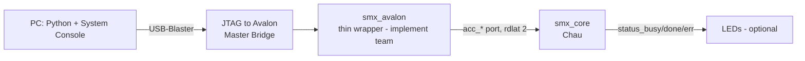
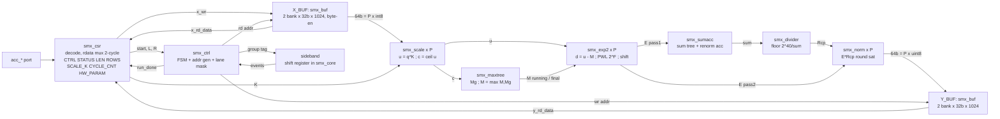
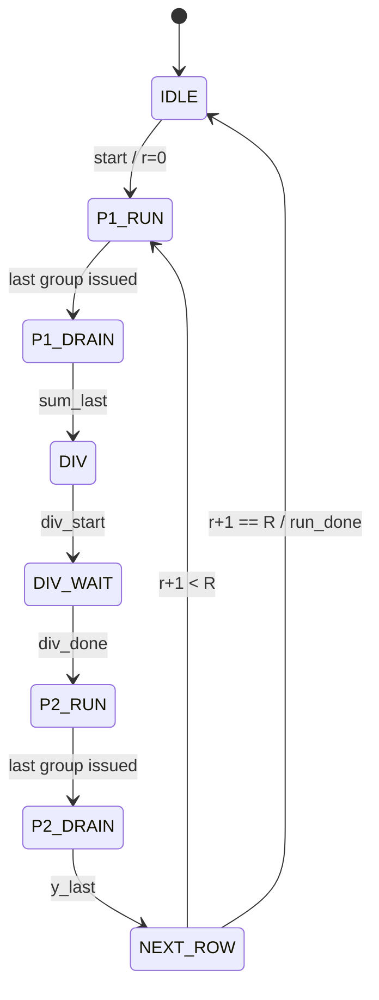

# Architecture — `smx` (v1.0)

> Kiến trúc mức top, làm khung cho tài liệu từng block `docs/spec/blocks/*.md` (viết bằng Claude Code CLI theo `_TEMPLATE.md`). Số học bit-exact: `docs/requirements.md` mục 4 và `model/softmax_ref.py`. Các mục `A1–A5` ở cuối đã chốt (2026-10-31); nguồn ở `docs/PROJECT.md` mục 7.1.
> Sơ đồ: mermaid (sửa tay được). Dạng sóng/timing chu kỳ sẽ dùng WaveDrom trong `docs/spec/wave/`.
> Hợp đồng chi tiết giữa các block: `docs/spec/cross-block.md`; khi khác file này về chi tiết thì `cross-block.md` được ưu tiên.

## 1. Ranh giới và phân vai

- **`smx_core` (Chau — ưu tiên số 1):** CSR, X_BUF, Y_BUF, controller, datapath. Lộ cổng `acc_*` (REQ-IF-06) và conduit trạng thái.
- **`smx_avalon` + `smx_hw.tcl` + hệ thống Platform Designer + script System Console (nhóm implement):** wrapper mỏng chỉ đổi tên `acc_*` ↔ Avalon `s0`. Ghi chú bàn giao: `docs/spec/integration-notes.md`.

## 2. Cấu trúc bên trong `smx_core`

Sơ đồ vẽ ở P = 8. Decode `acc_*` nằm trong `smx_csr`. Bản đầy đủ có sideband: `docs/spec/design-spec.md` mục 2.2.

| Block | Chức năng | Phần cứng chính |
|---|---|---|
| `smx_csr` | Thanh ghi; START/DONE/ERR sticky; kiểm LEN/ROWS; CYCLE_CNT | thanh ghi, so sánh, bộ đếm 32 bit |
| `smx_buf` (X_BUF, Y_BUF) | 8 KB mỗi buffer; cổng truy cập 32 bit (byte-enable), cổng datapath 64 bit | M10K, 2 bank × 32 bit |
| `smx_ctrl` | FSM theo hàng/lượt, địa chỉ nhóm, mask lane cuối hàng, điều phối pipeline | FSM, bộ đếm |
| `smx_scale` ×P | `u = q·K` (Q8.16), `c = ⌈u/2¹⁶⌉` | 1 nhân 8×16/lane |
| `smx_maxtree` | max 8→1 trên `c` (lane hợp lệ), `M ← max(M, Mg)` | 7 so sánh 9 bit, vòng phản hồi ngắn |
| `smx_exp2` ×P | `d = u − M·2¹⁶`, tách I/F, PWL, dịch `−I`, cutoff | 1 nhân 13×13 (N_SEG = 8), ROM 8 entry, barrel shifter |
| `smx_sumacc` | cây cộng 8→1, `sum ← (sum >> ΔM) + Σ` | cây cộng 25 bit, shifter trong vòng phản hồi |
| `smx_divider` | `Rcp = ⌊2⁴⁰/sum⌋`, radix-2 tuần tự | so sánh 25 bit, 28 chu kỳ |
| `smx_norm` ×P | `y = min(255, (E·Rcp + 2³¹) >> 32)` | 1 nhân 16×27/lane |

`smx_scale` và `smx_exp2` dùng chung cho hai lượt (chỉ khác nguồn M và đích của E). Số thật sau Fitter: 24 DSP ở P = 8, mỗi bộ nhân một khối (`docs/spec/blocks/smx_core.md` mục 7).

## 3. Điều khiển

`smx_csr` kiểm LEN, ROWS trước khi phát `start`: START sai cấu hình đặt DONE = 1, ERR = 1 mà BUSY không lên, nên FSM không thấy lần chạy đó.

Latency thiết kế mỗi hàng (L = 512, P = 8): `T_row = 2G + 54 = 182` chu kỳ (≤ 192 theo REQ-PRF-03). Công thức: `docs/spec/cross-block.md` mục 5; kiểm bằng `CYCLE_CNT`.

## 4. Điểm găng timing (mục tiêu 100 MHz)

1. **Vòng cập nhật M (lượt 1):** E của một nhóm cần `Mnew` của chính nhóm đó. Cây max đặt ngay sau bộ nhân K; thanh ghi M cập nhật trong 1 chu kỳ (so sánh + chọn 9 bit); `Mnew` đi kèm nhóm xuống tầng exp2. Không chặn throughput 1 nhóm/chu kỳ.
2. **Vòng tích luỹ tổng:** barrel shifter 25 bit + cộng 25 bit trong 1 chu kỳ. Dự phòng: kẹp ΔM ≥ 25 → 0; nếu vẫn thiếu, tính trước điều khiển dịch ở tầng trước để vòng phản hồi chỉ còn mux + cộng. Không đổi kết quả bit-exact.
3. **Bộ nhân:** đăng ký đầu vào và đầu ra để Quartus dùng thanh ghi trong DSP.

Đo sau Fitter: mục tiêu 100 MHz đạt ở P = 4, 8, 16. Đường găng nhất ở P = 8, 16 là tầng 1 của `smx_maxtree`, không phải hai vòng trên; xem `docs/spec/blocks/smx_core.md` mục 6.

## 5. Quyết định kiến trúc (đã chốt v1.0)

- **A1** Mỗi buffer = 2 bank 32 bit × 1024; bit 0 địa chỉ word chọn bank; datapath đọc/ghi cả hai bank (64 bit). Infer M10K ổn định trên Quartus 18.1.
- **A2** Hai lượt với online normalization (D12), chấp nhận rủi ro ở vòng tích luỹ (mục 4.2). Ba lượt là phương án lùi.
- **A3** Không chồng lặp bộ chia với hàng sau ở v1.0; FSM chừa chỗ để thêm (nhân đôi thanh ghi M, sum).
- **A4** X_BUF, Y_BUF tách riêng (không ghi đè tại chỗ).
- **A5** Datapath tham số theo P bằng `generate`; tổng hợp kiểm ở P = 4/8/16 cho phần quét trong báo cáo; giá trị nộp P = 8.
