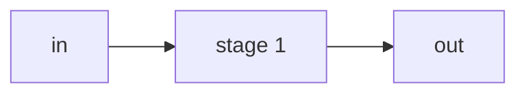

# `<block_name>` — Block design document

| Trường | Giá trị |
|---|---|
| Trạng thái | DRAFT / REVIEW / APPROVED (ghi ngày + người duyệt) |
| File RTL | `rtl/core/<block_name>.sv` |
| Testbench | `tb/tb_<block_name>.sv` |
| Yêu cầu liên quan | REQ-xxx, … |
| Golden model | hàm / bước tương ứng trong `model/softmax_ref.py` |

## 1. Chức năng
Block làm gì, nằm ở đâu trong datapath (trỏ về `docs/spec/architecture.md`), không làm gì.

## 2. Tham số
| Tham số | Mặc định | Nguồn (smx_pkg) | Ràng buộc |
|---|---|---|---|

## 3. Giao diện
| Port | Hướng | Độ rộng | Kiểu số (signed, Qm.n) | Mô tả |
|---|---|---|---|---|

Handshake (valid/ready, start/done, hay pipeline cố định không stall) và quy ước reset.

## 4. Hành vi và số học
Công thức bit-exact từng bước, đối chiếu từng dòng với golden model. Nêu rõ làm tròn, cắt bỏ, bão hoà, xử lý lane không hợp lệ.

## 5. Cấu trúc bên trong
Sơ đồ mermaid (flowchart cho datapath, stateDiagram-v2 nếu có FSM). Liệt kê thanh ghi pipeline, bộ nhân, bộ nhớ.

## 6. Timing
- Latency (chu kỳ) từ đầu vào hợp lệ tới đầu ra, throughput.
- Dạng sóng: `docs/spec/wave/<block_name>.json` (WaveDrom).
- Đường găng dự kiến cho 100 MHz và cách xử lý.

## 7. Tài nguyên ước tính
ALUT, register, DSP, M10K — ghi loại nguồn [TK]; thay bằng số Quartus khi có.

## 8. Kế hoạch kiểm thử block
Vector sinh từ golden model, các trường hợp biên, tiêu chí đạt (khớp bit-exact N vector ngẫu nhiên + toàn bộ corner).

## 9. Câu hỏi mở / quyết định cần duyệt
- [ ] …

## 10. Lịch sử
- YYYY-MM-DD: tạo DRAFT.
