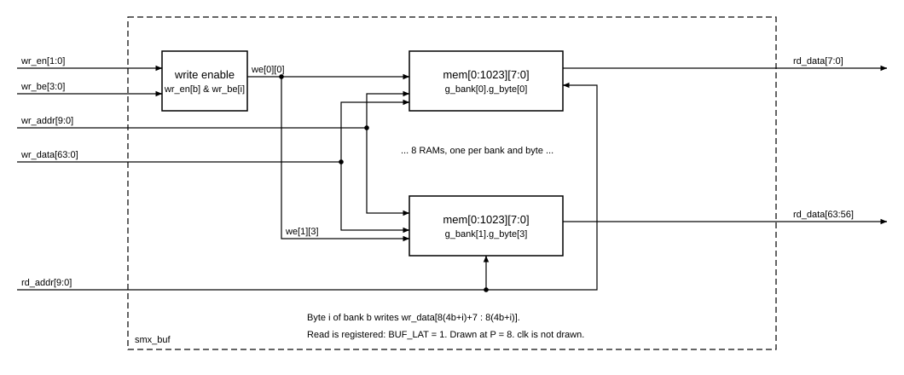

# `smx_buf` — Block design document

| Trường | Giá trị |
|---|---|
| Trạng thái | DRAFT — Chau ủy quyền viết RTL trước khi duyệt (2026-11-03), chưa duyệt |
| File RTL | `rtl/core/smx_buf.sv` |
| Testbench | `tb/tb_smx_buf.sv` |
| Yêu cầu liên quan | REQ-IF-07 (bố trí buffer), REQ-IF-09, `docs/spec/cross-block.md` mục 4.7 |
| Golden model | không có số học; chỉ là bộ nhớ. Bố trí địa chỉ theo REQ-IF-07 |

## 1. Chức năng

Bộ nhớ 8192 byte, hai cổng (một ghi, một đọc), dùng hai lần trong `smx_core`: X_BUF (điểm INT8 đầu vào) và Y_BUF (kết quả UINT8). Tổ chức `BANKS = P/4` bank, mỗi bank là từ 32 bit (4 byte), nên một lần đọc trả đúng một nhóm `P` phần tử, lane 0 ở `rd_data[7:0]`. Ghi theo từ 32 bit với byte-enable dùng chung và enable riêng cho từng bank: CSR ghi một từ vào một bank (X_BUF), còn Y_BUF ghi cả `BANKS` bank cùng lúc với `wr_be = 4'hF`.

Không làm: giải mã địa chỉ từ `acc_*`, mux địa chỉ đọc giữa `smx_ctrl` và CSR (thuộc `smx_csr`, `smx_core`), reset hay khởi tạo nội dung.

## 2. Tham số

| Tham số | Mặc định | Nguồn | Ràng buộc |
|---|---|---|---|
| `P` | 8 | `smx_pkg::P` | ∈ {4, 8, 16} |
| `BANKS` | `P/4` | suy ra | không nên override |
| `DEPTH` | `8192/P` | suy ra | số từ mỗi bank |
| `ADDR_W` | `$clog2(8192/P)` | suy ra | P=4: 11, P=8: 10, P=16: 9 |

`BANKS`, `DEPTH`, `ADDR_W` là `parameter int` ở header vì cần cho độ rộng port (`localparam` trong header bị Quartus 18.1 từ chối). Tổng dung lượng luôn 65 536 bit.

## 3. Giao diện

| Port | Hướng | Độ rộng | Mô tả |
|---|---|---|---|
| `clk` | in | 1 | không có `rst_n` |
| `wr_en` | in | `BANKS` | mỗi bit một bank |
| `wr_be` | in | 4 | byte-enable, chung cho các bank đang ghi |
| `wr_addr` | in | `ADDR_W` | địa chỉ từ trong bank |
| `wr_data` | in | `[BANKS-1:0][31:0]` | bank 0 ở bit thấp |
| `rd_addr` | in | `ADDR_W` | |
| `rd_data` | out | `[BANKS-1:0][31:0]` | bank 0 ở bit thấp; lane 0 ở `[7:0]` |

Kiểu packed hai chiều có cùng bố trí bit với vector phẳng `BANKS*32` của hợp đồng, nên nối với vector phẳng hợp lệ. Lưu ý khi viết testbench: part-select `+:` trên cổng hai chiều chọn theo bank, không theo byte; phải dùng bản phẳng. Đọc mọi chu kỳ, không có `rd_en`, không handshake. Không reset: nội dung chưa ghi đọc ra X trong mô phỏng.

## 4. Hành vi

Không có số học. Ghi ở cạnh clock `n` nếu `wr_en[b] & wr_be[i]` thì byte `i` của bank `b` tại `wr_addr` nhận `wr_data[b][8i +: 8]`. `rd_data` ở chu kỳ `n + BUF_LAT` (= `n+1`) là nội dung tại `rd_addr` của chu kỳ `n`. Ghi ở chu kỳ `n` rồi đặt `rd_addr` cùng địa chỉ ở `n+1` cho dữ liệu mới. Đọc đúng địa chỉ đang ghi trong cùng chu kỳ cho dữ liệu cũ trong mô phỏng; trên M10K hành vi này là don't-care nên không được dựa vào (testbench không kiểm trường hợp này). Địa chỉ phần tử theo REQ-IF-07 do `smx_csr` và `smx_ctrl` tính: bank = `w mod BANKS`, địa chỉ trong bank = `w / BANKS`, `grp_addr = {r, g}`.

## 5. Cấu trúc bên trong

Mỗi bank và mỗi byte có một mảng `logic [7:0] mem [0:DEPTH-1]` riêng trong `generate` lồng nhau, `genvar` khai báo ngoài vòng lặp. Lý do: RAM kiểu `logic [3:0][7:0] mem [DEPTH]` trong `generate` bị Quartus 18.1 âm thầm chuyển thành flip-flop (hợp đồng mục 4.7). Cách này cho `BANKS × 4` RAM rộng 8 bit, mỗi RAM có write-enable riêng nên byte-enable hoạt động mà không cần read-modify-write. P = 4 có một bank và không có part-select độ rộng 0 vì chỉ chọn `[b][8i +: 8]`.

## 6. Timing

Latency `BUF_LAT = 1`, throughput một từ mỗi chu kỳ mỗi bank. Dạng sóng: `docs/spec/wave/smx_buf.json`. Đường đọc là địa chỉ, M10K, thanh ghi đầu ra, không có logic xen giữa nên không phải đường găng. Fmax chưa đo (mới chạy Analysis & Synthesis).

## 7. Tài nguyên

Số từ `quartus_map` (`syn/map_check.sh smx_buf P=4,8,16`, Quartus Prime 18.1, 5CSXFC6D6F31C6), mỗi thể hiện:

| P | Total block memory bits | Total registers | ALUT | DSP |
|---|---|---|---|---|
| 4 | 65 536 | 0 | 4 | 0 |
| 8 | 65 536 | 0 | 8 | 0 |
| 16 | 65 536 | 0 | 16 | 0 |

Báo cáo ghi các RAM là `altsyncram` suy ra. Số khối M10K không có trong báo cáo map (cần Fitter). Ước tính [TK] cho mỗi thể hiện: 8 khối ở P=4 (4 RAM 2048×8, mỗi RAM 2 khối), 8 ở P=8 (8 RAM 1024×8), 16 ở P=16 (16 RAM 512×8, mỗi RAM 1 khối). Hai thể hiện (X_BUF, Y_BUF) gấp đôi. Cần đối chiếu sau Fitter.

## 8. Kế hoạch kiểm thử

`tb_smx_buf` giữ mảng bóng theo byte, dự đoán từng lần đọc và so bằng `!==` sau đúng `smx_pkg::BUF_LAT` chu kỳ; byte chưa ghi phải đọc ra X. Chạy ở P = 4, 8, 16. Các nhóm: T1 đọc bộ nhớ chưa ghi; T2 thứ tự lane (kèm kiểm tường minh lane 0 ở `[7:0]`); T3 mỗi bit `wr_en` chỉ chọn bank của nó, và `wr_en = 0` với `be = F` không ghi; T4 mỗi mẫu byte-enable (16 mẫu) ghi đúng các byte của mọi bank; T5 ghi cả bank (kiểu Y_BUF); T6 địa chỉ 0 và `DEPTH-1`, kiểm không alias; T7 đọc ngay chu kỳ sau khi ghi, và ghi đè liên tiếp; T8 đọc liên tục, địa chỉ đổi mỗi chu kỳ trên toàn bộ nhớ (xuôi, ngược, nhảy); T9 200 000 thao tác ngẫu nhiên (100 000 trên vùng 16 từ để va chạm nhiều, 100 000 trên toàn dải). Tiêu chí đạt: 0 sai khác. Đã chứng minh bắt lỗi bằng hai lần cố ý làm sai (đổi byte-enable, đọc lệch địa chỉ), cả hai ra `TB_RESULT: FAIL`.

## 9. Câu hỏi mở / quyết định cần duyệt

- [ ] Đọc đúng địa chỉ đang ghi trong cùng chu kỳ không được đặc tả (don't-care). Đề xuất giữ vậy; `smx_core` không nên phụ thuộc vào nó.
- [x] Số khối M10K: X_BUF 8/8/16 khối ở P = 4/8/16 đúng như ước tính, đo bằng Fitter (`syn/fit.sh`). Y_BUF dùng ít hơn: suy từ tổng còn 7 khối, xem `smx_core.md` mục 7.

## 10. Lịch sử

- 2026-11-03: tạo DRAFT, RTL và testbench; map_check P=4,8,16 đạt.
