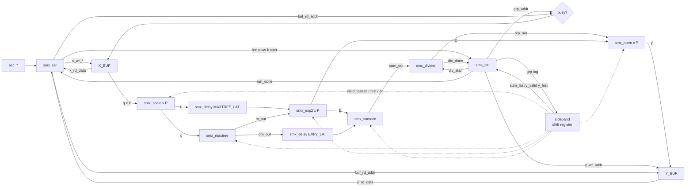

# `smx_core` — Block design document

| Trường | Giá trị |
|---|---|
| Trạng thái | DRAFT — Chau ủy quyền viết RTL trước khi duyệt (2026-11-03), chưa duyệt |
| File RTL | `rtl/core/smx_core.sv` |
| Testbench | `tb/tb_smx_core.sv` (vector: `model/vec_core.py`) |
| Yêu cầu liên quan | REQ-IF-06, REQ-IF-10, REQ-FUN-03, REQ-FUN-04, REQ-FUN-05, REQ-PRF-03, REQ-VER-01, REQ-VER-02, REQ-VER-04 |
| Golden model | `softmax_row(q, K, P, n_seg)` trong `model/softmax_ref.py`, so cả hàng bit-exact. `smx_core` không có công thức riêng |

## 1. Chức năng

`smx_core` là top của lõi: nối CSR, X_BUF, Y_BUF, `smx_ctrl` và datapath (`smx_scale`, `smx_maxtree`, `smx_exp2`, `smx_sumacc`, `smx_divider`, `smx_norm`, mỗi block lane có `P` bản), cộng phần sideband duy nhất mà hợp đồng giao cho nó: một shift register mang thẻ nhóm từ `smx_ctrl` tới đúng tầng pipeline cần (`cross-block.md` mục 1.2 và 3). Không có phép tính số học trong block này; mọi số học nằm ở block con. Ngoài ra nó có hai mux địa chỉ/ghi (mục 4) và hai đường trễ dữ liệu `smx_delay` (u và dm).

Nó không chứa Avalon: cổng ngoài là `acc_*` (REQ-IF-06) cùng conduit `status_*` (REQ-IF-10); `smx_avalon` là việc của nhóm implement.

## 2. Tham số

| Tham số | Mặc định | Nguồn | Ràng buộc |
|---|---|---|---|
| `P` | 8 | `smx_pkg::P` | ∈ {4, 8, 16}; truyền xuống mọi block con có `P` |
| `N_SEG` | 8 | `smx_pkg::N_SEG` | ∈ {4, 8, 16}; truyền cho `smx_exp2` và `smx_csr` (HW_PARAM) |

Nội bộ (không ghi đè): `BANKS = P/4`, `ADDR_W = $clog2(8192/P)`, `TW = 3 + P` (độ rộng thẻ dữ liệu), các điểm rút `T_*` tính từ hằng số latency của `smx_pkg` (mục 4.2).

## 3. Giao diện

| Port | Hướng | Độ rộng | Mô tả |
|---|---|---|---|
| `clk` | in | 1 | |
| `rst_n` | in | 1 | active-low, bất đồng bộ |
| `acc_addr` | in | 13 | word address (mục 4.1 của `cross-block.md`) |
| `acc_write` | in | 1 | |
| `acc_writedata` | in | 32 | |
| `acc_byteenable` | in | 4 | |
| `acc_read` | in | 1 | |
| `acc_readdata` | out | 32 | đúng `ACC_RD_LAT = 2` chu kỳ sau `acc_read`, không stall |
| `status_busy`, `status_done`, `status_err` | out | 1 | bit STATUS, đồng bộ |

Pipeline cố định, không stall, không backpressure. Chỉ thanh ghi điều khiển (valid, FSM, CSR) có reset; thẻ dữ liệu và datapath không (quy tắc 4, mục 1 của hợp đồng).

## 4. Hành vi và số học

`smx_core` không có số học. Đối chiếu golden model do testbench làm: `softmax_row(q, K, P=P, n_seg=N_SEG)` cho từng hàng, so mọi `Y[r][i]` với `i < L` bằng `!==`, và `CYCLE_CNT = R·(2·G + ROW_OVERHEAD) + 1`.

### 4.1. Nối dây

| Việc | Cách nối | Cơ sở |
|---|---|---|
| X_BUF `rd_addr` | `status_busy ? grp_addr : buf_rd_addr` | cross-block 4.10; đọc X_BUF từ `acc_*` khi BUSY là không xác định (REQ-IF-09) |
| Y_BUF `rd_addr` | `buf_rd_addr` | |
| Y_BUF ghi | `wr_en = {BANKS{y_valid}}`, `wr_be = 4'hF`, `wr_addr = y_wr_addr`, `wr_data` = `y_out` của lane `j` ở `[8j +: 8]`, lane 0 thấp | `y_wr_addr` tổ hợp từ `smx_ctrl` nên đúng chu kỳ `y_valid` |
| X_BUF ghi | trực tiếp từ cổng `x_wr_*` của `smx_csr` | |
| `smx_scale` lane `j` | `q_in = x_rd_data[8j +: 8]`, `k_in = k` (CSR) | lane 0 = byte thấp, REQ-IF-07 |
| `smx_exp2` lane `j` | `u_in` = `u_out` đã trễ `MAXTREE_LAT`, `m_in = m_out` của `smx_maxtree` (cùng dây ở cả hai lượt), `in_en = en[j]` tại điểm EXP | ở lượt 2 `smx_maxtree` không nhận `in_valid` nên `m_out` giữ M cuối hàng |
| `smx_maxtree` | `in_valid = valid & ~pass2` tại điểm MAXT, `in_first = first`, `in_en = en`, `c_in` = `c_out` các lane | |
| `smx_sumacc` | `in_valid = valid & ~pass2` tại điểm E, `in_first = first`, `e_in` = `e_out` các lane, `dm_in` = `dm_out` trễ `EXP2_LAT` | |
| `smx_norm` lane `j` | `in_valid = valid & pass2` tại điểm E, `e_in = e_out[j]`, `rcp_in = rcp_out` | |
| `smx_divider` | `start = div_start` (ctrl), `sum_in = sum_out`, `done → div_done`, `rcp_out → mọi lane norm` | |
| `out_valid` của block con | để trống; sự kiện dùng sideband | cross-block mục 4 |

### 4.2. Sideband

Thẻ nhóm `{valid, pass2, first, last, en[P]}` từ `smx_ctrl` đi qua shift register sâu `D_MAX` ô. Ô thứ `d` là thẻ của nhóm phát ra `d` chu kỳ trước. Bit `valid` có reset không đồng bộ; các bit còn lại nằm trong khối `always_ff` không reset, vì chúng chỉ có nghĩa kèm `valid = 1`. Các điểm rút đều tính từ hằng số `smx_pkg`, không dùng số cứng:

| Điểm | Số chu kỳ | Dùng cho |
|---|---|---|
| `T_SCALE` | `BUF_LAT` | `valid` → `smx_scale.in_valid` |
| `T_MAXT` | `T_SCALE + SCALE_LAT` | `valid & ~pass2`, `first`, `en` → `smx_maxtree` |
| `T_EXP` | `T_MAXT + MAXTREE_LAT` | `valid`, `en[j]` → `smx_exp2` |
| `T_E` | `T_EXP + EXP2_LAT` | lượt 1 `valid & ~pass2`, `first` → `smx_sumacc`; lượt 2 `valid & pass2` → `smx_norm` |
| `T_SUM` | `T_E + SUMACC_LAT` | `sum_last = valid & ~pass2 & last` → `smx_ctrl` |
| `T_Y` | `T_E + NORM_LAT` | `y_valid = valid & pass2`, `y_last = y_valid & last` → `smx_ctrl` và `wr_en` của Y_BUF |

Với `smx_pkg` hiện tại: 1, 4, 6, 9, 12, 12. Đổi một latency chỉ cần sửa `smx_pkg`.

Hai đường trễ dữ liệu dùng `smx_delay` (cùng tiện ích, không reset): `u` (`P·U_W` bit, `MAXTREE_LAT` chu kỳ) để `u` tới `smx_exp2` cùng chu kỳ với `m_out` của nhóm mình; `dm` (`DM_W` bit, `EXP2_LAT` chu kỳ) để `dm` tới `smx_sumacc` cùng `E`. **`smx_delay` không có testbench riêng**: bench này thực thi nó, và lỗi chênh một chu kỳ ở một trong hai tap làm sai Y ngay ở hàng có M tăng (đã chứng minh ở mục 8).

## 5. Cấu trúc bên trong

Thanh ghi: shift register `D_MAX = 12` ô × (1 valid có reset + `3 + P` bit dữ liệu), cộng hai `smx_delay` (`P·25·2` bit và `8·3` bit). Bộ nhân, RAM: nằm trong block con.

## 6. Timing

Dạng sóng: `docs/spec/wave/smx_core.json`, một hàng `L` ngắn, thu nhỏ latency để thấy các pha. Số chu kỳ thật:

- `T_row = 2·G + ROW_OVERHEAD` (`ROW_OVERHEAD = 54`), `CYCLE_CNT = R·T_row + 1`: testbench đếm số chu kỳ `BUSY = 1` ở chân conduit và đọc `CYCLE_CNT`, so cả hai với công thức dùng `smx_pkg::ROW_OVERHEAD`.
- BUSY lên ngay chu kỳ sau START, DONE chỉ lên khi BUSY đã xuống, không bao giờ cùng 1.

Đường găng chưa đo (chưa chạy Fitter theo chỉ dẫn). Điểm cần xem: đường `status_busy → mux địa chỉ X_BUF` và `thẻ → in_valid` các block; cả hai ngắn.

## 7. Tài nguyên ước tính

Số thật từ `quartus_map` (Analysis & Synthesis, 0 error, 0 warning), `DEPS="smx_delay smx_exp2 smx_scale smx_maxtree smx_sumacc smx_divider smx_norm smx_buf smx_csr smx_ctrl" syn/map_check.sh smx_core P=4,8,16`:

| P | Combinational ALUT | Registers | Block memory bits | DSP |
|---|---|---|---|---|
| 4 | 984 | 1494 | 131 072 | 12 |
| 8 | 1664 | 2477 | 131 072 | 24 |
| 16 | 2987 | 4474 | 131 072 | 48 |

131 072 bit = hai buffer 65 536 bit: không bị chuyển thành flip-flop. Fmax: chưa đo (cần Fitter).

## 8. Kế hoạch kiểm thử block

`tb/tb_smx_core.sv` chỉ lái `acc_*` như phần mềm, tôn trọng read latency 2 (đọc liên tiếp một lệnh mỗi chu kỳ). Vector từ `model/vec_core.py` (định dạng ở đầu file đó): mỗi run gồm `L`, `R`, `K`, từng hàng đầu vào và Y kỳ vọng từ `softmax_row(q, K, P, n_seg)`.

Phủ (REQ-VER-02 đủ): L ∈ {1, P−1, P, P+1, 2P−1, 2P+1, L_MAX} × K ∈ {0, 1, 5909, 65535} với R = 2; R = 1 cho mỗi L; R = R_MAX (L = 1, P+1, 37, 128, 2P+1) và L_MAX với R_MAX ở K = 5909, 0, 65535; mười hai loại hàng (toàn −128, toàn 127, đồng nhất, one-hot hai cực, max chỉ ở nhóm cuối, tăng dần, giảm dần, ngẫu nhiên toàn dải và dải hẹp, max ở nhóm đầu, max ở phần tử cuối), các hàng trong một run khác nhau; 24 run ngẫu nhiên; năm run lặp lại ca cũ (REQ-FUN-05).

Kiểm:
- Mọi `Y[r][i]`, `i < L`, đọc cả vùng qua `acc_*`, so bit-exact; phần tử `L ≤ i < G·P` không có X.
- REQ-FUN-03: phần tử X_BUF ở `i ≥ L` được ghi rác ngẫu nhiên (gồm 127 và −128), hoặc để chưa ghi (ba run đầu, địa chỉ chưa ghi bao giờ nên là X trong mô phỏng; bench đòi thấy ít nhất một byte X khi đọc lại).
- `CYCLE_CNT` và số chu kỳ BUSY đo độc lập đều bằng `R·(2G + ROW_OVERHEAD) + 1` ở mọi run (REQ-VER-04); BUSY ngay sau START; DONE chỉ ở cuối; monitor mỗi chu kỳ kiểm không bao giờ BUSY & DONE, không X trên chân.
- Chạy liên tiếp: các run không có khoảng cách; run cờ bit 1 START lại ngay chu kỳ DONE xuất hiện.
- Reset giữa lần chạy ở chín điểm (2, 12, T/5, T/3, T/2, 3T/5, 4T/5, T−3, T−1 chu kỳ sau START): trạng thái xoá ngay, các thanh ghi về 0, rồi một lần chạy đầy đủ đúng.
- ERR: LEN = 0, 513, 1023; ROWS = 0, 17, 31; cả hai 0: DONE = ERR = 1, BUSY không lên, STATUS = 6, CYCLE_CNT = 0, rồi một run tốt chạy đúng.
- Ghi/đọc X_BUF với byte enable (literal cố định, ghi be = 0 không đổi gì), `HW_PARAM`, vùng không định nghĩa đọc 0, đọc luân phiên hai nguồn đúng latency 2.

Cố ý làm sai tích hợp (mỗi lần một lỗi, `make` báo lỗi rồi khôi phục): trễ dm thêm một chu kỳ (`EXP2_LAT + 1`): sai Y ở nhiều run có M tăng, ví dụ `Y[0][8] = 80, want ff` ở L = 9, K = 65535; đổi `first` thành `last` ở `smx_sumacc`: `Y[0][i] = ff, want 1c` ở run đầu; đảo cực mux X_BUF: sai X_BUF đọc lại; dời tap Y một chu kỳ: `busy cycles 60, want 59` và `CYCLE_CNT` sai. Kết quả chạy chính thức ghi ở báo cáo của người xây.

## 9. Câu hỏi mở / quyết định cần duyệt

- [ ] Q1. Sideband dùng một shift register chung sâu 12 ô, mỗi tap đọc đúng ô cần, thay vì nhiều đường trễ nhỏ. Khuyến nghị giữ: một chỗ sửa khi đổi latency; Quartus gói chuỗi thanh ghi không reset rất ít tài nguyên (thẻ rộng `3 + P` bit).
- [ ] Q2. `status_busy` chọn địa chỉ X_BUF là một mux nhỏ trên đường tới RAM; nếu Fitter báo đường này găng, có thể đăng ký `status_busy` (BUSY ổn định nhiều chu kỳ trước khi nhóm đầu phát). Chờ số Fitter.

## 10. Lịch sử

- 2026-11-03: tạo DRAFT cùng RTL và testbench (Chau ủy quyền viết RTL trước khi duyệt).
