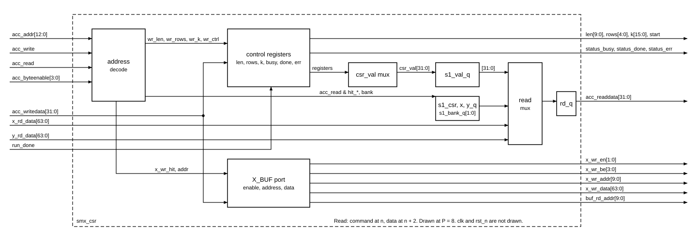

# `smx_csr` — Block design document

| Trường | Giá trị |
|---|---|
| Trạng thái | DRAFT — Chau ủy quyền viết RTL trước khi duyệt (2026-11-03), chưa duyệt |
| File RTL | `rtl/core/smx_csr.sv` |
| Testbench | `tb/tb_smx_csr.sv` |
| Yêu cầu liên quan | REQ-IF-01..03, REQ-IF-06..09, REQ-IF-10, REQ-VER-03, REQ-VER-04 |
| Golden model | Không có số học. Hành vi theo `docs/spec/cross-block.md` mục 4.8 và `docs/requirements.md` mục 5.2 |

## 1. Chức năng

`smx_csr` giữ toàn bộ thanh ghi của IP (CTRL, STATUS, LEN, ROWS, SCALE_K, CYCLE_CNT, HW_PARAM), giải mã cổng `acc_*` thành ba vùng (thanh ghi, X_BUF, Y_BUF) và dựng đường đọc hai tầng với `ACC_RD_LAT = 2`. Block phát `start` một xung cho `smx_ctrl` khi START hợp lệ, nhận `run_done` để hạ BUSY và lên DONE, đếm `CYCLE_CNT`, và đưa cổng ghi X_BUF cùng địa chỉ đọc chung `buf_rd_addr` ra `smx_core`.

Không làm: bộ nhớ X_BUF/Y_BUF (`smx_buf`), mux địa chỉ đọc X_BUF giữa `grp_addr` và `buf_rd_addr` (thuộc `smx_core`, mục 4.10), điều khiển hàng/nhóm (`smx_ctrl`), chuyển đổi sang Avalon. Bản đồ thanh ghi là hợp đồng đóng băng với hai nhóm khác; block này không đổi nó.

## 2. Tham số

| Tham số | Mặc định | Nguồn (smx_pkg) | Ràng buộc |
|---|---|---|---|
| `P` | 8 | `smx_pkg::P` (chỉ mặc định) | ∈ {4, 8, 16}; giá trị khác làm elaboration lỗi (module `smx_csr_unsupported_p` không tồn tại) |
| `N_SEG` | 8 | `smx_pkg::N_SEG` (chỉ mặc định) | ∈ {4, 8, 16}; chỉ dùng cho `HW_PARAM[23:20]` |
| `BANKS` | `P/4` | | dẫn xuất, không ghi đè |
| `ADDR_W` | `$clog2(8192/P)` | | dẫn xuất; P = 4: 11, P = 8: 10, P = 16: 9 |
| `L_MAX`, `R_MAX`, `VERSION`, `L_W`, `R_W`, `K_W` | | `smx_pkg` | hằng của thiết kế, không phải tham số của block |

Các trường log₂ của `HW_PARAM` tính từ `P` và `N_SEG` của chính block, không đọc `smx_pkg::P/N_SEG`, nên `smx_core` đặt P = 16 sẽ thấy đúng giá trị khi đọc.

## 3. Giao diện

| Port | Hướng | Độ rộng | Kiểu | Mô tả |
|---|---|---|---|---|
| `clk`, `rst_n` | in | 1 | | `rst_n` bất đồng bộ, active-low |
| `acc_addr` | in | 13 | word address | |
| `acc_write`, `acc_read` | in | 1 | | |
| `acc_writedata` | in | 32 | | |
| `acc_byteenable` | in | 4 | | |
| `acc_readdata` | out | 32 | | đúng 2 chu kỳ sau `acc_read`; thanh ghi |
| `status_busy/done/err` | out | 1 | | chính các bit STATUS |
| `len` | out | 10 | không dấu | nối thẳng thanh ghi |
| `rows` | out | 5 | không dấu | nối thẳng thanh ghi |
| `k` | out | 16 | UQ0.16 | nối thẳng thanh ghi |
| `start` | out | 1 | | xung một chu kỳ ở chu kỳ đầu BUSY, chỉ khi cấu hình hợp lệ |
| `run_done` | in | 1 | | từ `smx_ctrl` |
| `x_wr_en` | out | `BANKS` | | one-hot, 0 khi BUSY |
| `x_wr_be` | out | 4 | | `acc_byteenable` |
| `x_wr_addr` | out | `ADDR_W` | | `w / BANKS` |
| `x_wr_data` | out | `BANKS×32` | | `acc_writedata` lặp ở mọi bank |
| `buf_rd_addr` | out | `ADDR_W` | | `w / BANKS`, tổ hợp từ `acc_addr` |
| `x_rd_data`, `y_rd_data` | in | `BANKS×32` | | từ `smx_buf`, trễ `BUF_LAT = 1` |

Không có handshake, không stall. Chỉ thanh ghi điều khiển có reset (LEN, ROWS, SCALE_K, BUSY, DONE, ERR, CYCLE_CNT, `start`, các bit chọn nguồn đọc và `acc_readdata`). Thanh ghi dữ liệu của tầng đọc 1 (giá trị CSR, lựa chọn bank) nằm ở khối `always_ff` không reset.

## 4. Hành vi và số học

Không có số học. Mọi phép so sánh là số nguyên không dấu; không có điểm nào cần đối chiếu `softmax_ref.py` dòng-với-dòng. Các điểm nguy hiểm là giải mã địa chỉ và thời điểm.

**Giải mã** (13 bit đầy đủ, không aliasing; `smx_pkg::CSR_*` là offset byte, `acc_addr` là word):

| `acc_addr` | Điều kiện | Vùng |
|---|---|---|
| 0..6 | `acc_addr[12:3] == 0`, `acc_addr[2:0] ≤ 6` | CTRL 0, STATUS 1, LEN 2, ROWS 3, SCALE_K 4, CYCLE_CNT 5, HW_PARAM 6 |
| 7, 8..0x7FF | còn lại của `acc_addr[12:11] == 00` | không định nghĩa |
| 0x800..0xFFF | `acc_addr[12:11] == 01` | X_BUF, `w = acc_addr[10:0]` |
| 0x1000..0x17FF | `acc_addr[12:11] == 10` | Y_BUF, `w = acc_addr[10:0]` |
| 0x1800..0x1FFF | `acc_addr[12:11] == 11` | không định nghĩa |

**START** `= acc_write & addr==0 & be[0] & wd[0]`. Cấu hình hợp lệ: `1 ≤ LEN ≤ 512` và `1 ≤ ROWS ≤ 16` (so sánh trên thanh ghi 10 và 5 bit nên 513, 1023, 17, 31 bị loại).

| Trạng thái khi lệnh | Kết quả từ chu kỳ `n+1` |
|---|---|
| BUSY = 0, cấu hình hợp lệ | BUSY = 1, DONE = 0, ERR = 0, `start` = 1 một chu kỳ, CYCLE_CNT = 0 |
| BUSY = 0, cấu hình sai | DONE = 1, ERR = 1, BUSY = 0, không `start`, CYCLE_CNT = 0 |
| BUSY = 1 (kể cả chu kỳ `run_done`) | bỏ qua |

`run_done` ở chu kỳ `m` khi BUSY = 1: từ `m+1` BUSY = 0, DONE = 1. Quyết định chưa có trong hợp đồng: `run_done` khi BUSY = 0 bị bỏ qua (giữ bất biến DONE và BUSY không cùng 1 bằng cấu trúc, không dựa vào việc `smx_ctrl` không phát nhầm). Một START ở chu kỳ `m+1` thấy BUSY = 0 nên chạy bình thường; tại `m` thì thấy BUSY = 1 và bị bỏ qua.

`CYCLE_CNT` tăng 1 ở mỗi chu kỳ BUSY = 1 kể cả chu kỳ `run_done`, tức bằng số chu kỳ BUSY (`m − n`), và giữ khi BUSY = 0. Nó về 0 ở mỗi START (hợp lệ hay không) khi BUSY = 0. Phép đếm này là phép đo công thức `R·T_row + 1` ở `cross-block.md` mục 5.

**Ghi:** LEN `[7:0]` theo `be[0]`, `[9:8]` theo `be[1]`; ROWS theo `be[0]`; SCALE_K `[7:0]` theo `be[0]`, `[15:8]` theo `be[1]`; cả ba bị bỏ qua khi BUSY = 1. X_BUF: `x_wr_en` bằng 0 khi BUSY = 1. STATUS, CYCLE_CNT, HW_PARAM, Y_BUF, bit khác của CTRL, vùng không định nghĩa: bỏ qua. Bit ngoài độ rộng đọc 0.

**HW_PARAM** `= {VERSION[7:0], log₂N_SEG[3:0], R_MAX[7:0], log₂L_MAX[3:0], P[7:0]}`.

**Bank:** `bank = acc_addr[log₂BANKS-1:0]`, `x_wr_addr = buf_rd_addr = acc_addr[ADDR_W+log₂BANKS-1 : log₂BANKS] = w / BANKS`. P = 4: một bank, không part-select độ rộng 0 (nhánh `generate`).

## 5. Cấu trúc bên trong

FSM trạng thái thực chất là hai bit BUSY/DONE với ERR: IDLE (0,0), BUSY (1,0), DONE (0,1), vì BUSY và DONE loại trừ nhau. Thanh ghi: LEN 10, ROWS 5, K 16, CYCLE_CNT 32, BUSY/DONE/ERR/start, ba bit chọn nguồn, `s1_val_q` 32, `s1_bank_q` `BANKS`, `rd_q` 32. Không có bộ nhớ, không có bộ nhân.

## 6. Timing

- Thanh ghi: lệnh ở `n`, giá trị mới thấy ở `n+1`. START hợp lệ ở `n`: `n+1` có BUSY = 1 và `start` = 1; lệnh đọc STATUS ở `n+1` đã thấy BUSY.
- Đọc: lệnh ở `n`; cuối `n` tầng 1 đăng ký nguồn, bank và giá trị CSR của chu kỳ `n`, trong khi `smx_buf` lấy `buf_rd_addr`; ở `n+1` `rd_data` hợp lệ, tầng 2 chọn nguồn và bank đã đăng ký; `acc_readdata` hợp lệ ở `n+2`. Giá trị thanh ghi là giá trị ở chu kỳ lệnh, nên đọc STATUS cùng chu kỳ với `run_done` vẫn thấy BUSY. Đọc liên tiếp từ nguồn khác nhau đúng vì mọi lựa chọn đi cùng dữ liệu.
- Chu kỳ không có `acc_read` làm `acc_readdata` về 0 (không bắt buộc bởi hợp đồng; tránh rò dữ liệu cũ hoặc X của bộ nhớ chưa ghi).
- Dạng sóng: `docs/spec/wave/smx_csr.json`.
- Đường găng: so sánh LEN/ROWS hợp lệ (10 và 5 bit) vào bit BUSY, và mux `rd_q`; đều nông. Fmax chưa đo (chưa chạy Fitter).

## 7. Tài nguyên ước tính

Số đo thật từ `syn/map_check.sh smx_csr P=4,8,16` (Quartus 18.1 Analysis & Synthesis, 5CSXFC6D6F31C6, chưa phải Fitter):

| P | Thanh ghi | ALUT (Analysis & Synthesis) | DSP | Bit M10K |
|---|---|---|---|---|
| 4 | 134 | 126 | 0 | 0 |
| 8 | 136 | 192 | 0 | 0 |
| 16 | 138 | 259 | 0 | 0 |

ALUT tăng theo P vì mux bank của hai đường đọc và bộ lặp `x_wr_data` ([TK]: phần lớn là mux 32 bit theo `BANKS`). Fmax chưa có.

## 8. Kế hoạch kiểm thử block

`tb/tb_smx_csr.sv` chạy `P ∈ {4, 8, 16}` × `N_SEG ∈ {4, 8, 16}`. Không có file vector: kỳ vọng đến từ một mô hình chu kỳ viết trong testbench từ hợp đồng, cộng các kiểm tra có giá trị chữ (literal) để mô hình không chung lỗi với RTL. `smx_buf` được mô hình hoá bằng thanh ghi trễ một chu kỳ, dữ liệu là hàm riêng của (bank, địa chỉ) cho X và Y.

Có hướng:
- Reset: giá trị sau reset, START ngay sau reset cho ERR, reset bất đồng bộ giữa lần chạy với lệnh đọc đang bay.
- START hợp lệ; sai với L = 0, 513, 1023, R = 0, 17, 31; hợp lệ L = 512, R = 16, L = 1, R = 1; START khi BUSY; START cùng chu kỳ `run_done`; START ngay chu kỳ sau; `be[0] = 0`, `wd[0] = 0`.
- DONE/ERR sticky và xoá bởi START; CYCLE_CNT đếm, giữ, về 0 ở START hợp lệ và sai.
- Byte-enable LEN/ROWS/SCALE_K, bit ngoài độ rộng, ghi bị bỏ qua khi BUSY, ghi STATUS/CYCLE_CNT/HW_PARAM/Y_BUF/vùng không định nghĩa, `0x7FF`, `0x1800`, `0x1FFF`, từ 7, từ 8 (không aliasing).
- HW_PARAM ở từng P, N_SEG, so với giá trị chữ.
- Đường đọc: mọi cặp đọc liên tiếp trên tập địa chỉ gồm CSR, X, Y, vùng không định nghĩa (chọn bank sát biên); ghi X kiểm `x_wr_en` one-hot, địa chỉ, `be`, dữ liệu lặp; đọc STATUS cùng chu kỳ thay đổi.

Ngẫu nhiên: 40 000 lệnh với địa chỉ thiên về CSR, biên vùng, X, Y; byte-enable ngẫu nhiên; `run_done` ngẫu nhiên khi BUSY; reset giữa chừng. Testbench đòi các bộ đếm phủ (START hợp lệ/sai/khi BUSY/cùng `run_done`, đọc từng vùng, đọc liên tiếp, ghi X, ghi bị bỏ qua khi BUSY) đều khác 0 mới PASS.

Kết quả: 9 tổ hợp đều `TB_RESULT: PASS` (khoảng 486 000 đến 500 000 kiểm tra mỗi tổ hợp). Đã làm sai cố ý ba lần, đều ra `FAIL`: dùng bank chưa đăng ký ở tầng 2 (P = 16), `LEN < L_MAX` (P = 8), `HW_PARAM` đọc `smx_pkg::N_SEG` (P = 8, N_SEG = 16), bỏ cổng BUSY ở ghi LEN (P = 4).

## 9. Câu hỏi mở / quyết định cần duyệt

- [ ] **Q1** `run_done` khi BUSY = 0 bị bỏ qua. Khuyến nghị giữ: giữ bất biến DONE và BUSY loại trừ nhau bằng cấu trúc. Cần ghi vào hợp đồng mục 4.8.
- [ ] **Q2** `acc_readdata` về 0 khi chu kỳ lệnh không phải đọc. Khuyến nghị giữ (không vi phạm hợp đồng); nếu nhóm Avalon thích giữ giá trị cũ thì đổi một dòng.
- [ ] **Q3** START khi BUSY = 0 và cấu hình sai cũng xoá `CYCLE_CNT` về 0 (hợp đồng ghi `CYCLE_CNT = 0` cho trường hợp này). Giữ.
- [ ] **Q4** CYCLE_CNT 32 bit không bão hoà; quấn sau 2³² chu kỳ là không đạt tới trong một lần chạy hợp lệ (lớn nhất khoảng 5 000 chu kỳ). Giữ.

## 10. Lịch sử

- 2026-11-03: tạo DRAFT cùng RTL và testbench (Chau ủy quyền viết RTL trước khi duyệt).
