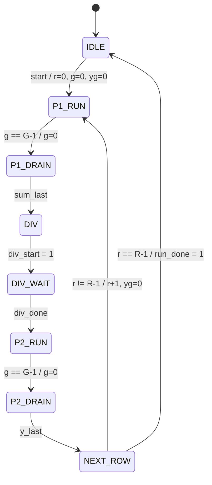

# `smx_ctrl` — Block design document

| Trường | Giá trị |
|---|---|
| Trạng thái | DRAFT — Chau ủy quyền viết RTL trước khi duyệt (2026-11-03), chưa duyệt |
| File RTL | `rtl/core/smx_ctrl.sv` |
| Testbench | `tb/tb_smx_ctrl.sv` |
| Yêu cầu liên quan | REQ-PRF-03 (`CYCLE_CNT`), REQ-FUN-03, REQ-IF-07 (bố trí địa chỉ), REQ-ARI-05 (thứ tự nhóm) |
| Golden model | Không có số học. Phân nhóm `G = ⌈L/P⌉` và mask nhóm cuối khớp cách chia nhóm của `softmax_row(P, n_seg)` trong `model/softmax_ref.py` |

## 1. Chức năng

`smx_ctrl` là bộ tuần tự hàng/nhóm của `smx_core`. Với mỗi hàng nó phát lần lượt các nhóm P phần tử của lượt 1 (thẻ `grp_*`, địa chỉ `{r, g}` cho X_BUF), chờ `sum_last`, phát một xung `div_start`, chờ `div_done`, phát lượt 2, chờ `y_last`, rồi sang hàng sau hoặc phát `run_done`. Nó cũng sinh địa chỉ ghi Y_BUF `y_wr_addr = {r, yg}` từ số `y_valid` đã thấy.

Điều khiển **theo sự kiện** (cross-block mục 1, nguyên tắc 3): không đếm latency của datapath, nên đổi `SCALE_LAT`, `EXP2_LAT`... chỉ cần sửa `smx_pkg`. Không làm: không tính số học, không biết datapath, không quản lý CSR/BUSY (do `smx_csr`).

## 2. Tham số

| Tham số | Mặc định | Nguồn | Ràng buộc |
|---|---|---|---|
| `P` | 8 | `smx_pkg::P` | ∈ {4, 8, 16} |
| `ADDR_W` | `$clog2(8192/P)` = 11, 10, 9 | cross-block 4.7 | độ rộng `{r, g}`; `g` chiếm `ADDR_W − 4` bit (7, 6, 5) |

Nội bộ: `LOGP = $clog2(P)`, `GW = ADDR_W − 4`.

## 3. Giao diện

| Port | Hướng | Độ rộng | Mô tả |
|---|---|---|---|
| `clk`, `rst_n` | in | 1 | reset bất đồng bộ, active-low |
| `start` | in | 1 | xung từ `smx_csr`; chỉ có nghĩa ở IDLE |
| `len` | in | 10 | L ∈ [1, 512], ổn định khi BUSY |
| `rows` | in | 5 | R ∈ [1, 16], ổn định khi BUSY |
| `grp_valid` | out | 1 | 1 đúng ở P1_RUN, P2_RUN |
| `grp_pass2` | out | 1 | trạng thái P2_RUN |
| `grp_first`, `grp_last` | out | 1 | nhóm đầu/cuối của lượt; cả hai = 1 khi G = 1 |
| `grp_en` | out | `P` | `en[j] = (g·P + j < L)` |
| `grp_addr` | out | `ADDR_W` | `{r[3:0], g}` |
| `sum_last` | in | 1 | nhóm cuối lượt 1 đã vào `sum_out` |
| `div_start` | out | 1 | mức 1 một chu kỳ (trạng thái DIV) |
| `div_done` | in | 1 | |
| `y_valid`, `y_last` | in | 1 | |
| `y_wr_addr` | out | `ADDR_W` | `{r, yg}` |
| `run_done` | out | 1 | mức 1 một chu kỳ trong NEXT_ROW của hàng cuối |

Quy ước: các output `grp_*`, `div_start`, `run_done`, `y_wr_addr` là **tổ hợp** từ trạng thái và thanh ghi, không có thanh ghi đầu ra (cross-block 4.9). Ngoài `grp_valid = 1`, RTL ép `grp_pass2/first/last/en = 0` (thừa so với hợp đồng nhưng làm bus sạch; testbench chỉ so các thẻ này khi `grp_valid = 1`). Reset: mọi thanh ghi (trạng thái, `r`, `g`, `yg`) có reset, về IDLE. Tiền điều kiện về sự kiện: mỗi sự kiện đến sau chu kỳ gây ra nó ít nhất 1 chu kỳ (`PIPE_LAT + SUMACC_LAT ≥ 1`, `DIV_LAT ≥ 1`, `PIPE_LAT + NORM_LAT ≥ 1`), đúng với mọi latency thật.

## 4. Hành vi và số học

Không có số học nên không có đối chiếu golden theo dòng. Các công thức hình học, tính bằng thao tác bit, không dùng bộ chia:

| Đại lượng | Công thức RTL | Ghi chú |
|---|---|---|
| `G − 1` | `(len − 1) >> LOGP` | = `⌈L/P⌉ − 1`; 8 bit vì tới 127 ở P = 4 |
| số lane hợp lệ ở nhóm cuối | lane `j` hợp lệ khi `j ≤ (len − 1)[LOGP−1:0]` | nhóm không cuối: tất cả 1 |
| nhóm cuối | `g == G − 1`, so 8 bit (`g` chỉ `GW` bit, được nới) | |
| hàng cuối | `{1'b0, r} == rows − 1`, so 5 bit | `r` 4 bit nhưng R = 16: `r + 1` 4 bit quấn về 0 và không bao giờ bằng R |

Thanh ghi: `r` (4 bit, về 0 khi `start`, +1 ở NEXT_ROW), `g` (về 0 khi `start`, ở nhóm cuối mỗi lượt và ở NEXT_ROW), `yg` (về 0 khi `start` và ở NEXT_ROW, +1 sau mỗi `y_valid` ở **mọi** trạng thái, vì `y_valid` của hàng còn bay trong pipeline khi lượt 2 vẫn đang phát). Nhóm cuối của hàng gửi `y_valid` ở P2_DRAIN, lúc `r` vẫn còn là hàng hiện tại, nên `y_wr_addr` đúng. `y_wr_addr` không được đăng ký: đăng ký sẽ ghi nhóm `g` vào địa chỉ `g+1`.

## 5. Cấu trúc bên trong

Thanh ghi: 3 bit trạng thái (Quartus mã hoá one-hot 8 bit), `r` 4 bit, `g` và `yg` `GW` bit. Không có bộ nhân, RAM.

## 6. Timing

Với `start` ở chu kỳ `n+1` (chu kỳ đầu BUSY), nhóm đầu ở `t0 = n+2`. Các đoạn và công thức `T_row = 2·G + ROW_OVERHEAD`, `CYCLE_CNT = R·T_row + 1` đúng như `cross-block.md` mục 5; testbench đo trực tiếp (số chu kỳ từ chu kỳ `start` tới `run_done` gồm cả hai = `R·T_row + 1`) và so với `smx_pkg::ROW_OVERHEAD` (= 54). Dạng sóng: `docs/spec/wave/smx_ctrl.json` (minh hoạ, thu nhỏ latency).

Đường găng: so sánh `g == G−1` (8 bit, từ `len`) kết hợp lấy `grp_en`; chưa có số Fmax thật vì chưa chạy Fitter (không chạy theo chỉ dẫn). Nếu cần, đăng ký sẵn `G−1` ở chu kỳ `start` (len ổn định khi BUSY) mà không đổi timing đầu ra.

## 7. Tài nguyên ước tính

Số thật từ `quartus_map` (Analysis & Synthesis, 0 error, 0 warning), `syn/map_check.sh smx_ctrl P=4,8,16`:

| P | Combinational ALUT | Registers | Block memory | DSP |
|---|---|---|---|---|
| 4 | 71 | 26 | 0 | 0 |
| 8 | 72 | 24 | 0 | 0 |
| 16 | 79 | 22 | 0 | 0 |

Fmax: chưa đo (cần Fitter).

## 8. Kế hoạch kiểm thử block

`tb/tb_smx_ctrl.sv` mô hình datapath theo hành vi: trễ `grp_*` rồi đưa `sum_last`, `div_done`, `y_valid`, `y_last` trở lại. Độc lập, `build_expected()` tính từ `(L, R)` chu kỳ chính xác của mọi output; mọi chu kỳ được so sánh.

- Phủ: L ∈ {1, 2, P−1, P, P+1, 2P−1, 2P, 2P+1, 63, 64, 65, 127, 128, 129, 256, 511, 512} × R ∈ {1, 2, 3, 15, 16}, ở P = 4, 8, 16, gồm R = 16 với L = 512.
- Kiểm: dãy `(grp_addr, grp_pass2, grp_first, grp_last, grp_en)` mọi nhóm của cả hai lượt mọi hàng; chu kỳ từng sự kiện; `y_wr_addr` đúng chu kỳ `y_valid` và bằng `grp_addr` của nhóm tương ứng; `run_done` đúng một chu kỳ; `div_start` đúng một chu kỳ sau `sum_last`; tổng chu kỳ BUSY `= R·T_row + 1`.
- Ba cấu hình latency (smx_pkg; cực tiểu PIPE = 1, SUMACC = 0, NORM = 0, DIV = 1; lớn PIPE = 20, SUMACC = 7, NORM = 9, DIV = 45) chứng minh không phụ thuộc ngầm vào latency.
- Chạy liên tiếp không reset, khoảng cách 0, 1, 5 chu kỳ giữa hai lần chạy, L và R luôn đổi: không giữ trạng thái cũ.
- Reset giữa lần chạy ở tám điểm (P1_RUN, P1_DRAIN, DIV, DIV_WAIT, P2_RUN, P2_DRAIN, NEXT_ROW hàng 0, hàng 1): output về idle ngay khi hạ `rst_n`, rồi một lần chạy đầy đủ.
- Kết quả đã thấy: PASS ở P = 4, 8, 16, 271 ca mỗi P, 1902 hàng, số chu kỳ kiểm tra 210 700 / 158 902 / 133 002. Đã chứng minh bắt lỗi: sửa `y_wr_addr` thành `yg+1` (27 531 lỗi) và sửa mask lane `<=` thành `<` (FAIL).

## 9. Câu hỏi mở / quyết định cần duyệt

- [ ] Q1. `grp_pass2/first/last/en` được ép 0 khi `grp_valid = 0` (hợp đồng chỉ yêu cầu valid). Khuyến nghị giữ; đổi sang không ép chỉ tiết kiệm vài ALUT.
- [ ] Q2. Có nên đăng ký trước `G−1` ở cạnh `start` nếu Fitter báo đường `len → grp_last/grp_en` không đạt 100 MHz? Khuyến nghị chờ số Fitter của `smx_core`.

## 10. Lịch sử

- 2026-11-03: tạo DRAFT cùng RTL và testbench (Chau ủy quyền viết RTL trước khi duyệt).
