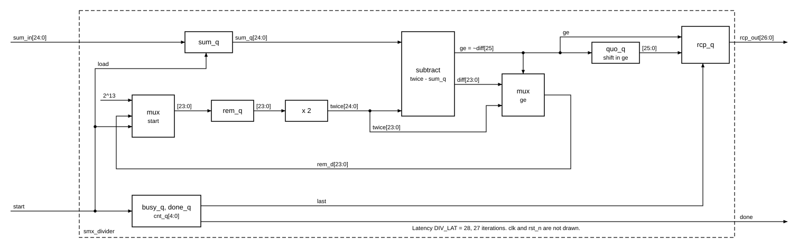
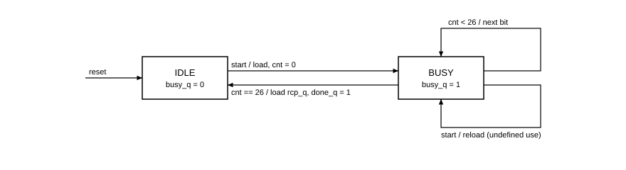

# `smx_divider` — Block design document

| Trường | Giá trị |
|---|---|
| Trạng thái | DRAFT — Chau ủy quyền viết RTL trước khi duyệt (2026-11-03), chưa duyệt |
| File RTL | `rtl/core/smx_divider.sv` |
| Testbench | `tb/tb_smx_divider.sv`, vector từ `model/vec_divider.py` |
| Yêu cầu liên quan | REQ-ARI-06 (Rcp = ⌊2⁴⁰/sum⌋), REQ-PRF-03 (ROW_OVERHEAD), `cross-block.md` mục 4.5 |
| Golden model | `softmax_ref.reciprocal(s)` = `(1 << RECIP_SHIFT) // s` |

## 1. Chức năng

Block tính `Rcp = ⌊2⁴⁰ / sum⌋` một lần mỗi hàng, giữa lượt 1 và lượt 2 (`architecture.md`, đường DIV). Đây là bộ chia khôi phục (restoring) nối tiếp, mỗi chu kỳ ra một bit thương, 27 chu kỳ lặp. Một phép chia mỗi hàng nên không cần pipeline hoá hay chia song song; chi phí là 28 chu kỳ trong `ROW_OVERHEAD`, đã tính sẵn trong `smx_pkg::DIV_LAT`. Block không kiểm khoảng hợp lệ của `sum` (đó là bảo đảm của lõi: `2¹⁴ ≤ sum ≤ 2²⁴`), không xử lý `sum = 0`.

## 2. Tham số

Block không có tham số module, nên không phụ thuộc `P` hay `N_SEG`. Mọi hằng lấy từ `smx_pkg`.

| Hằng | Giá trị | Nguồn (smx_pkg) | Ràng buộc |
|---|---|---|---|
| `SUM_W` | 25 | `SUM_W` | `sum ≤ 2²⁴` cần 25 bit |
| `RCP_W` | 27 | `RCP_W` | số lần lặp; `⌊2⁴⁰/2¹⁴⌋ = 2²⁶` nên 27 bit đủ |
| `RECIP_SH` | 40 | `RECIP_SH` | |
| `REM_INIT` | 2¹³ | `2^(RECIP_SH − RCP_W)` | suy ra, không ghi số 13 |
| `DIV_LAT` | 28 | `DIV_LAT` | `= RCP_W + 1`, testbench kiểm bằng `smx_pkg::DIV_LAT` |

## 3. Giao diện

| Port | Hướng | Độ rộng | Kiểu số | Mô tả |
|---|---|---|---|---|
| `clk` | in | 1 | | |
| `rst_n` | in | 1 | | bất đồng bộ, active-low |
| `start` | in | 1 | | xung một chu kỳ; `sum_in` lấy mẫu tại cạnh clock kết thúc chu kỳ này |
| `sum_in` | in | 25 | không dấu | hợp lệ khi `2¹⁴ ≤ sum ≤ 2²⁴`; không cần giữ ổn định sau chu kỳ `start` |
| `done` | out | 1 | | xung một chu kỳ, đúng `DIV_LAT` chu kỳ sau `start` |
| `rcp_out` | out | 27 | không dấu | hợp lệ từ `done`, giữ nguyên đến `done` kế tiếp |

Handshake là `start`/`done`, không có `ready`: bên gọi (`smx_ctrl`) tự bảo đảm không phát `start` khi đang chia. Quy ước reset: chỉ `busy`, bộ đếm và `done` có reset; thanh ghi dữ liệu không reset (`cross-block.md` mục 1.4). Reset giữa chừng huỷ phép chia đang chạy, `done` về 0 ngay (bất đồng bộ) và không bao giờ lên cho phép chia đó. `rcp_out` không bị xoá bởi reset (là thanh ghi dữ liệu); giá trị chỉ có nghĩa sau `done` đầu tiên sau reset.

**Hai quyết định ghi lại.** (a) `rcp_out` chỉ đổi tại `done`, không đổi trong lúc đang chia: hợp đồng ghi "giữ đến `start` kế tiếp", và đọc chặt nhất là giá trị cũ còn nguyên suốt phép chia mới. Chi phí là thanh ghi 27 bit riêng, tách khỏi thanh ghi dịch thương. (b) `start` khi đang bận (trước `done`) khởi động lại phép chia. Đây là dùng sai theo hợp đồng, nên hành vi chỉ để không treo; `start` ở đúng chu kỳ `done` và ngay sau đó đều hợp lệ và được kiểm.

## 4. Hành vi và số học

Golden model (`softmax_ref.py`, dòng 112–114):

```python
def reciprocal(s):
    return (1 << RECIP_SHIFT) // s
```

Bộ chia khôi phục tính chính xác số này với `rem` khởi tạo `2^(RECIP_SH − RCP_W)`: viết `2⁴⁰ = 2¹³ · 2²⁷`, tức chia số bị chia `2¹³` dịch trái 27 bit mà dịch từng bit một. Mỗi vòng tạo một bit thương từ MSB xuống.

| Bước RTL | Biểu thức | Tương ứng golden |
|---|---|---|
| nạp (cạnh kết thúc chu kỳ `start`) | `sum_q ← sum_in`, `rem_q ← 2¹³`, `cnt ← 0`, `busy ← 1` | `s`, và số bị chia 2⁴⁰ = 2¹³·2²⁷ |
| nhân đôi | `twice = {rem_q, 1'b0}` (25 bit) | dịch số bị chia thêm 1 bit |
| so sánh | `diff = {0,twice} − {0,sum_q}` (26 bit), `ge = ~diff[25]` | `twice ≥ sum` |
| cập nhật dư | `rem_q ← ge ? diff[23:0] : twice[23:0]` | dư của phép `//` |
| bit thương | `quo ← {quo, ge}`, 27 lần | các bit của `⌊2⁴⁰/s⌋`, MSB trước |
| kết thúc (vòng thứ 27) | `rcp_q ← {quo_q, ge}`, `done_q ← 1` | `Rcp` |

Độ rộng. Bất biến `rem < sum ≤ 2²⁴` sau mỗi vòng, nên `rem` đủ 24 bit và `twice` đủ 25 bit; ban đầu `2¹³ < 2¹⁴ ≤ sum` thoả bất biến. Phép trừ 26 bit lấy borrow ở bit 25. Thương không vượt 2²⁶ vì `sum ≥ 2¹⁴`, nên bit thương đầu luôn là 0 hoặc nằm trong 27 bit; không bão hoà, không làm tròn. Hợp đồng ghi đã kiểm vét cạn trên 16 760 833 giá trị của `sum`; testbench này kiểm bằng vector (mục 8), không lặp lại vét cạn.

## 5. Cấu trúc bên trong





Thanh ghi: `sum_q` 25, `rem_q` 24, `quo_q` 26 (bit thương thứ 27 đi thẳng vào `rcp_q`), `rcp_q` 27, `cnt_q` 5, `busy_q`, `done_q`: tổng 109. Không có bộ nhân, không RAM. Thanh ghi dữ liệu `rem_q`, `quo_q` chạy tự do (không cần enable) khi rảnh; giá trị rác đó không bao giờ vào `rcp_q`.

## 6. Timing

Với `start` ở chu kỳ `s`: nạp ở cạnh cuối `s`; vòng lặp ở cạnh cuối `s+1 … s+27` (27 cạnh); `done` và `rcp_out` cuối cùng thấy ở `s+28 = s + DIV_LAT`. `done` rộng một chu kỳ; `start` mới được nhận ở `s+28` (cùng chu kỳ `done`) hoặc muộn hơn. Dạng sóng: `docs/spec/wave/smx_divider.json`.

Đường găng: `rem_q → twice → trừ 26 bit → mux → rem_q`, một bộ cộng/trừ 26 bit cộng một mux; dự kiến [TK] thoải mái ở 100 MHz trên Cyclone V (chuỗi carry ngắn), chưa đo. Số Fmax thật sẽ lấy từ lần tổng hợp lõi trong `syn/`.

## 7. Tài nguyên ước tính

Số đo thật bằng `quartus_map` (Analysis & Synthesis, `syn/map_check.sh smx_divider`, Cyclone V 5CSXFC6D6F31C6): 60 ALUT tổ hợp, 109 thanh ghi, 0 DSP, 0 bit bộ nhớ, 0 cảnh báo. Chưa chạy Fitter nên chưa có Fmax [TK]. 109 thanh ghi khớp với cộng tay ở mục 5.

## 8. Kế hoạch kiểm thử block

Vector sinh bởi `model/vec_divider.py` (gọi qua `model/gen_vectors.py divider`), mọi giá trị kỳ vọng từ `softmax_ref.reciprocal`. Mỗi dòng `sum rcp`.

| Tập | Nội dung | Số phép chia |
|---|---|---|
| t1 | 300 giá trị sát mỗi đầu `2¹⁴`, `2²⁴` (gồm `2¹⁴`, `2¹⁴+1`, `2²⁴`, `2²⁴−1`); mọi `2ᵏ + d`, `k = 14..24`, `d = −3..3`; các `sum` quanh `⌊2⁴⁰/q⌋ ± 2` với `q = 2ʲ + {−2..2}` (j = 0..26) và mẫu bit xen kẽ (ranh giới mẫu bit của thương); `2ᵏ − 1` và mẫu xen kẽ | 773 |
| t2 | 20 000 `sum` đều trên `[2¹⁴, 2²⁴]` xen kẽ 20 000 `sum` log-đều (`2^e`, `e ∈ [14, 24]`) | 40 000 |

Kiểm tra mỗi chu kỳ bằng scoreboard (không chỉ ở thời điểm `done`): `done` bằng 1 đúng ở `s + DIV_LAT` và 0 ở mọi chu kỳ khác (xung một chu kỳ); tại `done`, `rcp_out` bằng giá trị golden; giữa các `done`, `rcp_out` giữ nguyên (đây là phép kiểm "hold" chạy ở hơn một triệu chu kỳ). Khoảng cách giữa hai `start` luân phiên: cùng chu kỳ `done`, ngay sau `done`, và 0..4 chu kỳ rảnh. `sum_in` chỉ đúng ở chu kỳ `start`; ở mọi chu kỳ khác lái giá trị rác (ngẫu nhiên, toàn 1, toàn 0, hoặc X), nên lỗi lấy mẫu `sum_in` sau `start` sẽ lộ ra (đã thử bằng lỗi cố ý).

Reset (T-reset): reset bất đồng bộ giữa chừng ở các độ lệch 1, 5, 14, 27, 28, 29 chu kỳ sau `start` (27 là ngay trước cạnh lặp cuối, 28 là chu kỳ có `done`). Sau reset: `done` bằng 0 ngay, `done` không lên suốt `DIV_LAT + 4` chu kỳ, rồi hai `start` liên tiếp cho kết quả đúng.

Tiêu chí đạt: 0 sai khác trên 40 786 phép chia kể cả bộ reset, `TB_RESULT: PASS`. Đã chứng minh bắt lỗi bằng hai lỗi cố ý (đổi `>=` thành `>`; lấy mẫu `sum_in` liên tục trong lúc chia), cả hai cho `TB_RESULT: FAIL`.

## 9. Câu hỏi mở / quyết định cần duyệt

- [ ] `rcp_out` chỉ đổi tại `done` (thanh ghi 27 bit riêng, +27 thanh ghi) hay cho đổi trong lúc chia để tiết kiệm? Khuyến nghị giữ như hiện tại: `smx_norm` chỉ dùng `rcp_in` ở lượt 2 nên cả hai đều đúng, nhưng chỉ phương án này không lộ giá trị trung gian ra dây.
- [ ] `start` khi đang bận hiện khởi động lại phép chia. Nếu muốn bỏ qua `start` thay vì khởi động lại, đổi một dòng; khuyến nghị giữ nguyên vì `smx_ctrl` không bao giờ làm vậy.
- [ ] Thực tế `sum` chỉ tới `2²⁴` khi `K = 0`; hợp đồng giữ cận 2²⁴, RTL theo hợp đồng.

## 10. Lịch sử

- 2026-11-03: tạo DRAFT, RTL và testbench viết trước khi duyệt theo uỷ quyền của Chau.
