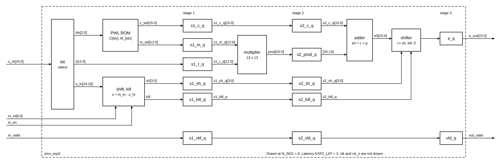

# `smx_exp2` — Block design document

| Trường | Giá trị |
|---|---|
| Trạng thái | **APPROVED** (2026-10-31, Chau duyệt) |
| File RTL | `rtl/core/smx_exp2.sv` |
| Testbench | `tb/tb_smx_exp2.sv` |
| Yêu cầu liên quan | REQ-ARI-03, REQ-ARI-04, REQ-ARI-05, REQ-ARI-07, REQ-FUN-03, REQ-IMP-03, REQ-PRF-01, REQ-PRF-02 |
| Golden model | `exp2_neg(d, n_seg, table)` (dòng 54–68), gọi với `d = u − (M << 16)` ở lượt 1 (dòng 94) và lượt 2 (dòng 102) trong `model/softmax_ref.py` |

## 1. Chức năng

Một lane tính `E = 2^(d/2¹⁶)` ở dạng UQ1.15 cho `d = u − M·2¹⁶ ≤ 0`: tách phần nguyên và phần lẻ, tra bảng PWL N_SEG đoạn cho `2^F`, nội suy bằng một phép nhân, dịch phải `−I` bit, và trả 0 khi `−I > 15`.

Vị trí trong datapath (`docs/spec/architecture.md` mục 2): sau `smx_scale` (nhận `u`) và `smx_maxtree` (nhận `M`); đầu ra đi vào `smx_sumacc` ở lượt 1 và `smx_norm` ở lượt 2. Block **dùng chung cho cả hai lượt**; chỉ nguồn M (Mnew đang chạy hay M cuối hàng) và đích của E thay đổi, do `smx_core` và `smx_ctrl` quyết định.

Module là **một lane**; `smx_core` sinh P bản bằng `generate`, cùng chung `m_in` (câu hỏi mở Q1).

Không làm: tính `u` hay `c`, tìm max, cộng dồn, chuẩn hoá. Không có trạng thái giữa các phần tử (thuần pipeline).

## 2. Tham số

| Tham số | Mặc định | Nguồn (smx_pkg) | Ràng buộc |
|---|---|---|---|
| `N_SEG` | 8 | `smx_pkg::N_SEG` | ∈ {4, 8, 16}; cần bảng tương ứng trong `smx_pkg` (Q5) |
| `SEG_W` (localparam) | 3 | `$clog2(N_SEG)` | |
| `R_BITS` (localparam) | 13 | `U_FRAC − SEG_W` | độ rộng `r` và của hệ số `M_[i]` |
| `U_W` | 25 | `smx_pkg::U_W` | `u` có dấu Q8.16 |
| `C_W` | 9 | `smx_pkg::C_W` | `M` có dấu |
| `E_W` | 16 | `smx_pkg::E_W` | `E` UQ1.15 |
| `EXP_CUTOFF` | 15 | `smx_pkg::EXP_CUTOFF` | cố định 15 vì `E₀ < 2¹⁶` |
| `EXP2_LAT` (mới) | 3 | thêm vào `smx_pkg` | latency cố định; `smx_core` dùng để căn pipeline (Q2, `cross-block.md` mục 1) |

## 3. Giao diện

| Port | Hướng | Độ rộng | Kiểu số | Mô tả |
|---|---|---|---|---|
| `clk` | in | 1 | | clock duy nhất |
| `rst_n` | in | 1 | | reset bất đồng bộ, active-low |
| `in_valid` | in | 1 | | có phần tử ở chu kỳ này |
| `in_en` | in | 1 | | lane hợp lệ (`k < L`); 0 → đầu ra E = 0 |
| `u_in` | in | 25 | signed Q8.16 | `u = q·K` từ `smx_scale` |
| `m_in` | in | 9 | signed, số nguyên | M (lượt 1: Mnew của nhóm; lượt 2: M cuối hàng). Cùng chu kỳ với `u_in` |
| `out_valid` | out | 1 | | `in_valid` trễ đúng `EXP2_LAT` chu kỳ |
| `e_out` | out | 16 | UQ1.15, không dấu | E; bằng 0 khi `in_en = 0` hoặc cutoff |

Handshake: **pipeline cố định, không stall**, throughput 1 phần tử/chu kỳ/lane. `out_valid` là `in_valid` trễ `EXP2_LAT`; `e_out` chỉ có nghĩa khi `out_valid = 1`. Không có backpressure: `smx_ctrl` bảo đảm phía sau luôn nhận được.

Reset: chỉ chuỗi valid có reset (`rst_n` → `out_valid = 0`); thanh ghi dữ liệu không reset (Q7).

Tiền điều kiện (do `smx_core` bảo đảm, verify bằng assertion): khi `in_valid & in_en`, `m_in ≥ ⌈u_in/2¹⁶⌉`, tức `d ≤ 0`.

## 4. Hành vi và số học

### 4.1. Biến đổi tương đương dùng trong RTL

Vì `M·2¹⁶` có 16 bit thấp bằng 0, phép trừ `d = u − M·2¹⁶` **không mượn** từ 16 bit thấp:

- `F = d[15:0] = u[15:0]` — không phụ thuộc M.
- `I = d >> 16 = u[24:16] − M` — chỉ là phép trừ 9 bit.

RTL dùng trực tiếp `s = M − u[24:16] = −I` (lượng dịch), nên không cần phép đảo dấu.

Độ rộng: `u[24:16] ∈ [−128, 126]`, `M ∈ [−127, 127]` (mọi K, q hợp lệ) → `s ∈ [−253, 255]`, vừa 9 bit có dấu, **không tràn với mọi đầu vào** kể cả lane rác. [GM: phạm vi tính từ `ceil_q16` với K = 65535, q = −128/127]

### 4.2. Đối chiếu từng bước với golden model

| Bước | Golden (`exp2_neg`) | RTL | Ghi chú |
|---|---|---|---|
| 1 | `I = d >> 16` | `s = m_in − u_in[24:16]` (9 bit) | `s = −I` |
| 2 | `F = d & 0xFFFF` | `F = u_in[15:0]` | §4.1 |
| 3 | `idx = F >> r_bits` | `idx = u_in[15 −: SEG_W]` | N = 8: `u_in[15:13]` |
| 4 | `r = F & (2^r_bits − 1)` | `r = u_in[R_BITS−1:0]` | N = 8: `u_in[12:0]` |
| 5 | `E = c[idx] + ((m[idx]·r) >> r_bits)` | `e0 = C[idx] + prod[2·R_BITS−1 : R_BITS]`, `prod = M_[idx]·r` không dấu | dịch là cắt bỏ (floor), không làm tròn |
| 6 | `sh = −I`; `if sh > 15: return 0` | `kill = ~in_en \| (s[8:4] ≠ 0)` | `s[8:4] = 0` ⇔ `s ∈ [0, 15]` |
| 7 | `return E >> sh` | `e_out = kill ? 0 : e0 >> s[3:0]` | dịch logic (E không âm) |

`s[8:4] ≠ 0` gồm cả `s < 0` (tức `d > 0`). Với lane hợp lệ điều này không xảy ra (tiền điều kiện mục 3); với lane rác (`in_en = 0`) đầu ra đã bằng 0. RTL trả 0 cho `d > 0` là hành vi **ngoài miền** của golden (golden `assert d ≤ 0`), chỉ để không có giá trị lạ trên bus.

### 4.3. Độ rộng và giới hạn đã kiểm bằng golden model

Đo bằng script kiểm (2026-10-31), [GM]:

| Đại lượng | N_SEG = 4 | 8 | 16 | Kết luận |
|---|---|---|---|---|
| `R_BITS` | 14 | 13 | 12 | `16 − SEG_W` |
| bit của `max M_[i]` | 14 (10427) | 13 (5439) | 12 (2779) | `M_` vừa đúng `R_BITS` bit → nhân `R_BITS × R_BITS` không dấu |
| bit của `prod` | 28 | 26 | 24 | |
| `max E₀` | 65535 | 65535 | 65535 | phép cộng 16 bit **không có carry ra** |

- Trên toàn bộ `d ∈ [−17·2¹⁶, 0]` (1 114 113 điểm, N = 8): `max E = 32768 = 2¹⁵`, đạt duy nhất tại `d = 0`. Với `d ∈ (−2¹⁶, 0]`: `E ≥ 16384`. Tại `I = −15`: `E ≤ 1`; tại `I = −16`: `E = 0` (cutoff).
- 300 000 cặp `(u, M)` hợp lệ ngẫu nhiên: dạng tách bit ở §4.1 khớp `exp2_neg(u − (M << 16))`, **0 sai khác**.

Hệ quả cho block sau (ghi lại, không quyết ở đây): `E ≤ 2¹⁵` nên `sum ≤ L_MAX·2¹⁵ = 2²⁴` (25 bit); `SUM_W` đã giảm từ 26 xuống 25 trong `smx_pkg` (`open-decisions.md` B1).

### 4.4. Lane không hợp lệ

`in_en = 0` → `e_out = 0` bất kể `u_in`, `m_in`. Nhờ vậy `smx_sumacc` cộng thẳng P lane mà không cần mask, đúng REQ-FUN-03 ở lượt 1. Ở lượt 2, `y` của lane `k ≥ L` là không xác định theo REQ-FUN-03 nên E = 0 không gây hại.

## 5. Cấu trúc bên trong

Pipeline 3 tầng, căn theo khối DSP (thanh ghi đầu vào và đầu ra của bộ nhân).

Thanh ghi (độ rộng ở N_SEG = 8):

| Tầng | Thanh ghi | Bit |
|---|---|---|
| 1 | `s1_c_q` 16, `s1_m_q` 13, `s1_r_q` 13, `s1_sh_q` 4, `s1_kill_q` 1, `s1_vld_q` 1 | 48 |
| 2 | `s2_prod_q` 26 (trong DSP nếu Quartus gói được), `s2_c_q` 16, `s2_sh_q` 4, `s2_kill_q` 1, `s2_vld_q` 1 | 48 |
| 3 | `e_q` 16, `vld_q` 1 | 17 |

`s1_m_q` và `s1_r_q` là thanh ghi đầu vào của bộ nhân, `s2_prod_q` là thanh ghi đầu ra, để Quartus đặt cả ba vào khối DSP (CLAUDE.md: đăng ký đầu vào/đầu ra bộ nhân). Chỉ 13 bit cao của `s2_prod_q` được dùng; Quartus tự bỏ phần còn lại ngoài DSP.

ROM: 8 entry × (16 + 13) bit, là hàm 3 biến của `idx` → mỗi bit đầu ra một LUT; không dùng M10K (Q6). Mọi `C[i] ≥ 32768` nên bit 15 của C luôn bằng 1 và Quartus bỏ thanh ghi đó (thấy trong probe mục 5.1).

### 5.1. Tổng hợp được trên Quartus Prime Lite 18.1

**Đã kiểm** bằng một module probe nhỏ, chạy `quartus_map` (Analysis & Synthesis) trên 5CSXFC6D6F31C6 ngày 2026-10-31: 0 lỗi; các warning chỉ do probe để thừa chân. Probe chỉ nằm trong scratchpad, không thuộc repo.

| Cấu trúc dự định dùng | Kết quả |
|---|---|
| Bảng `localparam logic [15:0] PWL_C_N8 [8] = '{…}` (unpacked) trong `smx_pkg`, đọc bằng chỉ số biến | Qua; ra LUT |
| `module … import smx_pkg::*; #(…) (…)` (import ở header) | Qua |
| `generate if (N_SEG == …)` chọn bảng | Qua |
| N_SEG không hỗ trợ → nhánh `else` khởi tạo module không tồn tại `smx_exp2_unsupported_n_seg` | Báo `Error (12006)` lúc elaboration, đúng ý: chặn cấu hình sai mà không cần `$error` |
| `m_in − $signed(u_in[24:16])` 9 bit | Qua |
| `a * b` không dấu 13×13, có thanh ghi trước và sau | Qua; báo cáo: 1 DSP block, "Fixed Point Unsigned Multiplier" |

**Chưa kiểm:** thanh ghi trước và sau bộ nhân có được gói vào DSP không. Ở bước Analysis & Synthesis, probe báo 75 dedicated logic register, tức gần như chưa gói. Phải xem báo cáo DSP của Fitter khi biên dịch đủ `smx_exp2` trong `syn/`. Nếu không gói được, đường FF → DSP → FF vẫn là một tầng riêng, nên không đổi latency hay kết quả.

**Quy tắc viết RTL rút ra** (bổ sung cho quy ước trong `CLAUDE.md`):

1. Part-select luôn là **unsigned** trong SystemVerilog (`u_in[24:16]` mất dấu), nên ép kiểu bằng `$signed()`. Bit kết quả của phép trừ 9 bit giống nhau dù diễn giải có dấu hay không (§4.1 đã chứng minh không tràn); ép kiểu chỉ để code đọc đúng ý.
2. Chuỗi valid nằm trong một `always_ff @(posedge clk or negedge rst_n)`. Thanh ghi dữ liệu nằm ở một `always_ff @(posedge clk)` **riêng**. Nếu trộn chung một khối có reset mà không gán dữ liệu ở nhánh reset, Quartus sẽ suy ra logic giữ giá trị (clock enable) trên đường dữ liệu và có thể không gói được thanh ghi vào DSP.
3. Khai báo `prod` rộng đúng `2·R_BITS` bit, gán từ toán hạng `R_BITS` bit, để phép nhân không bị cắt theo độ rộng ngữ cảnh. Lấy `prod[2·R_BITS−1 : R_BITS]` cho phép dịch.
4. Barrel shifter viết `e0 >> sh` với `sh` 4 bit; không tự viết mux.
5. Không `initial`, `$display`, `$error`, SVA trong file tổng hợp. Assertion ở mục 8 đặt trong `tb/` hoặc file `*_bind.sv`.
6. Thứ tự file: `rtl/pkg/smx_pkg.sv` trước `rtl/core/smx_exp2.sv`, cả trong Quartus lẫn `vlog`.

Ở bước RTL, `smx_exp2.sv` phải qua `quartus_map` với 0 lỗi ở N_SEG = 4/8/16 trước khi coi là xong, cùng với unit test trên ModelSim ASE 18.1 (đã có trên máy).

## 6. Timing

- **Latency:** `EXP2_LAT = 3` chu kỳ từ cạnh lấy mẫu `in_valid` tới `out_valid`. **Throughput:** 1 phần tử/chu kỳ/lane, không bong bóng.
- **Dạng sóng:** `docs/spec/wave/smx_exp2.json` — ba phần tử liền nhau (phần tử thứ ba là lane bị mask → E = 0), một chu kỳ trống, rồi hai phần tử với M mới.
- **Đường găng dự kiến (100 MHz):**
  1. Tầng 3: cộng 16 bit → barrel shifter 4 mức → mux kill → thanh ghi. Đây là đường dài nhất của block, ước lượng còn dư so với 10 ns [TK]. Dự phòng: tách cộng và dịch thành hai tầng → `EXP2_LAT = 4`; tốn thêm 2 chu kỳ/hàng (một ở mỗi lượt), không đổi kết quả.
  2. Tầng 2: bộ nhân 13×13 có thanh ghi vào/ra trong DSP — không phải đường găng nếu Quartus gói được thanh ghi vào DSP [ĐC: cần đối chiếu Fmax của DSP Cyclone V −6 trong datasheet].
  3. Tầng 1: ROM 3 biến song song với phép trừ 9 bit → so sánh 5 bit; ngắn.
- **Ràng buộc với block khác:** `m_in` phải đến **cùng chu kỳ** với `u_in`. Ở lượt 1, `smx_core` phải trễ `u` của nhóm cho bằng latency của `smx_maxtree` để Mnew đi cùng nhóm (architecture mục 4.1). Vì F không phụ thuộc M, có thể cho M đến muộn hơn một chu kỳ để giảm đường trễ `u` (Q4).

## 7. Tài nguyên ước tính

Tất cả là [TK], chưa tổng hợp; thay bằng số Fitter khi có.

| Tài nguyên | Mỗi lane | × P = 8 | Ghi chú |
|---|---|---|---|
| Bộ nhân | 1 × (13×13 không dấu) | 8 | số khối DSP phụ thuộc chế độ ghép của DSP Cyclone V [ĐC: cần đối chiếu]; ước 4–8 khối |
| ALUT | ~80–100 | ~650–800 | ROM ~29, trừ 9 bit ~10, cộng 16 bit ~16, barrel 16 bit ~32, điều khiển ~5 |
| Thanh ghi | ~85–115 | ~700–900 | ~113 bit mục 5, trừ phần Quartus đưa vào DSP; chuỗi valid có thể được gộp giữa các lane |
| M10K | 0 | 0 | |

Số đo một lane từ `syn/map_check.sh` (Quartus 18.1 Lite, chỉ Analysis & Synthesis, 2026-11-03). Đây chưa phải số Fitter, và chưa có Fmax:

| N_SEG | ALUT logic | Thanh ghi | Khối DSP |
|---|---|---|---|
| 4 | 77 | 72 | 1 |
| 8 | 93 | 94 | 1 |
| 16 | 95 | 95 | 1 |

## 8. Kế hoạch kiểm thử block

Testbench `tb/tb_smx_exp2.sv` đọc file vector `(in_valid, in_en, u_in, m_in, e_expected)` sinh từ golden model, đưa vào DUT 1 vector/chu kỳ và so `e_out` với kỳ vọng khi `out_valid = 1`. Vector sinh bằng script mới `model/gen_vectors.py exp2 --n-seg N` (import `softmax_ref`, không đổi số học của model; Q8) vào `tb/vectors/smx_exp2/p
_n<N>/t1.hex … t4.hex`. Mỗi dòng: `valid en u m e` ở dạng hex (bù hai theo độ rộng port); dòng bắt đầu bằng `#` là chú thích. Chạy cả ba N_SEG: `cd sim && make regress` (mặc định 4 8 16).

| Tập | Nội dung | Số vector |
|---|---|---|
| T1 vét cạn | mọi `d ∈ [−17·2¹⁶, 0]` (đủ mọi F với mỗi lượng dịch 0..15 và dải cutoff đầu tiên), mỗi d tách thành một cặp `(u, M)` hợp lệ ngẫu nhiên | 1 114 113 |
| T2 ngẫu nhiên | `(q, K, M)` ngẫu nhiên toàn dải hợp lệ, `u = q·K`, `M ≥ ⌈u/2¹⁶⌉` (gồm dịch sâu tới `I = −255`) | 100 000 |
| T3 corner | `d = 0`, `d = −1`; biên đoạn PWL (`r = 0`, `r = 2^R_BITS − 1` ở mỗi `idx`); `I = −15/−16`; `q = −128, 127` với `K = 65535`; `M = −127, 127`; `K = 0` | ~200 |
| T4 lane mask | `in_en = 0` với `u_in`, `m_in` ngẫu nhiên, gồm cả `d > 0` → kỳ vọng 0 | 10 000 |
| T5 handshake | `in_valid` liền nhau, có lỗ, ngẫu nhiên 50 %; kiểm `out_valid` trễ đúng `EXP2_LAT` và số phần tử ra bằng số phần tử vào | trộn vào T2 |
| T6 reset | `rst_n` xuống giữa luồng → `out_valid = 0` ngay; luồng sau reset vẫn đúng | 1 kịch bản |

Tiêu chí đạt: **0 sai khác** trên T1–T4; `out_valid` khớp chính xác T5–T6. Nếu tham số hoá N_SEG (Q5): chạy lại T1–T3 ở N_SEG = 4 và 16.

Assertion đề xuất cho nhóm verify (file bind riêng, không ở file tổng hợp): `in_valid & in_en |-> m_in ≥ ⌈u_in/2¹⁶⌉`; `out_valid == $past(in_valid, EXP2_LAT)`; `out_valid |-> !$isunknown(e_out)`.

## 9. Câu hỏi mở / quyết định cần duyệt

- [x] **Q1** Module một lane, `smx_core` sinh P bản. **Chau duyệt 2026-10-31.**
- [x] **Q2** `EXP2_LAT = 3`, tầng 3 gồm cộng + dịch. `EXP2_LAT` thêm vào `smx_pkg`; `smx_ctrl` và `smx_core` chỉ đọc hằng này. Nếu tổng hợp không đạt 100 MHz thì tách thành 4 tầng (+2 chu kỳ/hàng, kết quả không đổi). **Chau duyệt 2026-10-31.**
- [x] **Q3** Mask lane trong `smx_exp2`: `in_en = 0` → E = 0 (gộp vào `kill`, không tốn tầng). `smx_sumacc` cộng thẳng P lane, không cần mask riêng. **Chau giao Claude chọn, 2026-10-31.**
- [x] **Q4** Phương án A: `m_in` đến cùng chu kỳ với `u_in`; `smx_core` trễ `u` theo latency của `smx_maxtree` ở lượt 1. Phương án M đến muộn (tiết kiệm ~130 FF và ~1 chu kỳ/hàng) để dành nếu ngân sách latency của `smx_core` căng. **Chau duyệt 2026-10-31.**
- [x] **Q5** Tham số hoá N_SEG ∈ {4, 8, 16}; giá trị nộp vẫn là 8 (B5). Thêm `PWL_C/M_N4`, `PWL_C/M_N16` sinh bằng `--gen-pwl` vào `smx_pkg`; T1–T3 chạy ở cả ba giá trị. Lý do: kế hoạch tuần 8 quét N_SEG, `HW_PARAM` đã có trường log₂N_SEG, REQ-ARI-04 viết tổng quát theo N_SEG, và RTL vốn đã suy độ rộng từ `SEG_W`. **Chau giao Claude chọn, 2026-10-31.**
- [x] **Q6** ROM lấy từ hằng `localparam` trong `smx_pkg` (LUT, không M10K). Đã kiểm tổng hợp được (mục 5.1). **Chau duyệt 2026-10-31.**
- [x] **Q7** Thanh ghi dữ liệu không reset; chỉ chuỗi valid có reset, viết ở hai khối `always_ff` riêng (mục 5.1, quy tắc 2). **Chau duyệt 2026-10-31.**
- [x] **Q8** Vector sinh lúc chạy bằng `model/gen_vectors.py`, không commit; thêm mẫu file vector vào `.gitignore` ở bước RTL. **Chau duyệt 2026-10-31.**

## 10. Lịch sử

- 2026-10-31: tạo DRAFT (Claude Code). Kiểm số học bằng golden model: dạng tách bit §4.1, độ rộng §4.3.
- 2026-10-31: chốt Q1 (một lane) và Q5 (tham số hoá N_SEG 4/8/16).
- 2026-10-31: chốt Q2 (3 tầng), Q4 (A), Q6–Q8 theo đề xuất. Thêm mục 5.1: kiểm cấu trúc SV bằng Quartus 18.1 Lite và quy tắc viết RTL để tổng hợp được.
- 2026-10-31: chốt Q3 (mask trong `smx_exp2`). Mọi câu hỏi mở đã trả lời.
- 2026-10-31: **APPROVED** (Chau). Viết RTL `rtl/core/smx_exp2.sv`, testbench `tb/tb_smx_exp2.sv`, script `tb/run_smx_exp2.sh`, bộ sinh vector `model/gen_vectors.py`; thêm `EXP2_LAT` và bảng PWL N = 4/16 vào `smx_pkg`. Chưa compile/mô phỏng (Chau chạy).
- 2026-11-03: **UT-PASS** (số từ mô phỏng thật). `make regress` trong `sim/` (ModelSim ASE 10.5b): 0 sai khác ở N_SEG = 4, 8, 16 (1 224 196 / 1 224 228 / 1 224 292 phần tử). `tb/run_smx_exp2.sh` được thay bằng flow `sim/`. `syn/map_check.sh smx_exp2 N_SEG=4,8,16` đạt, 0 lỗi, 0 cảnh báo (số ở mục 7).
