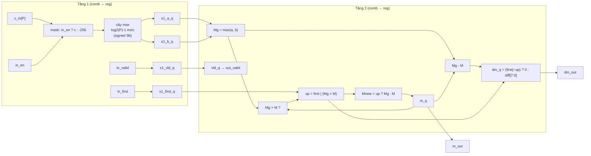

# `smx_maxtree` — Block design document

| Trường | Giá trị |
|---|---|
| Trạng thái | DRAFT — Chau ủy quyền viết RTL trước khi duyệt (2026-11-03), chưa duyệt |
| File RTL | `rtl/core/smx_maxtree.sv` |
| Testbench | `tb/tb_smx_maxtree.sv`, vector từ `model/vec_maxtree.py` |
| Yêu cầu liên quan | REQ-ARI-02, REQ-ARI-05, REQ-FUN-03, REQ-PRF-01, REQ-PRF-02 (số học IntMax và online normalization); hợp đồng `docs/spec/cross-block.md` mục 4.2 |
| Golden model | `softmax_row` trong `model/softmax_ref.py`: `Mg` (dòng 91), `Mnew` (92), `dM` (93), `M = Mnew` (96); các giá trị theo nhóm nằm ở `info["groups"]` (dòng 97) |

## 1. Chức năng

Block nhận một nhóm P giá trị `c = ⌈u/2¹⁶⌉` mỗi chu kỳ, tìm max của các lane hợp lệ (`Mg`), cập nhật max chạy của hàng `M`, và đưa ra `Mnew` cùng bước nhảy `dM = Mnew − M`. `m_out` đi vào `smx_exp2` để mỗi nhóm tính E theo `Mnew` của chính nó (REQ-ARI-05); `dm_out` đi qua đường trễ `EXP2_LAT` đến `smx_sumacc` để dịch tổng cũ.

Vị trí trong datapath (`architecture.md` mục 2, `cross-block.md` mục 2): sau `smx_scale` (nhận `c`), song song với đường trễ của `u`. Chỉ hoạt động ở lượt 1. Ở lượt 2 `in_valid = 0`, block giữ `m_out` là M cuối hàng, và cùng dây đó cấp M cho `smx_exp2`.

Không làm: tính `c`, tính E, cộng dồn, đếm nhóm. Block không biết lượt hay hàng; nó chỉ tin `in_valid`, `in_first`, `in_en` do `smx_core` rút từ thẻ sideband.

## 2. Tham số

| Tham số | Mặc định | Nguồn (smx_pkg) | Ràng buộc |
|---|---|---|---|
| `P` | 8 | `smx_pkg::P` (chỉ là mặc định) | ∈ {4, 8, 16}; luỹ thừa của 2, `P ≥ 4` |
| `LV` (localparam) | `log₂P − 1` | | số mức so sánh ở tầng 1 (1, 2, 3 ở P = 4, 8, 16) |
| `C_W` | 9 | `smx_pkg::C_W` | `c` và `M` có dấu |
| `DM_W` | 8 | `smx_pkg::DM_W` | `dM ∈ [0, 254]` |
| `MAXTREE_LAT` | 2 | `smx_pkg::MAXTREE_LAT` | latency cố định; `smx_core` dùng để căn `u` và sideband |

## 3. Giao diện

| Port | Hướng | Độ rộng | Kiểu số | Mô tả |
|---|---|---|---|---|
| `clk` | in | 1 | | clock duy nhất |
| `rst_n` | in | 1 | | reset bất đồng bộ, active-low; chỉ xoá chuỗi valid |
| `in_valid` | in | 1 | | có nhóm ở chu kỳ này; chỉ lên ở lượt 1 |
| `in_first` | in | 1 | | nhóm đầu của hàng; **chỉ có nghĩa khi `in_valid = 1`** |
| `in_en` | in | `P` | | lane hợp lệ (`k < L`); lane 0 luôn hợp lệ khi `in_valid = 1` |
| `c_in` | in | `P × 9` | signed, mỗi lane 9 bit, lane 0 ở bit thấp | lane có `in_en = 0` có thể là rác hoặc X, không ảnh hưởng gì |
| `out_valid` | out | 1 | | `in_valid` trễ đúng `MAXTREE_LAT` |
| `m_out` | out | 9 | signed | `Mnew` của nhóm; giữ nguyên khi không có nhóm mới |
| `dm_out` | out | 8 | không dấu | `Mnew − M`; 0 ở nhóm đầu; có nghĩa khi `out_valid = 1` |

Handshake: pipeline cố định, không stall, một nhóm mỗi chu kỳ. Reset: chỉ `s1_vld_q`, `vld_q` có reset; thanh ghi dữ liệu (kể cả `m_q`, `dm_q`) không reset (cross-block mục 1, quy tắc 4). Hệ quả: từ sau reset đến nhóm `in_first` đầu tiên, `m_out` và `dm_out` chưa xác định (X trong mô phỏng). Chúng không được dùng trước đó, vì `smx_core` chỉ đọc `m_out` sau khi lượt 1 đã đi qua nhóm đầu. Nếu nhóm verify muốn `m_out` bằng 0 sau reset, thêm reset cho `m_q` chỉ tốn 9 FF nhưng trái quy tắc 4; xem Q1.

## 4. Hành vi và số học

### 4.1. Đối chiếu từng bước với golden model

| Bước | Golden (`softmax_row`) | RTL |
|---|---|---|
| 1 | `Mg = max(c[k] for k in grp)`, `grp` chỉ gồm `k < L` (dòng 90–91) | lane `in_en = 0` thay bằng `NEG_INF = 9'b1_0000_0000 = −256`; cây so sánh có dấu 9 bit. `NEG_INF` nhỏ hơn mọi `c ∈ [−127, 127]` và lane 0 luôn hợp lệ nên `Mg` không bao giờ là `NEG_INF` |
| 2 | `Mnew = Mg` nếu `M is None`, ngược lại `max(M, Mg)` (dòng 92) | `up = in_first \| (Mg > M)`; `Mnew = up ? Mg : M`. `in_first` thay cho `M is None`; nó chỉ được xét khi `s1_vld_q = 1` (thanh ghi M chỉ cập nhật có điều kiện này) |
| 3 | `dM = 0` nếu `M is None`, ngược lại `Mnew − M` (dòng 93) | `dm = (first \| ~up) ? 0 : (Mg − M)[7:0]` |
| 4 | `M = Mnew` (dòng 96) | `m_q <= Mnew` khi `s1_vld_q` |

Về độ rộng: `c ∈ [−127, 127]` với `q ∈ [−128, 127]`, `K ≤ 65535` nên `Mg − M ∈ [−254, 254]`; khi `up` và không phải nhóm đầu thì hiệu `∈ [1, 254]`, vừa 8 bit không dấu (đã thấy `dm` lớn nhất bằng 254 trong vector, mục 8). Phép trừ dùng 9 bit có dấu, lấy 8 bit thấp. [GM]

Về `in_first`: thẻ `first` cũng lên ở nhóm đầu của lượt 2 (cross-block mục 4), lúc đó `in_valid = 0`. Block bỏ qua nó vì cả `m_q` lẫn `dm_q` chỉ cập nhật khi `s1_vld_q = 1`. Testbench đưa `in_first = 1` ngẫu nhiên vào hàng nghìn chu kỳ `in_valid = 0` và kiểm `m_out` giữ nguyên.

### 4.2. Lane không hợp lệ và X

Lane mask được chọn bằng `in_en[i] ? c_in[i] : NEG_INF` ngay đầu tầng 1, trước mọi phép so sánh, nên giá trị rác (hoặc X) ở lane đó bị thay bằng hằng. Trong mô phỏng `in_en` luôn được biết, nên toán tử `?:` không lan X. Các thanh ghi tầng 1 chỉ nhận X khi `in_valid = 0` và lane hợp lệ mang X; trường hợp đó tầng 2 không dùng chúng (kiểm bằng test `hold`, mục 8).

## 5. Cấu trúc bên trong

Chia tầng bắt buộc theo cross-block mục 4.2: đo Fitter trên probe cho thấy cả cây ở một tầng chỉ đạt 90 MHz ở P = 16, chia đều đạt 117 MHz.

Thanh ghi (độ rộng không phụ thuộc P):

| Tầng | Thanh ghi | Bit |
|---|---|---|
| 1 | `s1_a_q` 9, `s1_b_q` 9, `s1_first_q` 1, `s1_vld_q` 1 | 20 |
| 2 | `m_q` 9, `dm_q` 8, `vld_q` 1 | 18 |

Tổng 38 thanh ghi ở mọi P, khớp báo cáo `quartus_map` (mục 7). Không có bộ nhân, không có RAM.

Quy tắc viết RTL (theo `smx_exp2.md` mục 5.1): thanh ghi dữ liệu ở một `always_ff @(posedge clk)` riêng, chuỗi valid ở `always_ff @(posedge clk or negedge rst_n)`; không `initial`, `$display`, SVA; cây max viết bằng vòng `for` trong `always_comb` với biến chạy `int`, không dùng `genvar` nội tuyến; `NEG_INF` viết dạng chuỗi bit để tránh warning 10259. `m_q` và `dm_q` có điều kiện cập nhật (enable) nên Quartus sinh FF có clock enable, không phải mux giữ giá trị trên đường dữ liệu.

## 6. Timing

- **Latency:** `MAXTREE_LAT = 2` chu kỳ, từ cạnh lấy mẫu `in_valid` đến `out_valid`, và `m_out` đổi giá trị đúng chu kỳ đó (cross-block mục 3: `t+4` đầu vào, `t+6` đầu ra). **Throughput:** một nhóm mỗi chu kỳ, không bong bóng.
- **Dạng sóng:** `docs/spec/wave/smx_maxtree.json`: ba nhóm, giữa nhóm 2 và 3 có một chu kỳ `in_first = 1, in_valid = 0` với rác ở `c_in`; `m_out` giữ nguyên qua đó.
- **Đường găng dự kiến cho 100 MHz:** tầng 2 (so sánh 9 bit + mux + trừ 9 bit + mux 0) và tầng 1 ở P = 16 (mask + 3 mức so sánh) [TK]. Không có số Fmax từ Fitter cho block này; số đo trên probe trong cross-block mục 4.2 (117 MHz với chia đều) là nguồn duy nhất. Phương án lùi nếu không đạt: `MAXTREE_LAT = 3` (thêm một thanh ghi giữa so sánh với M và trừ), tốn 2 chu kỳ mỗi hàng.

## 7. Tài nguyên ước tính

Số đo từ `syn/map_check.sh smx_maxtree P=4,8,16` (Quartus Prime Lite 18.1, **chỉ Analysis & Synthesis**, 2026-11-03, 0 lỗi, 0 cảnh báo). Chưa chạy Fitter, chưa có Fmax.

| P | ALUT logic | Thanh ghi | DSP | M10K bit |
|---|---|---|---|---|
| 4 | 89 | 38 | 0 | 0 |
| 8 | 202 | 38 | 0 | 0 |
| 16 | 409 | 38 | 0 | 0 |

ALUT tăng gần tuyến tính theo P vì mỗi lane có một mux mask 9 bit (~9 ALUT) và mỗi nút so sánh cần ~18–27 ALUT; đây là chi phí của việc mask trước cây thay vì xử lý ở cuối.

## 8. Kế hoạch kiểm thử block

`model/vec_maxtree.py` dựng nhiều hàng, gọi `softmax_row(q, K, P=P, n_seg=n_seg)` và lấy `c` từ `info["c"]`, `Mg/M/dM` từ `info["groups"]`; không tính lại công thức. Mỗi dòng của `t1.hex` là một chu kỳ: `valid first en c m dm mk dk xm`. Testbench dịch kỳ vọng đúng `MAXTREE_LAT` chu kỳ và so `out_valid` mọi chu kỳ, `m_out` mọi chu kỳ khi đã xác định (cả khi giữ), `dm_out` ở mọi nhóm hợp lệ.

| Nội dung | Cách phủ |
|---|---|
| Độ dài `L` | 1, 2, P−1, P, P+1, P+2, 2P−1, 2P, 2P+1, 3P, 4P+3, 17, 33, 64, 255, 256, 509, 511, 512, và 400 hàng ngẫu nhiên `L ∈ [1, 512]` |
| Vị trí max | max ở nhóm cuối (phần tử cuối), max ở nhóm đầu, tăng dần (M tăng ở mọi nhóm), giảm dần, mọi phần tử bằng nhau (−128 và 127) |
| `dM` lớn nhất | `[−128]*P + [127]` với `K = 65535` cho `dM = 254` (đã thấy `dm` max = 254 ở P = 4, 8, 16) |
| `K = 0` | hàng có mọi `c = 0` |
| Lane ngoài `L` | rác ngẫu nhiên, và khi `L` lẻ nhóm: giá trị cực trị (255, −256, 127, 0) để thử rò vào max; ba chế độ X: không X, X ở mọi lane bị mask, X ở lane bị mask lẻ |
| Gói liên tiếp, khoảng trống | hàng nối ngay nhau (chu kỳ nhóm cuối hàng trước kề nhóm đầu hàng sau); khoảng trống 1–3 chu kỳ giữa nhóm; khoảng trống 1–3P chu kỳ giữa hàng mô phỏng lượt 2 (`in_valid = 0`, M giữ) |
| `in_first` khi `in_valid = 0` | ngẫu nhiên 50 % ở mọi chu kỳ trống (hàng nghìn chu kỳ, thấy 3 421–4 849 chu kỳ như vậy mỗi P); thêm test `hold`: 6 chu kỳ `first = 1, valid = 0` với **mọi** lane `c_in` và `in_en` là X |
| Reset | `rst_n` xuống giữa luồng với nhóm trong pipeline: `out_valid` về 0 ngay (bất đồng bộ), hàng sau reset bắt đầu sạch (M = −7 chứ không phải 120 trước reset) |

Kết quả (ModelSim ASE 10.5b, `make regress testname=tb_smx_maxtree PS="4 8 16" N_SEGS=8`): 0 sai khác ở P = 4, 8, 16; số nhóm kiểm lần lượt 24 630, 12 880, 6 874 (34 406, 19 754, 15 176 mẫu `m_out` được kiểm, kể cả chu kỳ giữ). Đã chứng minh testbench bắt lỗi bằng ba lần phá RTL một cách cố ý (mỗi lần phải ra lỗi, rồi khôi phục): (1) cập nhật M khi `s1_first_q` dù `valid = 0`, bắt bằng kiểm giữ `m_out`; (2) bỏ mask lane, bắt bằng X lan vào `m_out`/`dm_out`; (3) `dm + 1`, bắt bằng so `dm_out`.

Assertion đề xuất cho nhóm verify (file bind riêng): `out_valid == $past(in_valid, MAXTREE_LAT)`; `!in_valid |=> $stable(m_out)` (sau hai chu kỳ trễ, tức `!$past(in_valid, MAXTREE_LAT-1) |=> $stable(m_out)`); `out_valid |-> !$isunknown({m_out, dm_out})`.

## 9. Câu hỏi mở / quyết định cần duyệt

- [ ] **Q1** `m_q`/`dm_q` không reset, nên `m_out` là X từ reset đến nhóm `in_first` đầu tiên. Khuyến nghị: giữ không reset (đúng quy tắc 4 của hợp đồng; `smx_core` không đọc M trước nhóm đầu). Phương án khác: reset `m_q` về 0, tốn 9 FF có reset, và che lỗi nếu ai đó đọc M quá sớm. Chọn khuyến nghị trong bản này.
- [ ] **Q2** RTL mask cả lane 0 như mọi lane, không dựa vào quy ước "lane 0 luôn hợp lệ". Bỏ mux của lane 0 tiết kiệm khoảng 9 ALUT và làm block phụ thuộc vào một tiền điều kiện của `smx_ctrl`; khuyến nghị giữ như hiện tại, vì 9 ALUT không đáng để thêm tiền điều kiện.

## 10. Lịch sử

- 2026-11-03: tạo DRAFT, viết RTL, testbench, bộ sinh vector (Claude, theo uỷ quyền của Chau). `make regress` PASS ở P = 4, 8, 16; `map_check` đạt, 0 lỗi, 0 cảnh báo.
