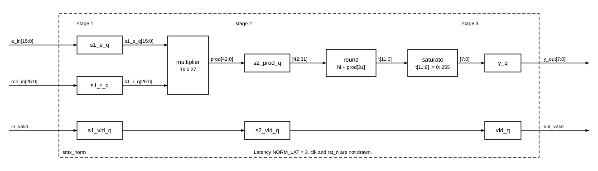

# `smx_norm` — Block design document

| Trường | Giá trị |
|---|---|
| Trạng thái | DRAFT — Chau ủy quyền viết RTL trước khi duyệt (2026-11-03), chưa duyệt |
| File RTL | `rtl/core/smx_norm.sv` |
| Testbench | `tb/tb_smx_norm.sv` (vector: `model/vec_norm.py`) |
| Yêu cầu liên quan | REQ-ARI-07, REQ-ARI-08, REQ-FUN-03, REQ-IMP-03, REQ-PRF-01, REQ-PRF-02 |
| Golden model | `norm_out(e, R)` trong `model/softmax_ref.py`; gọi cho từng phần tử với `e = info["E"][k]`, `R = info["R"]` trong `softmax_row` |

## 1. Chức năng

Một lane chuẩn hoá của lượt 2: nhận `E` (UQ1.15) từ `smx_exp2` và `Rcp = ⌊2⁴⁰/sum⌋` từ `smx_divider`, trả `y = min(255, (E·Rcp + 2³¹) >> 32)` dạng UINT8, giá trị thực `y/256`. Vị trí trong datapath: sau `smx_exp2` (lượt 2) và `smx_divider`, trước cổng ghi Y_BUF (`docs/spec/cross-block.md` mục 2).

Module là **một lane**; `smx_core` sinh P bản, cùng chung `rcp_in`. Không có trạng thái giữa các phần tử (thuần pipeline). Không làm: tính E, chia, quyết định lượt hay địa chỉ ghi. Lane bị mask (`k ≥ L`) mang `E = 0` từ `smx_exp2` nên `y = 0`; REQ-FUN-03 cho phép ghi giá trị này vào Y_BUF.

## 2. Tham số

Không có tham số synthesis: độ rộng lấy thẳng từ `smx_pkg`, và không phụ thuộc P hay N_SEG.

| Hằng (smx_pkg) | Giá trị | Vai trò |
|---|---|---|
| `E_W` | 16 | độ rộng `e_in` |
| `RCP_W` | 27 | độ rộng `rcp_in` |
| `Y_W` | 8 | độ rộng `y_out` |
| `OUT_SH` | 32 | số bit dịch phải |
| `NORM_LAT` | 3 | latency cố định; `smx_core` dùng để căn thẻ `y_valid`, `y_last` |

## 3. Giao diện

| Port | Hướng | Độ rộng | Kiểu số | Mô tả |
|---|---|---|---|---|
| `clk` | in | 1 | | clock duy nhất |
| `rst_n` | in | 1 | | reset bất đồng bộ, active-low |
| `in_valid` | in | 1 | | có phần tử ở chu kỳ này; chỉ lên ở lượt 2 |
| `e_in` | in | 16 | không dấu UQ1.15 | `E` từ `smx_exp2` |
| `rcp_in` | in | 27 | không dấu | `Rcp`; ổn định suốt lượt 2 |
| `out_valid` | out | 1 | | `in_valid` trễ đúng `NORM_LAT` chu kỳ |
| `y_out` | out | 8 | không dấu | `y`; chỉ có nghĩa khi `out_valid = 1` |

Handshake: **pipeline cố định, không stall**, throughput 1 phần tử/chu kỳ/lane. Reset: chỉ chuỗi valid có reset; thanh ghi dữ liệu không reset và nằm ở khối `always_ff @(posedge clk)` riêng (cross-block mục 1, quy tắc 4). `rcp_in` được lấy mẫu cùng chu kỳ với `e_in` nên testbench có thể đổi `Rcp` theo từng vector; trong thiết kế thật nó đứng yên cả lượt.

## 4. Hành vi và số học

Golden (dòng `norm_out`): `min(OUT_MAX, (e * R + (1 << (OUT_SHIFT - 1))) >> OUT_SHIFT)` với `OUT_MAX = 255`, `OUT_SHIFT = 32`.

| Bước | Golden | RTL | Ghi chú |
|---|---|---|---|
| 1 | `e * R` | `s2_prod_q <= s1_e_q * s1_r_q` | 16×27 không dấu, tích đủ 43 bit, không cắt |
| 2 | `+ (1 << 31)` rồi `>> 32` | `t = prod[42:32] + prod[31]` | xem dưới |
| 3 | `min(255, ·)` | `y = (t[11:8] ≠ 0) ? 255 : t[7:0]` | bão hoà toàn độ rộng |

**Bước 2 tương đương.** Đặt `prod = H·2³² + Lo`, `0 ≤ Lo < 2³²`. Khi đó `(prod + 2³¹) >> 32 = H + [Lo ≥ 2³¹] = H + prod[31]`. Chứng minh: `Lo + 2³¹ ≥ 2³²` ⇔ `Lo ≥ 2³¹` ⇔ `prod[31] = 1`, và `Lo + 2³¹ < 2³³` nên phần mang chỉ là 0 hoặc 1. Cách viết này tránh bộ cộng 43 bit; chỉ còn bộ cộng 11 bit với một bit nhớ vào. Làm tròn là half-up (không phải half-even), đúng như golden: `Lo = 2³¹` cho `H + 1`, `Lo = 2³¹ − 1` cho `H`. Testbench kiểm đúng hai điểm này (mục 8).

**Độ rộng.** `H ≤ ⌊(65535·(2²⁷−1))/2³²⌋ = 2047` (11 bit), nên `t` tối đa 2048, cần 12 bit; `t[11:8] ≠ 0` ⇔ `t ≥ 256` ⇔ golden trả 255. Trong lần chạy thật `E ≤ 2¹⁵` và `Rcp ≤ 2⁴⁰/2¹⁴ = 2²⁶` nên `E·Rcp ≤ 2⁴¹`; nhưng `sum ≥ E_max` của chính hàng đó nên thực tế `E·Rcp ≤ 2⁴⁰` (hợp đồng mục 4.6), tức `t ≤ 256`. Phần cứng vẫn giữ bão hoà trên toàn 12 bit để quét được E, Rcp độc lập; không tốn tầng vì so sánh nằm cùng tầng 3 với bộ cộng 11 bit.

**Trường hợp đặc biệt.**
- `E = 0` ⇒ `prod = 0` ⇒ `y = 0` với mọi `Rcp` (kể cả `Rcp = 0`, ngoài miền thật).
- `L = 1`: `sum = E_max = 2¹⁵`, `Rcp = 2²⁵`, `E·Rcp = 2⁴⁰`, `t = 256`, bão hoà về 255 (REQ-ARI-08); nằm trong tập T4.
- Đầu ra không phụ thuộc chỉ số lane; lane mask có `E = 0` từ khối trước, `smx_norm` không có `in_en`.

## 5. Cấu trúc bên trong

Ba tầng, căn theo khối DSP: thanh ghi đầu vào bộ nhân, bộ nhân, thanh ghi đầu ra bộ nhân, rồi làm tròn và bão hoà.

| Tầng | Thanh ghi | Bit |
|---|---|---|
| 1 | `s1_e_q` 16, `s1_r_q` 27, `s1_vld_q` 1 | 44 |
| 2 | `s2_prod_q` 43 (trong DSP nếu Quartus gói được), `s2_vld_q` 1 | 44 |
| 3 | `y_q` 8, `vld_q` 1 | 9 |

Chỉ `prod[42:31]` (12 bit) được dùng; Quartus tự bỏ 31 bit thấp của `s2_prod_q`. Tuân theo quy tắc `smx_exp2.md` 5.1: valid trong `always_ff` có reset, dữ liệu trong `always_ff` không reset, tích khai báo đủ 43 bit để phép nhân không bị cắt theo ngữ cảnh. Không `initial`, `$display`, SVA trong file RTL.

## 6. Timing

- **Latency:** `NORM_LAT = 3` chu kỳ từ cạnh lấy mẫu `in_valid` tới `out_valid`. **Throughput:** 1 phần tử/chu kỳ/lane, không bong bóng.
- **Dạng sóng:** `docs/spec/wave/smx_norm.json`: ba phần tử liền nhau (phần tử thứ ba có `E = 0`), một chu kỳ trống, rồi hai phần tử với `Rcp` khác.
- **Đường găng dự kiến (100 MHz):** tầng 3 gồm cộng 11 bit rồi so sánh 4 bit và mux; ngắn. Tầng 2 là bộ nhân 16×27 có thanh ghi vào/ra. 27 bit vượt 18×18 của một DSP Cyclone V nên Quartus có thể dùng hơn một khối, bước cộng một phần tích có thể nằm ngoài thanh ghi DSP [ĐC: cần đối chiếu Fmax sau Fitter]. Phương án lùi nếu không đạt 100 MHz: tách bộ nhân thành hai tích riêng đăng ký giữa chừng, `NORM_LAT = 4` (+1 chu kỳ/hàng, kết quả không đổi). Chưa có số Fmax thật.

## 7. Tài nguyên ước tính

Ước tính thiết kế [TK]: 1 bộ nhân 16×27, ~97 bit thanh ghi trước khi Quartus loại bỏ phần dư, ~15–20 ALUT.

Số đo một lane từ `syn/map_check.sh smx_norm` (Quartus 18.1 Lite, chỉ Analysis & Synthesis, 2026-11-03; chưa phải số Fitter, chưa có Fmax): 20 ALUT logic, 66 thanh ghi, 1 khối DSP, 0 bit block memory, 0 lỗi, 0 cảnh báo. 66 thanh ghi = 16 + 27 + 12 + 8 + 3: 31 bit thấp của tích bị loại như dự kiến. Với P = 8: ~160 ALUT, ~530 thanh ghi, 8 DSP (nhân với một lane, chưa gộp chuỗi valid giữa các lane).

## 8. Kế hoạch kiểm thử block

`model/vec_norm.py` (gọi qua `model/gen_vectors.py norm`, mọi giá trị kỳ vọng từ `softmax_ref.norm_out`) sinh `tb/vectors/smx_norm/p
_n<N>/t1..t4.hex`, dòng `valid e rcp y` ở dạng hex. Testbench đưa 1 vector/chu kỳ, `Rcp` đổi theo từng vector cùng chu kỳ với `E`, so `out_valid` và `y_out` đúng `NORM_LAT` chu kỳ sau.

| Tập | Nội dung | Số vector (P = 8) |
|---|---|---|
| T1 góc | tích chéo `E ∈ {0, 1, 2, 255, 256, 32767, 32768, 32769, 65534, 65535}` × `Rcp ∈ {0, 1, 2¹⁶, 2¹⁶+1, 2²⁰, 2²⁶, 2²⁶+1, 2²⁷−2, 2²⁷−1}`; thêm `E = 0` với mọi Rcp | 99 |
| T2 ngẫu nhiên | cặp `(E, Rcp)` độc lập toàn độ rộng, tích nhỏ, và dải thật; ~30 % chu kỳ trống (valid = 0, dữ liệu rác) | 100 000 valid, tổng 143 175 dòng |
| T3 biên | `E·Rcp = n·2³² + t` chính xác với `t ∈ {2³¹−1, 2³¹}`, `n = 253..257` (làm tròn thành 253..257 quanh điểm bão hoà 255/256), thêm `Rcp ± 1`; các cặp `t = 2³¹−1` chính xác ở mọi `n ≤ 2047`; cặp lệch ≤ 64 so với biên cho các lớp không có nghiệm nguyên | 681 |
| T4 đạt được | `E` từng phần tử và `R` từ `softmax_row(q, K, P, n_seg)` với L ∈ {1, 2, 3, 7, 8, 9, 16, 64, 100, 255, 512}, K ∈ {0, 1, 5909, 65535, ngẫu nhiên}, q ngẫu nhiên / hằng / cực trị; có L = 1 (y = 255); 15 % chu kỳ trống | 60 136 dòng |
| Reset | `rst_n` xuống giữa luồng với 3 phần tử đang bay → `out_valid = 0` ngay (async), phần tử bị xả không ra; luồng sau reset đúng, gồm `E = 0` và một chu kỳ trống | 5 |

Một số lớp `(n, t)` không có nghiệm nguyên với `E ≤ 65535`, `Rcp < 2²⁷` (ví dụ `t = 2³¹−1`, `n = 254, 255`, vì tích là số lẻ gần như nguyên tố); với các lớp đó T3 dùng cặp lệch tối đa 64 so với biên thay cho điểm chính xác. Các lớp `t = 2³¹`, `n = 253..257` đều có nghiệm chính xác.

Tiêu chí đạt: 0 sai khác trên mọi tập, `out_valid` đúng từng chu kỳ, số phần tử ra bằng số vào. Testbench đã được chứng minh bắt lỗi: bỏ phép cộng `prod[31]` trong RTL cho `TB_RESULT: FAIL` (40 567 sai khác), khôi phục thì PASS.

Assertion đề xuất cho nhóm verify (file bind riêng): `out_valid == $past(in_valid, NORM_LAT)`; `out_valid |-> !$isunknown(y_out)`; `in_valid && e_in == 0 |-> ##NORM_LAT y_out == 0`.

## 9. Câu hỏi mở / quyết định cần duyệt

- [ ] **Q1** `smx_norm` không có `in_en`: lane mask tin vào `E = 0` từ `smx_exp2` (đúng hợp đồng mục 4.6). Khuyến nghị: giữ. Nếu sau này `smx_exp2` ngừng ép E = 0 ở lane mask thì Y_BUF tại `i ≥ L` mang rác, vẫn hợp lệ theo REQ-FUN-03.
- [ ] **Q2** Bộ nhân 16×27 có thể chiếm 2 khối DSP và đường vào–ra DSP có thể không đạt 100 MHz. Khuyến nghị: giữ `NORM_LAT = 3` đến khi Fitter cho số thật; phương án lùi `NORM_LAT = 4` ghi ở mục 6.

## 10. Lịch sử

- 2026-11-03: tạo DRAFT cùng RTL, testbench, vector (Claude Code, theo ủy quyền của Chau viết RTL trước khi duyệt). `make regress` P = 8, N_SEG = 8: 0 sai khác trên 153 126 phần tử; `syn/map_check.sh smx_norm` đạt.
