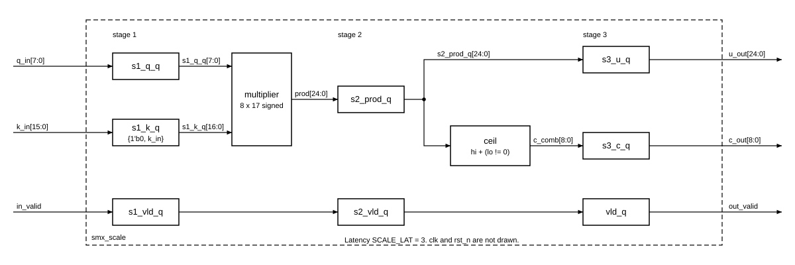

# `smx_scale` — Block design document

| Trường | Giá trị |
|---|---|
| Trạng thái | DRAFT — Chau ủy quyền viết RTL trước khi duyệt (2026-11-03), chưa duyệt |
| File RTL | `rtl/core/smx_scale.sv` |
| Testbench | `tb/tb_smx_scale.sv` (vector: `model/vec_scale.py`) |
| Yêu cầu liên quan | REQ-ARI-01, REQ-ARI-02, REQ-ARI-03, REQ-PRF-01, REQ-IMP-03 |
| Golden model | `u = [v * K for v in q]` (dòng 83) và `c = [ceil_q16(x) for x in u]` (dòng 84), `ceil_q16` ở dòng 71–72 trong `model/softmax_ref.py` |

## 1. Chức năng

Một lane tính `u = q·K` (số có dấu Q8.16, 25 bit) và `c = ⌈u / 2¹⁶⌉` (số nguyên có dấu 9 bit) từ một phần tử INT8 `q` và hệ số `K` (UQ0.16) do HPS ghi vào `SCALE_K`. `u` đi tiếp vào đường trễ rồi vào `smx_exp2`; `c` đi vào `smx_maxtree` (`docs/spec/architecture.md` mục 2, `cross-block.md` mục 2). `smx_core` sinh P bản bằng `generate`, mỗi bản nhận cùng `k_in`.

Không làm: tìm max, mũ, mask lane (lane `k ≥ L` được `in_en` xử lý ở `smx_maxtree` và `smx_exp2`), kiểm tra miền của `K`. Block không có trạng thái ngoài chuỗi valid.

## 2. Tham số

Block không có tham số (một lane, không phụ thuộc P hay N_SEG).

| Hằng | Giá trị | Nguồn (smx_pkg) | Ghi chú |
|---|---|---|---|
| `Q_W` | 8 | `smx_pkg::Q_W` | |
| `K_W` | 16 | `smx_pkg::K_W` | |
| `U_W` | 25 | `smx_pkg::U_W` | `Q_W + K_W + 1` |
| `C_W` | 9 | `smx_pkg::C_W` | |
| `U_FRAC` | 16 | `smx_pkg::U_FRAC` | |
| `SCALE_LAT` | 3 | `smx_pkg::SCALE_LAT` | `smx_core` đọc để căn thẻ sideband |

## 3. Giao diện

| Port | Hướng | Độ rộng | Kiểu số | Mô tả |
|---|---|---|---|---|
| `clk` | in | 1 | | clock duy nhất |
| `rst_n` | in | 1 | | reset bất đồng bộ, active-low |
| `in_valid` | in | 1 | | có phần tử ở chu kỳ này |
| `q_in` | in | 8 | signed INT8 | điểm attention đã lượng tử hoá |
| `k_in` | in | 16 | không dấu UQ0.16 | `SCALE_K`, ổn định suốt lần chạy |
| `out_valid` | out | 1 | | `in_valid` trễ đúng `SCALE_LAT` chu kỳ |
| `u_out` | out | 25 | signed Q8.16 | `u = q·K` |
| `c_out` | out | 9 | signed | `c = ⌈u/2¹⁶⌉`, cùng chu kỳ với `u_out` |

Handshake: pipeline cố định, không stall, 1 phần tử/chu kỳ/lane. `u_out`, `c_out` chỉ có nghĩa khi `out_valid = 1`. Reset: chỉ chuỗi valid có reset; thanh ghi dữ liệu không reset.

## 4. Hành vi và số học

Bẫy dấu: trong SystemVerilog, `$signed(q_in) * k_in` có một toán hạng không dấu nên cả biểu thức là phép nhân **không dấu**, `q` âm bị zero-extend và `u` sai. RTL mở rộng `K` thành 17 bit có dấu với bit dấu 0 (`$signed({1'b0, k_in})`) và nhân 8×17 có dấu; tích nằm trong 25 bit vì `|q·K| ≤ 128·65535 < 2²⁴`.

| Bước | Golden | RTL | Ghi chú |
|---|---|---|---|
| 1 | `u = q * K` (dòng 83) | `prod = s1_q_q * s1_k_q` (8×17 có dấu), `s2_prod_q <= prod[24:0]` | `u ∈ [−128·65535, 127·65535]`, vừa 25 bit có dấu |
| 2 | `c = ceil_q16(u) = −((−u) >> 16)` (dòng 72) | `c = u[24:16] + (u[15:0] != 0)` | xem dưới |

Đẳng thức bước 2: `⌈u/2¹⁶⌉ = ⌊u/2¹⁶⌋ + [u mod 2¹⁶ ≠ 0]`. `u[24:16]` là `⌊u/2¹⁶⌋` (dịch số học), `u[15:0]` là `u mod 2¹⁶` (phần dư không âm) với mọi dấu của `u`. Hệ quả: bội âm đúng của 2¹⁶ (ví dụ `u = −65536`) cho `c = −1`, không bị làm tròn lên; `u = 0` (kể cả `K = 0`) cho `c = 0`. Khác với cách viết `(u + 65535) >> 16`, dạng này không cần bộ cộng 25 bit mà chỉ cộng 9 bit với một bit cờ. Tràn: `c ∈ [−127, 127]` (với `q = −128`, `K = 65535` thì `u/2¹⁶ ≈ −127,998` và làm tròn lên cho −127), nên phép cộng 9 bit có dấu không tràn.

Phạm vi `c`: `[−127, 127]`, khớp giả định `smx_maxtree` ("lane mask nhỏ hơn mọi c hợp lệ").

## 5. Cấu trúc bên trong

Thanh ghi: tầng 1 `s1_q_q` 8, `s1_k_q` 17; tầng 2 `s2_prod_q` 25; tầng 3 `s3_u_q` 25, `s3_c_q` 9; valid 3. `s1_*` là thanh ghi đầu vào và `s2_prod_q` là thanh ghi đầu ra của bộ nhân, để Quartus gói vào DSP. Mọi thanh ghi dữ liệu nằm trong `always_ff @(posedge clk)` không reset, chuỗi valid nằm trong khối riêng có reset (`smx_exp2.md` mục 5.1, quy tắc 2).

## 6. Timing

- Latency `SCALE_LAT = 3`, throughput 1 phần tử/chu kỳ. Dạng sóng: `docs/spec/wave/smx_scale.json`.
- Đường găng: tầng 3 gồm OR 16 bit rồi cộng 9 bit rồi thanh ghi, ngắn. Tầng 2 là bộ nhân có thanh ghi vào/ra trong DSP [ĐC: Fmax DSP cần Fitter]. Chưa có số Fmax.

## 7. Tài nguyên ước tính

Số đo một lane từ `syn/map_check.sh smx_scale` (Quartus 18.1 Lite, chỉ Analysis & Synthesis, 2026-11-03), 0 lỗi, 0 cảnh báo; chưa phải số Fitter, chưa có Fmax:

| ALUT logic | Thanh ghi | Khối DSP | M10K |
|---|---|---|---|
| 13 | 85 | 1 | 0 |

Nhân với P ở `smx_core`. Số thanh ghi 85 thấp hơn tổng khai báo 87 bit vì Quartus bỏ bớt bit dư.

## 8. Kế hoạch kiểm thử block

Vector sinh bởi `python3 model/gen_vectors.py scale` (`model/vec_scale.py`, gọi `softmax_ref.ceil_q16` và đối chiếu `softmax_row(...)["u"/"c"]`). Dòng: `valid q k u c`.

| Tập | Nội dung | Số vector |
|---|---|---|
| T1 | cả 256 giá trị `q` liên tiếp, với K ∈ {0, 1, 2, 255, 256, 5909, 32767, 32768, 65534, 65535} và 40 K ngẫu nhiên | 12 800 |
| T2 | `(q, K)` ngẫu nhiên, 30 % chu kỳ trống (valid = 0, đầu vào rác) | 100 000 hợp lệ |
| T3 | mọi `(q, K)` với `u` là bội của 2¹⁶ (có cả `u < 0`) và biên `K ∈ {0, 1, 65534, 65535}` | 1 308 |
| T4 | reset giữa luồng: `out_valid` về 0 ngay, luồng sau reset đúng (giá trị viết tay) | 1 kịch bản |

Testbench kiểm `out_valid`, `u_out`, `c_out` đúng từng chu kỳ với `smx_pkg::SCALE_LAT`. Kết quả mô phỏng (ModelSim ASE 10.5b, `make regress testname=tb_smx_scale N_SEGS=8`): 0 sai khác, 114 112 phần tử. Đã cố ý làm sai (bỏ bit 0 khỏi cờ phần lẻ): testbench báo `TB_RESULT: FAIL`, 4 lỗi `c_out`.

## 9. Câu hỏi mở / quyết định cần duyệt

- [x] **Q1** Không có tham số `P`, `N_SEG`; testbench vẫn nhận hai tham số này theo `cross-block.md` mục 6. Đề xuất đã áp dụng.
- [ ] **Q2** Tách `u_out` và `c_out` cùng ở tầng 3 (`u` chỉ qua thanh ghi thêm một nhịp). Có thể bớt 25 FF nếu `smx_core` lấy `u` từ tầng 2 và tự trễ ít hơn một chu kỳ, nhưng sẽ làm `u_out` lệch `out_valid` so với hợp đồng. Khuyến nghị giữ như hợp đồng.

## 10. Lịch sử

- 2026-11-03: tạo DRAFT cùng RTL và testbench (Claude Code, Chau ủy quyền viết RTL trước duyệt). UT-PASS 114 112 phần tử; `map_check` 0 lỗi.
