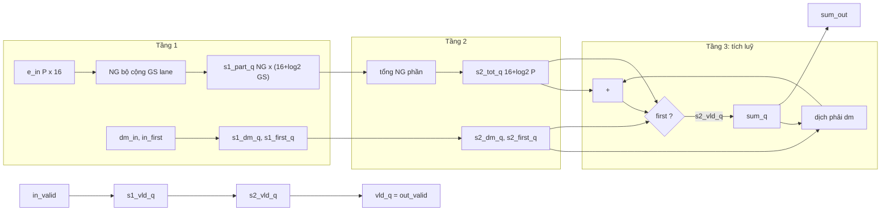

# `smx_sumacc` — Block design document

| Trường | Giá trị |
|---|---|
| Trạng thái | DRAFT — Chau ủy quyền viết RTL trước khi duyệt (2026-11-03), chưa duyệt |
| File RTL | `rtl/core/smx_sumacc.sv` |
| Testbench | `tb/tb_smx_sumacc.sv`, vector từ `model/vec_sumacc.py` |
| Yêu cầu liên quan | REQ-ARI-05 (online normalization), REQ-ARI-06 (độ rộng sum), REQ-PRF-01, REQ-PRF-02 |
| Golden model | `group_sum(s, dM, e_grp, first)` (dòng 107–109) và vòng lặp nhóm trong `softmax_row` (dòng 88–101) của `model/softmax_ref.py` |

## 1. Chức năng

Bộ tích luỹ của lượt 1. Mỗi chu kỳ nhận một nhóm P giá trị `E` (UQ1.15) cùng `dM = Mnew − M` của nhóm, cộng P lane bằng cây cộng hai tầng, rồi cập nhật tổng chạy của hàng: nhóm đầu thì lấy thẳng tổng cây, các nhóm sau thì dịch phải tổng cũ `dM` bit (cắt bỏ, tức hiệu chỉnh về max mới) rồi cộng tổng cây. Cuối hàng `sum_out` là mẫu số của `smx_divider`.

Vị trí: sau `smx_exp2` (lượt 1), trước `smx_divider` (`docs/spec/architecture.md` mục 2, `cross-block.md` 4.4). Block không biết hàng, lượt hay `L`; `smx_ctrl` lấy sự kiện `sum_last` từ thẻ `last` đã trễ `SUMACC_LAT`. Không làm: tính E, tìm max, chia.

## 2. Tham số

| Tham số | Mặc định | Nguồn (smx_pkg) | Ràng buộc |
|---|---|---|---|
| `P` | 8 | `smx_pkg::P` | ∈ {4, 8, 16}; không suy từ `smx_pkg` bên trong |
| `GS` (localparam) | 4 (2 khi P = 4) | | số lane mỗi bộ cộng tầng 1 |
| `NG` (localparam) | `P/GS` = 2, 2, 4 | | số tổng riêng tầng 1 |
| `E_W`, `DM_W`, `SUM_W` | 16, 8, 25 | `smx_pkg` | |
| `SUMACC_LAT` | 3 | `smx_pkg` | 2 tầng cây + 1 tầng tích luỹ |

## 3. Giao diện

| Port | Hướng | Độ rộng | Kiểu số | Mô tả |
|---|---|---|---|---|
| `clk` | in | 1 | | |
| `rst_n` | in | 1 | | reset bất đồng bộ, active-low |
| `in_valid` | in | 1 | | có nhóm; chỉ lên ở lượt 1 |
| `in_first` | in | 1 | | nhóm đầu của hàng; chỉ có nghĩa khi `in_valid = 1` |
| `e_in` | in | `P × 16` | không dấu UQ1.15 | lane 0 ở bit thấp; lane bị mask đã bằng 0 |
| `dm_in` | in | 8 | không dấu | `Mnew − M`, 0..254; cùng chu kỳ với `e_in` |
| `out_valid` | out | 1 | | `in_valid` trễ `SUMACC_LAT` |
| `sum_out` | out | 25 | không dấu | giữ nguyên đến nhóm hợp lệ kế tiếp |

Pipeline cố định, không stall, 1 nhóm/chu kỳ. Chỉ chuỗi valid có reset; `sum_out` và các thanh ghi dữ liệu không reset (quy tắc 2 của `smx_exp2.md` mục 5.1), nên `sum_out` là X cho đến nhóm hợp lệ đầu tiên sau khi cấp nguồn. Điều đó vô hại vì nhóm `first` ghi đè hoàn toàn và `smx_ctrl` chỉ đọc `sum_out` sau `sum_last`.

## 4. Hành vi và số học

| # | Golden (`softmax_ref.py`) | RTL | Ghi chú |
|---|---|---|---|
| 1 | `sum(e_grp)` | `tot_d = Σ_j part[j]`, `part[g] = Σ_{j<GS} e_in[g·GS + j]` | cộng số nguyên không dấu, không tràn: tối đa `16·2¹⁵ = 2¹⁹` (E ≤ 2¹⁵ trong miền hợp lệ, nhưng độ rộng `E_W + log₂P` bao cả E tới 65535) |
| 2 | `e_grp` chỉ có phần tử thật (nhóm cuối của hàng có thể ngắn) | lane mask có `E = 0` từ `smx_exp2` | pad 0 không đổi tổng |
| 3 | `s >> dM` (Python, số không âm) | `sum_q >> s2_dm_q` | dịch logic phải, cắt bỏ; SystemVerilog cho 0 khi lượng dịch ≥ 25 nên `dm ≥ 25` tự cho 0 mà không cần so sánh |
| 4 | `... + sum(e_grp)` | `+ SUM_W'(s2_tot_q)` | 25 bit đủ: `sum ≤ L_MAX·2¹⁵ = 2²⁴` (REQ-ARI-06) |
| 5 | `first ? sum(e_grp) : ...` (`first = (M is None)`) | `s2_first_q ? tot : ...` | `first` đi cùng nhóm tới tầng 3 |
| 6 | `s` giữ nguyên giữa các nhóm | `if (s2_vld_q) sum_q <= acc_d` | không có nhóm hợp lệ thì không cập nhật |

Quan hệ `in_first` với `in_valid`: thanh ghi `s2_first_q` chỉ được dùng khi `s2_vld_q = 1`, và `s2_vld_q` là bản trễ của `in_valid`, nên `in_first`, `dm_in`, `e_in` rác ở chu kỳ bubble bị bỏ qua. Testbench cố ý đặt giá trị ngẫu nhiên lên các cổng đó ở bubble.

Nhóm liên tiếp: tầng 3 là `sum_q ← f(sum_q, ...)` mỗi chu kỳ nên nhóm kế tiếp thấy ngay tổng của nhóm trước; đây là vòng phản hồi một chu kỳ duy nhất của block (đường găng, mục 6).

## 5. Cấu trúc bên trong

Chia cây hai tầng với mọi P: tầng 1 gom `GS` lane liền kề (P = 4: 2 lane, hai tổng; P = 8: 4 lane, hai tổng; P = 16: 4 lane, bốn tổng); tầng 2 cộng các tổng riêng. Thanh ghi: `s1_part_q` (NG phần tử 17–18 bit), `s2_tot_q` (18–20 bit), `s1/s2_dm_q` 8 bit, `s1/s2_first_q`, `sum_q` 25 bit, ba bit valid. Không DSP, không RAM. Tầng 3 là bộ dịch barrel 25 bit (5 mức, bit 5..7 của `dm` chỉ thêm điều kiện về 0) nối tiếp bộ cộng 25 bit.

## 6. Timing

- Latency `SUMACC_LAT = 3`: `in_valid` ở `t` → `sum_q` cập nhật ở cạnh cuối `t+2` → `out_valid` và `sum_out` mới thấy ở `t+3`. Throughput 1 nhóm/chu kỳ. Dạng sóng: `docs/spec/wave/smx_sumacc.json`.
- Đường găng: tầng 3 (dịch barrel rồi cộng 25 bit, phản hồi một chu kỳ) và tầng 1 ở P = 16 (cộng 4 số 16 bit). Chưa đo Fmax (`map_check` chỉ chạy Analysis & Synthesis). Nếu tầng 3 không đạt 100 MHz, phương án là tính trước `sum_q >> dm` không thể (phụ thuộc `sum_q` chu kỳ trước), nên hướng xử lý là chuyển bộ cộng sang dạng carry-save hoặc thêm một tầng cây và nâng `SUMACC_LAT`; quyết định đó thuộc hợp đồng, sẽ báo giám sát.

## 7. Tài nguyên ước tính

Số liệu từ `syn/map_check.sh smx_sumacc P=4,8,16` (Quartus Prime Lite 18.1, chỉ Analysis & Synthesis, trước Fitter):

| P | Total registers | Combinational ALUT | DSP | Block memory bits |
|---|---|---|---|---|
| 4 | 98 | 141 | 0 | 0 |
| 8 | 101 | 180 | 0 | 0 |
| 16 | 138 | 272 | 0 | 0 |

Fmax: chưa đo (cần Fitter + TimeQuest, không chạy trong lần này).

## 8. Kế hoạch kiểm thử block

Vector sinh bởi `model/vec_sumacc.py` qua `softmax_row(q, K, P=P, n_seg=n_seg)`: mỗi nhóm lấy `E` (pad 0 đến P), `dM`, `sum` từ `info["groups"]`, và `first` là nhóm 0 của hàng. Testbench lái một dòng mỗi chu kỳ, kiểm `out_valid` và `sum_out` bit-exact đúng `SUMACC_LAT` chu kỳ sau, **mọi chu kỳ** sau nhóm đầu tiên (nên kiểm luôn việc giữ giá trị khi bubble).

| Tập | Nội dung |
|---|---|
| t1 | 150 hàng ngẫu nhiên (đồng đều, phân tán nhỏ, dốc tăng với K lớn để `dM > 0` hầu hết nhóm, một đỉnh cao sau nhóm thấp, hằng), L từ 1 đến 512; nhóm và hàng liên tiếp không khoảng trống |
| t2 | như t1, chèn bubble ngẫu nhiên giữa các nhóm; bubble mang `first`, `dm`, `e` ngẫu nhiên |
| t3 | `K = 0`, L = 512 (sum đúng `2²⁴`), L = 1, P, 511; hàng 512 với nhóm thấp rồi đỉnh (dM lớn); hàng 512 toàn 127 |
| t4 | trên nền sum = `2²⁴`, một nhóm với `dm ∈ {0, 1, 23, 24, 25, 26, 31, 32, 254}`, giá trị kỳ vọng tính bằng `group_sum`, rồi thêm một nhóm `dm = 0` để xác nhận tổng mới được phản hồi |
| t5 | hàng ngắn, lái dở dang, reset bất đồng bộ khi nhóm còn trong pipeline (`out_valid` về 0 ngay), rồi lái lại từ đầu |

Kết quả (ModelSim, `make regress testname=tb_smx_sumacc N_SEGS=8 PS="4 8 16"`): `TB_RESULT: PASS` ở P = 4 (11813 nhóm), P = 8 (5548), P = 16 (3368). Đã phá RTL hai lần để chứng minh testbench bắt lỗi: dịch bằng `dm[4:0]` (bắt được ở t4, 149 lỗi) và bỏ cổng valid của việc cập nhật `sum_q` (2909 lỗi); cả hai đã khôi phục.

## 9. Câu hỏi mở / quyết định cần duyệt

- [ ] Q1: `sum_q` không reset (X sau cấp nguồn đến nhóm hợp lệ đầu). Khuyến nghị giữ, theo quy tắc thanh ghi dữ liệu không reset; chi phí reset gần 0 nếu giám sát muốn `sum_out = 0` sau reset.
- [ ] Q2: Fmax của vòng tích luỹ chưa đo. Khuyến nghị đo ở bước tổng hợp lõi; nếu thiếu, xem mục 6.

## 10. Lịch sử

- 2026-11-03: tạo DRAFT cùng RTL và testbench (Chau ủy quyền viết RTL trước khi duyệt).
