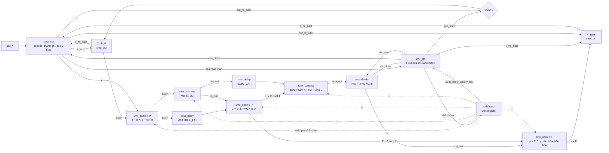
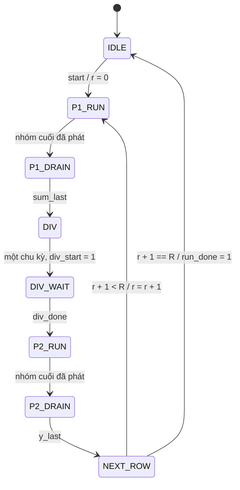

# Design spec — `smx_core`

| Trường | Giá trị |
|---|---|
| Trạng thái | DRAFT, chờ Chau duyệt cùng tài liệu block (`open-decisions.md` A1) |
| Phạm vi | Lõi `smx_core`: CSR, X_BUF, Y_BUF, controller, datapath. Không gồm wrapper Avalon, hệ thống Platform Designer, phần mềm demo |
| Phiên bản giao diện | `HW_PARAM.VERSION = 0x10` (requirements v1.0, đóng băng) |
| Nhánh RTL | `rtl/smx-core` |

File này gộp các phần cần đọc để hiểu thiết kế từ đầu đến cuối. Nó không tạo quyết định mới. Khi có khác biệt, nguồn gốc được ưu tiên theo thứ tự sau:

| Nội dung | Nguồn chân lý |
|---|---|
| Số học | `model/softmax_ref.py`, rồi `docs/requirements.md` mục 4 |
| Giao diện ngoài, bản đồ thanh ghi | `docs/requirements.md` mục 5 |
| Port, latency, căn pipeline giữa các block | `docs/spec/cross-block.md` |
| Port và cấu trúc từng block | `docs/spec/blocks/<block>.md` mục 3, 5 |
| Việc chưa chốt | `docs/spec/open-decisions.md` |

Loại số liệu: **[GM]** từ golden model, **[SIM]** từ mô phỏng RTL, **[QTS]** từ báo cáo Quartus, **[TK]** suy luận thiết kế.

## 1. Tổng quan

`smx_core` tính softmax theo hàng cho điểm attention đã lượng tử hoá. Đầu vào là INT8, đầu ra là UINT8 với thang 1/256. Một lần chạy xử lý R hàng, mỗi hàng L phần tử, và mọi hàng trong lần chạy dùng chung một hệ số `K`. Target workload là softmax trong MHSA của DeiT-Tiny, L = 197 (`target-workload.md`).

Ba ý chính của kiến trúc:

- **Số mũ cơ số 2.** Phần cứng không có hàm log. Phần mềm tính `K = round(S·log₂e·2¹⁶)`, phần cứng tính `u = q·K` rồi `2^(u/2¹⁶)` bằng PWL cộng bộ dịch.
- **Hai lượt, không lưu trung gian.** Lượt 1 tìm `M` và `sum`. Lượt 2 đọc lại X_BUF và tính lại `E` từ `M` cuối. Giữa hai lượt có đúng một phép chia cho mỗi hàng.
- **Online normalization.** `M` tăng dần theo nhóm, và `sum` được dịch phải theo độ tăng của `M`, nên `sum` không tràn dù chưa biết `M` cuối.

| Tham số | Giá trị | Ý nghĩa |
|---|---|---|
| `P` | 8, kiểm thêm 4 và 16 | Số lane, phần tử xử lý mỗi chu kỳ |
| `N_SEG` | 8, kiểm thêm 4 và 16 | Số đoạn PWL của `2^F` |
| `L_MAX` | 512 | Độ dài hàng tối đa |
| `R_MAX` | 16 | Số hàng tối đa mỗi lần chạy |
| Clock | Một miền, mục tiêu ≥ 100 MHz | Reset `rst_n` active-low |

Kết quả đo ở P = 8: 182 chu kỳ/hàng khi L = 512 và 104 chu kỳ/hàng khi L = 197 [SIM]; 1 681 ALUT, 24 DSP, 21 M10K, 122–134 MHz qua 3 seed [QTS]. Chi tiết ở mục 7.

## 2. Sơ đồ tổng quan

### 2.1. Ranh giới hệ thống

Lõi chỉ biết cổng `acc_*`. Wrapper và hệ thống thuộc nhóm implement (`integration-notes.md`).


### 2.2. Bên trong `smx_core`



## 3. Giao diện

### 3.1. Port của `smx_core`

| Port | Hướng | Độ rộng | Mô tả |
|---|---|---|---|
| `clk` | in | 1 | Miền clock duy nhất |
| `rst_n` | in | 1 | Active-low, assert bất đồng bộ. Lõi không có bộ đồng bộ reset: bên lái `rst_n` phải deassert đồng bộ với `clk` (A2) |
| `acc_addr` | in | 13 | Địa chỉ word |
| `acc_write` | in | 1 | Ghi trong chu kỳ này |
| `acc_writedata` | in | 32 | |
| `acc_byteenable` | in | 4 | Tôn trọng khi ghi X_BUF và thanh ghi R/W |
| `acc_read` | in | 1 | Đọc trong chu kỳ này |
| `acc_readdata` | out | 32 | Đúng 2 chu kỳ sau `acc_read`, không stall |
| `status_busy` | out | 1 | Bit STATUS.BUSY |
| `status_done` | out | 1 | Bit STATUS.DONE, sticky |
| `status_err` | out | 1 | Bit STATUS.ERR, sticky |

Tham số: `P`, `N_SEG`. Không có `waitrequest`, burst hay IRQ; phần mềm poll `DONE`.

### 3.2. Bản đồ địa chỉ

Offset byte so với base của IP; `acc_addr` bằng offset chia 4. Đóng gói little-endian, 4 phần tử mỗi word.

| Offset | Word | Tên | Truy cập | Bit |
|---|---|---|---|---|
| `0x0000` | `0x000` | CTRL | W | `[0]` START, tự xoá. Đọc trả 0 |
| `0x0004` | `0x001` | STATUS | R | `[0]` BUSY, `[1]` DONE, `[2]` ERR |
| `0x0008` | `0x002` | LEN | R/W | `[9:0]` L, 1..512 |
| `0x000C` | `0x003` | ROWS | R/W | `[4:0]` R, 1..16 |
| `0x0010` | `0x004` | SCALE_K | R/W | `[15:0]` K, UQ0.16 |
| `0x0014` | `0x005` | CYCLE_CNT | R | `[31:0]` số chu kỳ BUSY của lần chạy gần nhất |
| `0x0018` | `0x006` | HW_PARAM | R | `[7:0]` P, `[11:8]` log₂L_MAX, `[19:12]` R_MAX, `[23:20]` log₂N_SEG, `[31:24]` VERSION |
| `0x2000–0x3FFF` | `0x800–0xFFF` | X_BUF | R/W | INT8, hàng `r` phần tử `i` ở byte `r·512 + i` |
| `0x4000–0x5FFF` | `0x1000–0x17FF` | Y_BUF | R | UINT8, cùng bố trí |

Vùng không định nghĩa đọc 0, ghi bị bỏ qua. Bản gốc: requirements mục 5.2.

### 3.3. Timing cổng `acc_*`

Mỗi chu kỳ một lệnh, đọc liên tiếp được. Lệnh đọc ở chu kỳ `n` cho dữ liệu ở `n+2`, và giá trị thanh ghi là giá trị tại `n`. Dạng sóng: `docs/spec/wave/smx_csr.json`.

### 3.4. Trình tự phần mềm

1. Tính `K = round(S·log₂e·65536)`, ghi `SCALE_K`.
2. Ghi R hàng vào X_BUF, mỗi hàng bắt đầu ở bội của 512 byte. Ghi `LEN`, `ROWS`.
3. Ghi `CTRL.START = 1`.
4. Poll `STATUS` tới khi `DONE = 1`. Nếu `ERR = 1` thì cấu hình sai và không có lần chạy nào.
5. Đọc Y_BUF, đọc `CYCLE_CNT` nếu cần đo.

Trạng thái và hành vi bus:

| Tình huống | Kết quả |
|---|---|
| Sau reset | LEN, ROWS, SCALE_K, BUSY, DONE, ERR, CYCLE_CNT, `acc_readdata` bằng 0. X_BUF, Y_BUF giữ nguyên, không reset |
| START hợp lệ ở chu kỳ `n` | Từ `n+1`: BUSY = 1, DONE = 0, ERR = 0, CYCLE_CNT đếm lại |
| START khi L ∉ [1, 512] hoặc R ∉ [1, 16] | Từ `n+1`: DONE = 1, ERR = 1, BUSY không lên, CYCLE_CNT = 0 |
| START khi BUSY | Bỏ qua, kể cả ở chu kỳ cuối của BUSY |
| Ghi LEN, ROWS, SCALE_K, X_BUF khi BUSY | Bỏ qua, bảo vệ lần chạy (B3) |
| Đọc X_BUF, Y_BUF khi BUSY | Không xác định (REQ-IF-09); không ảnh hưởng kết quả [SIM] |
| Reset giữa lần chạy | Trạng thái xoá ngay, lần chạy sau đúng [SIM] |

Lưu ý: chỉ các bit trong trường được lưu. Ghi LEN = 1025 cho `len = 1` và lần chạy diễn ra bình thường, không có ERR (A6).

## 4. Hoạt động

### 4.1. Số học của một hàng

Đây là mô tả ngắn; bit-exact xem requirements mục 4.

1. **Scale.** `u = q·K` (25 bit có dấu, Q8.16), `c = ⌈u/2¹⁶⌉` (9 bit có dấu).
2. **Lượt 1, theo nhóm P phần tử tăng dần.** `Mg = max c` trên các lane hợp lệ. `Mnew = Mg` ở nhóm đầu, ngược lại `max(M, Mg)`. `dM = Mnew − M`, bằng 0 ở nhóm đầu. `sum = (sum >> dM) + Σ E(u − Mnew·2¹⁶)`, nhóm đầu bỏ qua `sum` cũ.
3. **Hàm E(d), d ≤ 0.** Tách `d` thành phần nguyên `I` và phần lẻ `F`. `2^F` tính bằng PWL `N_SEG` đoạn, rồi dịch phải `−I` bit. `E = 0` khi `−I > 15`.
4. **Chia.** `Rcp = ⌊2⁴⁰/sum⌋` (27 bit), với `2¹⁴ ≤ sum ≤ 2²⁴`.
5. **Lượt 2.** Đọc lại X_BUF, tính `e = E(u − M·2¹⁶)` với `M` cuối, `y = min(255, (e·Rcp + 2³¹) >> 32)`.

Phép dịch ở bước 2 cắt bỏ bit và thứ tự nhóm là một phần của đặc tả: `sum`, do đó `y`, phụ thuộc cách chia nhóm, nên kết quả khác nhau giữa các giá trị `P`. Golden model luôn nhận `P` và `n_seg`.

**Ví dụ [GM]:** `softmax_row(q, K = 5909, P = 8, n_seg = 8)`, L = 10, tức 2 nhóm, với `q = [10, −5, 3, 0, −20, 7, 1, −8, 12, 40]`.

| Bước | Giá trị |
|---|---|
| `u` | 59090, −29545, 17727, 0, −118180, 41363, 5909, −47272, 70908, 236360 |
| `c` | 1, 0, 1, 0, −1, 1, 1, 0, 2, 4 |
| Nhóm 0 | `Mg = 1`, `M = 1`, `dM = 0`, `ΣE = 136257`, `sum = 136257` |
| Nhóm 1 | `Mg = 4`, `M = 4`, `dM = 3`, `ΣE = 29297`, `sum = (136257 >> 3) + 29297 = 46329` |
| Chia | `Rcp = ⌊2⁴⁰/46329⌋ = 23732686` |
| Lượt 2, `E` với `M = 4` | 3828, 1499, 2471, 2048, 587, 3172, 2181, 1243, 4339, 24958 |
| `y` | 21, 8, 14, 11, 3, 18, 12, 7, 24, 138 (tổng 256) |

Softmax float64 nhân 256 cho 21,15; 8,28; 13,66; 11,32; 3,24; 17,54; 12,05; 6,87; 23,97; 137,92.

### 4.2. Điều khiển

`smx_ctrl` đi theo FSM dưới đây và chuyển pha theo sự kiện từ datapath, không tự đếm latency. Một nhóm được phát mỗi chu kỳ ở `P1_RUN` và `P2_RUN`.



### 4.3. Một hàng theo chu kỳ

Đo bằng mô phỏng RTL ở P = 8, L = 197, R = 2, K = 5909, nên G = 25 [SIM]. `t0` là chu kỳ phát nhóm đầu của hàng.

| Chu kỳ | Trạng thái | Sự việc |
|---|---|---|
| `t0 − 1` | IDLE | BUSY vừa lên, xung `start`. Chỉ có ở hàng đầu |
| `t0` … `t0 + 24` | P1_RUN | Phát 25 nhóm, `grp_addr = {r, g}` tới X_BUF |
| `t0 + 25` … `t0 + 35` | P1_DRAIN | Pipeline xả dần |
| `t0 + 36` | P1_DRAIN | `sum_last`: `sum_out` đã gồm nhóm cuối |
| `t0 + 37` | DIV | `div_start`, bộ chia lấy mẫu `sum_out` |
| `t0 + 65` | DIV_WAIT | `div_done`, `rcp_out` hợp lệ |
| `t0 + 66` … `t0 + 90` | P2_RUN | Phát lại 25 nhóm với `M` cuối |
| `t0 + 78` | P2_RUN | Nhóm đầu ghi vào Y_BUF |
| `t0 + 102` | P2_DRAIN | `y_last`: nhóm cuối ghi vào Y_BUF |
| `t0 + 103` | NEXT_ROW | `run_done = 1` nếu là hàng cuối |
| `t0 + 104` | P1_RUN | `t0` của hàng sau |

Công thức, đã kiểm ở mọi L ∈ 1..512 với P = 4, 8, 16 [SIM]:

```
G            = ⌈L/P⌉
PIPE_LAT     = BUF_LAT + SCALE_LAT + MAXTREE_LAT + EXP2_LAT = 9
ROW_OVERHEAD = 2·PIPE_LAT + SUMACC_LAT + NORM_LAT + DIV_LAT + 2 = 54
T_row        = 2·G + ROW_OVERHEAD
CYCLE_CNT    = R·T_row + 1
```

Ở ví dụ trên `CYCLE_CNT = 2·104 + 1 = 209`. Cận REQ-PRF-03 là `2·G + 64`, nên đạt ở mọi L.

### 4.4. Một nhóm đi qua pipeline

Pipeline cố định, không stall, không backpressure. `smx_ctrl` phát thẻ `{valid, pass2, first, last, en}` cùng nhóm, và `smx_core` trễ thẻ qua một shift register rồi rút ra đúng tầng. Block datapath không biết lượt hay hàng.

Với nhóm phát ở chu kỳ `t`, ở mọi P:

| Chu kỳ | Sự việc | Thẻ dùng tại đây |
|---|---|---|
| `t` | `grp_addr` ở cổng đọc X_BUF | |
| `t+1` | `q` vào `smx_scale` | `valid` |
| `t+4` | `c` vào `smx_maxtree`; `u` vào đường trễ | `valid & ~pass2`, `first`, `en` |
| `t+6` | `m_out`, `dm_out`, `u` đã trễ vào `smx_exp2` | `valid`, `en` |
| `t+9` | `E` vào `smx_sumacc` (lượt 1) hoặc `smx_norm` (lượt 2) | `valid`, `pass2`, `first` |
| `t+12` | Lượt 1: `sum_out` của nhóm | `sum_last = valid & ~pass2 & last` |
| `t+12` | Lượt 2: `y` ở cổng ghi Y_BUF | `y_valid = valid & pass2`, `y_last = y_valid & last` |

Hai điều phải giữ: mỗi nhóm thấy `Mnew` của chính nó ở `smx_exp2`, nhờ `u` được trễ thêm `MAXTREE_LAT`; và ở lượt 2 `smx_maxtree` không nhận `in_valid`, nên `m_out` giữ `M` cuối hàng. `dm_out` được trễ `EXP2_LAT` để gặp `E` cùng nhóm ở `smx_sumacc`.

Dạng sóng: `docs/spec/wave/smx_core.json`.

### 4.5. Hàng ngắn và lane bị mask

`L` không cần là bội của P. Nhóm cuối có `en[j] = (g·P + j < L)`. Lane bị mask không ảnh hưởng kết quả: `smx_maxtree` thay bằng giá trị nhỏ hơn mọi `c`, `smx_exp2` cho `E = 0`, và `smx_norm` cho `y = 0`. Y_BUF vẫn được ghi cả nhóm, nên nội dung ở `i ≥ L` không xác định (REQ-FUN-03).

### 4.6. Reset

Chỉ thanh ghi điều khiển có reset (valid, FSM, CSR); thanh ghi dữ liệu không có để Quartus gói được vào DSP. Dữ liệu chỉ có nghĩa khi đi kèm valid, và không có trạng thái nào giữ qua các lần chạy ngoài CSR (REQ-FUN-05). Deassert `rst_n` phải đồng bộ với `clk`: trong mô phỏng testbench thả ở cạnh xuống (A2).

## 5. Các block

Port và sơ đồ bên trong của từng block nằm ở `docs/spec/blocks/<block>.md` mục 3 và 5, chỉ `smx_delay` nằm ở `cross-block.md` mục 4.10.

| Block | Số bản | Vai trò | Latency | Phần cứng chính |
|---|---|---|---|---|
| `smx_csr` | 1 | Decode `acc_*`, thanh ghi, kiểm LEN/ROWS, đọc 2 tầng | `ACC_RD_LAT = 2` | Thanh ghi, bộ đếm 32 bit |
| `smx_buf` | 2 | X_BUF, Y_BUF, 8 KB mỗi buffer, `BANKS = P/4` | `BUF_LAT = 1` | M10K |
| `smx_ctrl` | 1 | FSM hàng/lượt, địa chỉ, lane mask | Tổ hợp từ trạng thái | FSM, bộ đếm `r`, `g`, `yg` |
| `smx_scale` | P | `u = q·K`, `c = ⌈u⌉` | `SCALE_LAT = 3` | 1 DSP |
| `smx_maxtree` | 1 | `Mg`, cập nhật `M`, `dM` | `MAXTREE_LAT = 2` | `P` so sánh 9 bit |
| `smx_exp2` | P | `E(u − M·2¹⁶)`: PWL cộng dịch | `EXP2_LAT = 3` | 1 DSP, ROM `N_SEG` entry, bộ dịch |
| `smx_sumacc` | 1 | Cây cộng, tích luỹ có dịch | `SUMACC_LAT = 3` | Cây cộng, bộ dịch 25 bit |
| `smx_divider` | 1 | `⌊2⁴⁰/sum⌋`, restoring, 27 vòng | `DIV_LAT = 28` | Trừ 26 bit |
| `smx_norm` | P | `y = min(255, (E·Rcp + 2³¹) >> 32)` | `NORM_LAT = 3` | 1 DSP |
| `smx_delay` | 2 | Trễ `u` và `dM`, không reset | Tham số `DEPTH` | Thanh ghi hoặc M10K |
| `smx_core` | 1 | Nối dây, mux địa chỉ X_BUF, sideband | Không có số học | Shift register |

Độ rộng trong `smx_pkg`: `Q_W = 8`, `K_W = 16`, `U_W = 25`, `C_W = 9`, `DM_W = 8`, `E_W = 16`, `SUM_W = 25`, `RCP_W = 27`, `Y_W = 8`.

Nơi tìm sơ đồ từng block:

| Block | Sơ đồ cấu trúc | Dạng sóng |
|---|---|---|
| `smx_scale` | `blocks/smx_scale.md` mục 5 | `wave/smx_scale.json` |
| `smx_maxtree` | `blocks/smx_maxtree.md` mục 5 | `wave/smx_maxtree.json` |
| `smx_exp2` | `blocks/smx_exp2.md` mục 5 | `wave/smx_exp2.json` |
| `smx_sumacc` | `blocks/smx_sumacc.md` mục 5 | `wave/smx_sumacc.json` |
| `smx_divider` | `blocks/smx_divider.md` mục 5, gồm FSM | `wave/smx_divider.json` |
| `smx_norm` | `blocks/smx_norm.md` mục 5 | `wave/smx_norm.json` |
| `smx_buf` | `blocks/smx_buf.md` mục 5 | `wave/smx_buf.json` |
| `smx_csr` | `blocks/smx_csr.md` mục 5 | `wave/smx_csr.json` |
| `smx_ctrl` | `blocks/smx_ctrl.md` mục 5, gồm FSM | `wave/smx_ctrl.json` |
| `smx_core` | `blocks/smx_core.md` mục 5 | `wave/smx_core.json` |

## 6. Kiểm thử

| Mức | Cách | Kết quả |
|---|---|---|
| Từng block | `tb/tb_smx_<block>.sv`, vector từ `model/vec_<block>.py`, chạy qua `sim/` | UT-PASS cả 9 block con |
| Lõi | `tb/tb_smx_core.sv`, chỉ lái `acc_*`, so Y với `softmax_row` | PASS ở P, N_SEG = 4/8/16, 9 tổ hợp [SIM] |
| Rà soát độc lập | Bench riêng ngoài repo, 27 305 hàng, cộng mọi K ∈ 0..65535 ở P = N_SEG = 8 | PASS [SIM] |
| Độ nhạy của bench | 11 mutation trên RTL | 11/11 bị `tb_smx_core` bắt ở P = N_SEG = 8 [SIM] |

`tb_smx_core` phủ: mọi L ∈ 1..512; R = 1, 2, 16; K = 0, 1, 5909, 65535 và giá trị khác; `sum = 2¹⁴` và `2²⁴`; `dM = 254` ở từng vị trí nhóm; traffic bus khi BUSY; run cặp để Y cũ không che lỗi; START ngay sau DONE; reset ở chín điểm giữa lần chạy; START sai cấu hình; `CYCLE_CNT` ở mọi run. Chi tiết: `blocks/smx_core.md` mục 8.

Verification chính thức do nhóm khác làm, dùng golden model làm scoreboard (`requirements.md` mục 9).

Chạy lại:

```bash
cd sim && make regress testname=tb_smx_core PS="4 8 16" N_SEGS="4 8 16" REGEN=1
syn/fit.sh 8 8 1      # P N_SEG SEED
```

## 7. Tài nguyên và timing

Quartus Prime Lite 18.1, 5CSXFC6D6F31C6, clock 100 MHz, `syn/fit.sh` [QTS]. Tài nguyên ở seed 1. Fmax là số nhỏ hơn của hai góc slow 85 °C và 0 °C.

| P | ALM | ALUT logic | Thanh ghi | M10K | DSP | Fmax seed 1 / 2 / 3 (MHz) | T_row, L = 512 |
|---|---|---|---|---|---|---|---|
| 4 | 645 | 991 | 860 | 18 | 12 | 148,81 / chưa chạy / chưa chạy | 310 |
| 8 | 1 035 | 1 681 | 1 211 | 21 | 24 | 122,09 / 129,87 / 134,41 | 182 |
| 16 | 1 821 | 2 994 | 2 011 | 33 | 48 | 108,57 / 112,94 / 107,83 | 118 |

- REQ-PRF-01 (≥ 100 MHz) và REQ-RES-01 (ALUT + DSP > 1000 ở P = 8) đạt. Hold dương ở mọi góc đã xem.
- Fmax chỉ gồm đường thanh ghi tới thanh ghi, vì SDC chỉ có clock; `acc_*` và `rst_n` chưa được ràng buộc (A7).
- Đường găng nhất ở P = 8, 16 là tầng 1 của `smx_maxtree`. Ở P = 8, đầu đường là `tag_q` bị Quartus chuyển vào M10K. Tắt suy luận này không cho lợi Fmax rõ ràng qua 3 seed (A5).

## 8. Việc còn mở

Chi tiết ở `docs/spec/open-decisions.md`.

| Mục | Nội dung | Ai |
|---|---|---|
| A1 | Duyệt tài liệu 9 block mới và file này | Chau |
| A3 | Sửa cận `sum` trong REQ-ARI-05 thành `≤ 512·2¹⁵` | Chau |
| A4 | Span Platform Designer có thể là 0x8000 | Chau, rồi nhóm implement |
| A5 | Giữ `tag_q` trong M10K hay không | Chau |
| A6 | LEN, ROWS vượt độ rộng trường không báo ERR | Chau |
| A7 | Ràng buộc timing đường `acc_*` | Chau, rồi nhóm implement |

Chưa làm: wrapper `smx_avalon`, `ip/smx_hw.tcl`, hệ thống Platform Designer, chạy trên board, đo DeiT-Tiny E1–E3. Các phần này ngoài phạm vi lõi hoặc thuộc các tuần sau (`PROJECT.md` mục 8).
